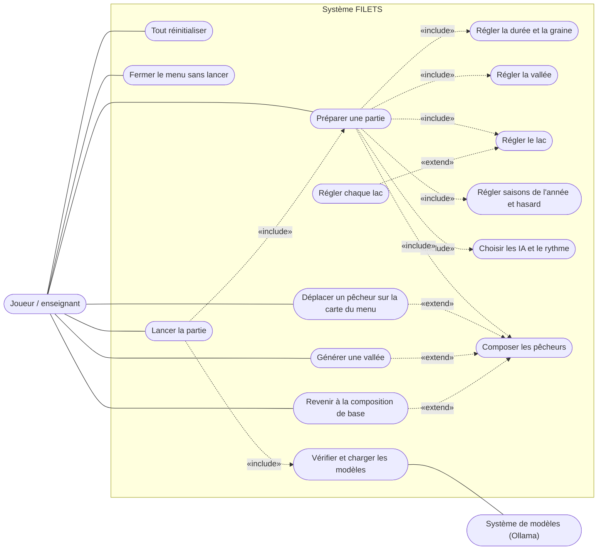
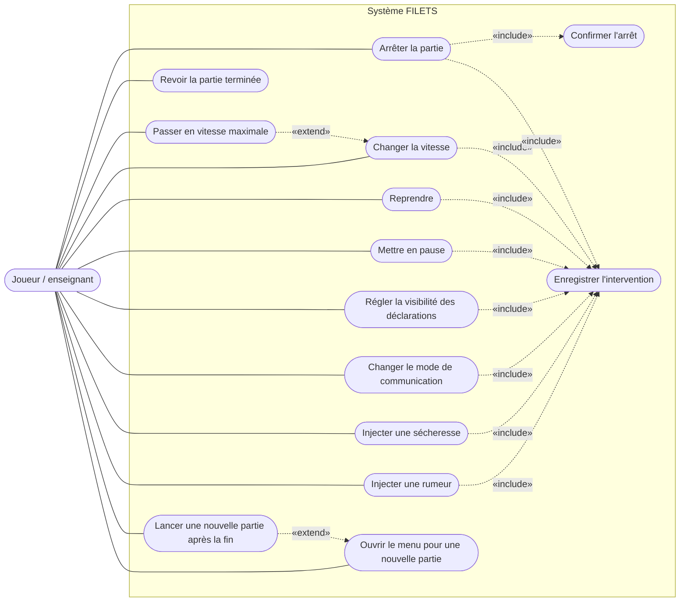
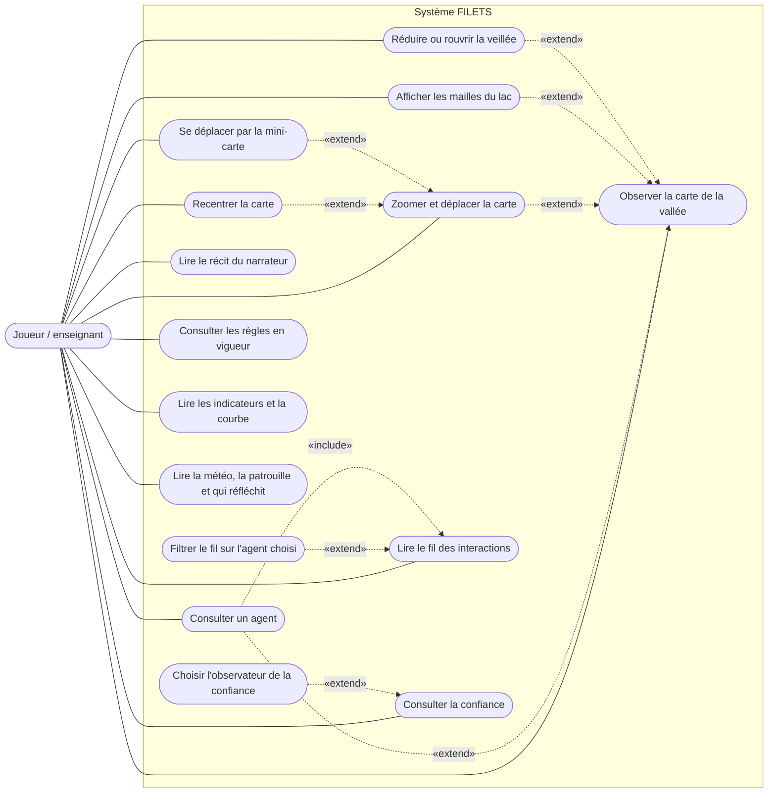
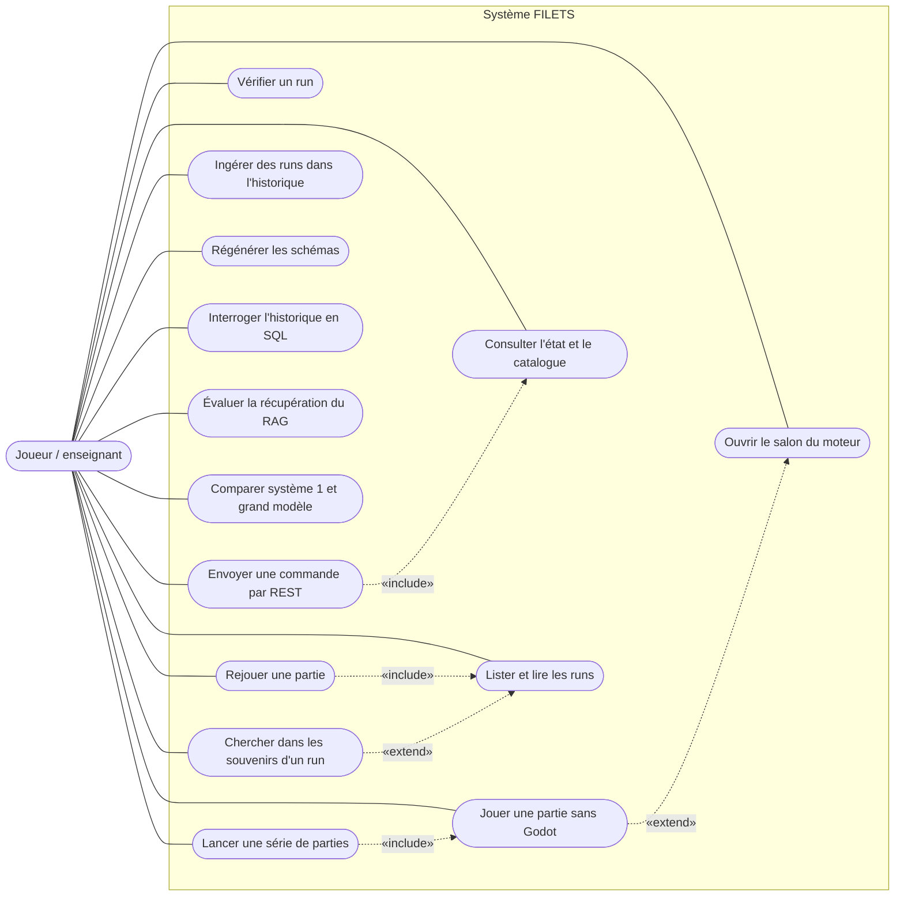
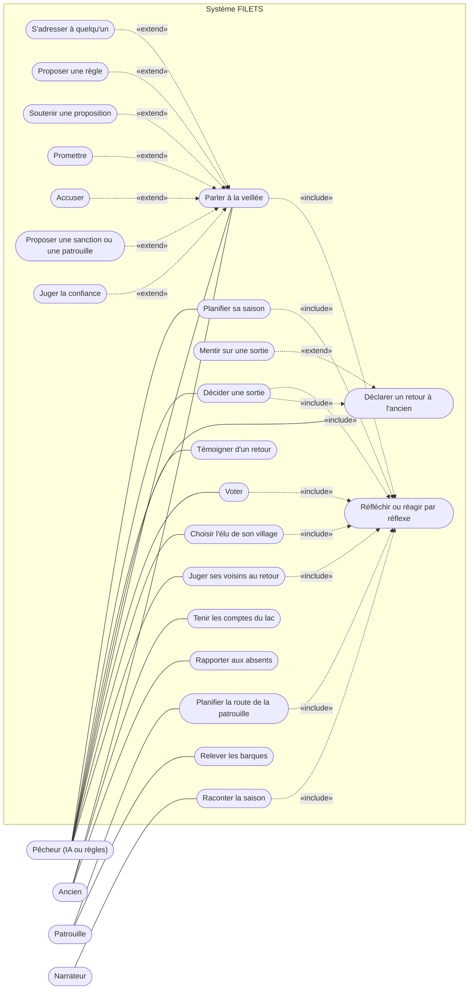
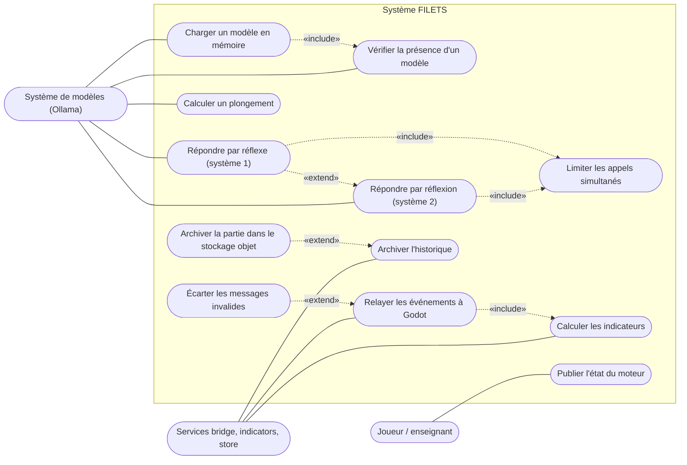

# Diagrammes de cas d'utilisation

Mermaid n'a pas de diagramme de cas d'utilisation : on le dessine avec un `flowchart` en lecture de gauche à droite. Les acteurs sont les capsules en dehors du cadre « Système FILETS » ; chaque ovale dans le cadre est un but que l'acteur peut atteindre ; un trait plein relie un acteur à un cas qu'il déclenche. Les traits pointillés étiquetés `«include»` (le cas de départ a toujours besoin de l'autre) et `«extend»` (le cas de départ est une option qui complète l'autre, la flèche va du cas optionnel vers le cas de base) relient les cas entre eux.

Le diagramme est découpé en six pour rester lisible : (1) préparer la partie dans le menu, (2) piloter la partie en cours, (3) observer et consulter, (4) ligne de commande et API REST, (5) les agents (pêcheur, ancien, patrouille, narrateur), (6) le système de modèles et les services. Chaque ovale correspond à une action qui existe réellement : un contrôle de l'interface Godot (relevé dans `start_menu.gd` et `main.gd`), une commande du moteur, une sous-commande de `python -m filets`, une route de l'API, ou une action d'agent dans le moteur. Le tableau final décrit tous les cas (acteur, but, déclencheur, résultat, code).

Les acteurs : le **joueur / enseignant** (une seule personne : celle qui prépare, lance et observe ; en ligne de commande elle est « l'enseignant » mais c'est le même acteur), le **pêcheur** (IA ou règles d'archétype), **l'ancien** (arbitre sans pouvoir, IA ou règles), la **patrouille** (ses capitaines, agents eux aussi), le **narrateur** (un modèle externe, pas un agent), le **système de modèles** (Ollama, que seul le moteur appelle) et les **services** (`bridge`, `indicators`, `store`, processus reliés par Kafka).

## 1. Préparer la partie (menu de démarrage)

Dans le code :
- Menu : `godot/scripts/start_menu.gd:205` (`_build`), `:292` (`_build_left`), `:503` (`_build_center`), `:612` (`_build_right`).
- Durée et graine : `:302-315` (saisons `:303`, graine `:307`, bouton « Au hasard » `:311-313`).
- Vallée : `:318-342` (veillées `:319`, conseil `:321`, tours de parole `:324`, déclarations lues par la vallée `:327`, l'ancien et son cerveau `:333-339`).
- Lac : `:344-412` (stock max et « Auto » `:347-356`, repeuplement et « Normal » `:365-373`, arrêt si lac vide `:379`, route `:391-404`, part prenable `:406`) ; chaque lac : `:1190` (`_rebuild_lake_rows`), `:1211-1217`.
- Saisons et hasard : `:419-450` (climat `:420`, patrouille `:426-434`, événements `:443`, chance `:447`).
- IA et rythme : `:474-495` (fournisseur `:478`, réflexion `:484`, vitesse `:490`), `:829` (`_suggest_reflection`), `:844` (`_suggest_speed`).
- Pêcheurs : `:513-531` (ajouter `:523`, composition de base `:529`), `:890` (`_add_fisher`), `:921` (`_remove_fisher`), `:931` (`_rebuild_rows`), `:1032` (`_on_archetype`), `:773` (`reset_population`).
- Carte du menu : `godot/scripts/menu_map.gd:127` (`_gui_input`), `:7-8` (signaux `token_selected`, `token_moved`), `godot/scripts/start_menu.gd:624-626`.
- Génération : `:538-590` (mode, lacs, villages, pêcheurs, flotte, « Générer la vallée » `:562`, « Autre vallée » `:583`), `:1336` (`_on_generate`).
- Réinitialiser, annuler, lancer : `:262` (« Tout réinitialiser »), `:728` (`reset_all`), `:266-267` (« Annuler »), `:271-272` (« Démarrer la partie »), `:1402` (`_on_start`), `filets/engine.py:416` (`_prepare`), `:207` (`preflight`).

## 2. Piloter la partie en cours

« Enregistrer l'intervention » est le cas interne : chaque commande effective devient un événement `injection` dans le journal, donc rejouable.

Dans le code :
- Pause et reprise : `godot/scripts/main.gd:319-324` (bouton), `:588-591` (`_toggle_pause`), `:695-700` (barre d'espace) ; `filets/world.py:1698` (`_control_command`), `filets/control.py:50` (`pause`), `:58` (`resume`).
- Vitesse : `godot/scripts/main.gd:331-345` (neuf vitesses `SPEEDS` de `main.gd:17` et « Max »), `:572` (`_speed_label`) ; `filets/world.py:1710-1722`, `filets/control.py:66` (`set_speed`), `:71` (`set_fast`).
- Arrêt : `godot/scripts/main.gd:355-359` (`btn_stop`), `:555-560` (`btn_stop_top`), `:594-596`, `:562-568` (boîte « Arrêter la partie ? Elle ne pourra pas être reprise. ») ; `filets/world.py:1700-1706`, `filets/control.py:75`.
- Rumeur : `godot/scripts/main.gd:537-545`, `:702-705` ; `filets/world.py:1688-1696`.
- Sécheresse : `godot/scripts/main.gd:505-511` (bouton « Sécheresse · stock ÷ 2 ») ; `filets/world.py:1676-1683`.
- Communication et visibilité : `godot/scripts/main.gd:516-527` ; `filets/world.py:1684-1687`.
- Nouvelle partie, revoir : `godot/scripts/main.gd:360-363` (`btn_new`), `:400-408` (`end_new`, `end_look`), `:645-651` (`_show_end`) ; la nouvelle partie envoie ensuite `start_game` (`main.gd:598`) ; Godot n'envoie jamais `new_game`.
- Enregistrement : `filets/world.py:1675` (`injection`), `:1709-1727`.

## 3. Observer et consulter

Dans le code :
- Carte : `godot/scripts/world_view.gd:1167` (`on_event`), `:1560` (`_process`) ; `godot/scripts/main.gd:757` (`_on_event`).
- Consulter un agent : `godot/scripts/world_view.gd:1637-1671` (`_gui_input`, `agent_clicked.emit` `:1670`), `:1673` (`_pick`), `godot/scripts/main.gd:377`, `:1369` (`_select`), `:1379` (`_render_inspector`), `:487` (onglet « Agent »).
- Zoom et déplacement : `godot/scripts/world_view.gd:272` (`zoom_at`), `:280` (`pan`), `:1637-1660` (molette et glisser avec le bouton droit ou du milieu), `:298` (`_scroll`) ; recentrer : touche Origine `:345-346` (`_center_view` `:246`) ; mailles : touche G `:341-343` ; mini-carte : `:2300-2341` (`_mini_rect`, `_mini_goto`, `_draw_mini`) ; veillée : touche Échap `:335-338`, boutons « Réduire » et « Rouvrir la veillée » `:174-184`, `:630` (`set_salon`).
- Fil : `godot/scripts/main.gd:444` (onglet « Interactions »), `:206-229` (`_feed`, `_render_feed`), `:446-449` (filtre `feed_only_selected`).
- Récit du narrateur : `godot/scripts/main.gd:455-457`, cas `narration` de `_on_event` (`:757`).
- Confiance : `godot/scripts/main.gd:459-486` (modes « Moyenne des autres » et « De la part de… », sélecteur `trust_who`), `:1312-1368` (`_set_trust_mode`, `_fill_trust_who`, `_render_trust`).
- Règles : `godot/scripts/main.gd:490-491`, `:1230-1311` (`_render_rules`, `_norm_card`).
- Indicateurs : `godot/scripts/main.gd:247` (`_kpi`), `:1122` (`_on_indicator`), `:436-439` (`Chart`), `:546` (`Legend`).
- Météo, patrouille, réflexion : `godot/scripts/main.gd:1467-1512` (`_show_weather`, `_sky_text`), `:49` (`lbl_patrol`), `:614` (`world.set_thinking`).

## 4. Ligne de commande et API REST

Dans le code :
- Sous-commandes : `filets/cli.py:375` (`serve`), `:389` (`run`), `:402` (`replay`), `:410` (`verify`), `:414` (`batch`), `:423` (`ingest`), `:429` (`schemas`), `:431` (`query`), `:437` (`retrieval`), `:442` (`bench-reflexe`), `:359` (`main`) ; usage `:1-9`. Rejeu : `filets/cli.py:162`, `:156` (`load_events`).
- Routes de l'API : `filets/api.py:339` (`GET /api/health`), `:344` (`GET /api/status`), `:350` (`GET /api/catalog`), `:356` (`POST /api/commands`), `:376` (`GET /api/runs`), `:380` (`GET /api/runs/{run_id}`), `:388` (`GET /api/runs/{run_id}/events`), `:397` (`GET /api/runs/{run_id}/memories`).
- Banc : `filets/bench.py:3`, `:88`.

## 5. Les agents de la simulation

Dans le code :
- Plan, sorties et déclarations (`docs/peche.md`) : `filets/agents.py` (`decide_plan`, `decide_catch`), `filets/routing.py` (`outing_reasons`), `filets/policies.py` (`outing_rule`, `declare_outing`), `filets/scheduler.py` (`planned`, `go`, `report_then_go`), `filets/world.py` (`open_trip`, `start_outing`, `land_outing`, `report_outing`, `finish_trip`, `investigate`, `weigh_evidence`).
- Parole : `filets/agents.py:232` (`speak`), `:258-285` (actes : proposition, soutien, promesse, accusation, exclusion, réautorisation, patrouille, confiance), `filets/world.py:2066` (`post_utterance`, `utterance` `:2073`, destinataire `to`), `:2094` (`proposal`), `:2119` (`promise`), `:2134` (`accusation`), `:2145` (`judge` : confiance), `:2181` (`propose_sanction`), `:2195` (`propose_patrol`), `:2285` (`_support`).
- Vote : `filets/agents.py:289` (`ballot`), `:302` (`_sanction_ballot`), `:404` (`_quota_ballot`), `filets/world.py:2222` (`vote_sanction`, `sanction_vote` `:2226`), `:2232` (`close_sanctions`), `:2496` (`closing_vote`).
- Élection et bilan : `filets/agents.py:329` (`ballot_election`), `:349` (`debrief_villager`), `filets/world.py:1771` (`elect`, `election` `:1801`), `:1809` (`debrief`).
- Ancien : `filets/world.py:2029` (`council_members`), `:772` (`investigate`, `lake_audit` `:834`), `:836` (`weigh_evidence`), `:263` (`self.elder`).
- Patrouille : `filets/world.py:1819` (`plan_patrol`), `filets/agents.py:376` (`patrol_decision`), `filets/world.py:1841` (`patrol_route`), `:2004` (`patrol_report`), `:931` (`patrol_cover`), `:921` (`set_patrol`).
- Narrateur : `filets/world.py:2847` (`narrate`).
- Réflexe ou réflexion : `filets/routing.py:53`, `filets/agents.py:79` (`_ask_llm`).

## 6. Le système de modèles et les services

Dans le code :
- Modèles : `filets/engine.py:229` (`GET /api/tags`), `:247-259` (chargement), `filets/llm.py:176` et `:190` (`/chat/completions`), `:250-322` (`/v1/systemone`), `filets/vectors.py:72` (`/api/embed`), `filets/llm.py:61-152` (`ModelGate`), `:44-59` (`RateLimiter`).
- Services : `filets/services/bridge.py:23`, `filets/services/indicators.py:20`, `filets/services/store.py:43`, `filets/pipeline.py:28`.
- État et invalides : `filets/engine.py:330-346` (`status`, `publish_status`), `filets/events.py:96-107` (`deadletter`), `filets/world.py:1664-1667`.
- Archivage : `filets/world.py:2926-2946` (`close_storage`), `filets/objects.py` (`archive_run`).

## Tableau des cas

Les « acteurs » du tableau sont ceux des diagrammes ; « Code » donne le premier repère à ouvrir.

### Joueur / enseignant : préparer la partie

| Cas | Acteur | But | Déclencheur | Résultat | Code |
|---|---|---|---|---|---|
| Préparer une partie | Joueur | Composer la partie complète | Ouverture du menu de démarrage | Un dictionnaire de configuration prêt à envoyer | `start_menu.gd:1377` |
| Régler la durée et la graine | Joueur | Choisir le nombre de saisons (1 à 50) et la graine, ou la tirer au hasard | Champs « Saisons », « Graine », bouton « Au hasard » | `seasons` et `seed` dans la configuration | `start_menu.gd:302-315` |
| Régler la vallée | Joueur | Choisir la forme des veillées, le conseil, les tours de parole, la visibilité des déclarations, la présence et le cerveau de l'ancien | Listes et cases de la section « La vallée » | `communication`, `council`, `assembly_rounds`, `catches_visible`, `population.elder` | `start_menu.gd:318-342` |
| Régler le lac | Joueur | Fixer le stock maximal, le repeuplement, la route vers un autre lac, la part prenable, l'arrêt si le lac est vide | Champs de la section « Le lac » (et « Auto », « Normal ») | `lake`, `travel_days`, `travel_cost`, `hold_fraction`, `stop_on_extinction` | `start_menu.gd:344-412` |
| Régler chaque lac | Joueur | Avec plusieurs lacs : capacité, stock de départ et repeuplement de chacun | Lignes de lacs du menu | Liste `lakes` de la configuration | `start_menu.gd:1190`, `:1358` |
| Régler saisons de l'année et hasard | Joueur | Climat et événements, patrouille et son nombre, fréquence des événements, chance à la pêche | Cases et champs de la section « Saisons et hasard » | `climate`, `patrol`, `patrols`, `event_rate`, `luck` | `start_menu.gd:419-450` |
| Choisir les IA et le rythme | Joueur | Fournisseur de modèles, profil de réflexion, vitesse de départ | Listes de la section « Intelligence artificielle et rythme » | `llm`, `reflection`, `speed` ; vitesse conseillée suggérée | `start_menu.gd:474-495`, `:844` |
| Composer les pêcheurs | Joueur | Ajouter, retirer, modifier un pêcheur (prénom, hameau, archétype, bateau, expérience, richesse, remboursement, cerveau) | Boutons « + Ajouter un pêcheur », « × », champs des lignes | `population.fishers` | `start_menu.gd:890`, `:921`, `:931` |
| Déplacer un pêcheur sur la carte du menu | Joueur | Changer le hameau d'un pêcheur en le glissant ; le sélectionner pour voir sa fiche | Glisser ou cliquer un pion de l'aperçu | Hameau modifié, fiche affichée | `menu_map.gd:127`, `start_menu.gd:624-626` |
| Générer une vallée | Joueur | Obtenir villages, pêcheurs et lacs d'après des nombres, une flotte et une graine (ou « Aléatoire ») | Champs de génération, « Générer la vallée », « Autre vallée » | Nouvelle composition dans le menu (scénario g de `sequences.md`) | `start_menu.gd:1336`, `engine.py:376` |
| Revenir à la composition de base | Joueur | Rétablir la population de départ du catalogue | Bouton « Composition de base » | Liste de pêcheurs remise à l'état du catalogue | `start_menu.gd:529`, `:773` |
| Tout réinitialiser | Joueur | Remettre tous les réglages à leurs valeurs par défaut | Bouton « Tout réinitialiser » | Menu remis à zéro | `start_menu.gd:262`, `:728` |
| Fermer le menu sans lancer | Joueur | Revenir à la partie en cours | Bouton « Annuler » | Menu fermé (annulable seulement si une partie existe) | `start_menu.gd:266`, `main.gd:554` |
| Lancer la partie | Joueur | Démarrer la simulation | Bouton « Démarrer la partie » | `start_game` envoyé ; le moteur passe de `idle` à `starting`, puis `running` | `start_menu.gd:1402`, `main.gd:598` |
| Vérifier et charger les modèles | Système de modèles | S'assurer que chaque modèle demandé existe, le charger ; vérifier PostgreSQL, plongement, stockage objet | Début de `_prepare` | Prêt, ou erreur affichée dans le menu (le salon reste ouvert) | `engine.py:207`, `:263` |

### Joueur / enseignant : piloter la partie

| Cas | Acteur | But | Déclencheur | Résultat | Code |
|---|---|---|---|---|---|
| Mettre en pause | Joueur | Figer le monde, y compris les appels aux IA | Bouton « Pause » ou barre d'espace | État `paused`, horloge arrêtée ; événement `injection` | `main.gd:588`, `world.py:1698` |
| Reprendre | Joueur | Relever la pause | Bouton « Reprendre » ou barre d'espace | État `running` ; temps de pause non compté | `main.gd:588`, `control.py:58` |
| Changer la vitesse | Joueur | Choisir une vitesse de ×1/16 à ×16 | Boutons de la barre de vitesse | `set_speed` ; vitesse republiée dans l'état | `main.gd:331-345`, `control.py:66` |
| Passer en vitesse maximale | Joueur | Supprimer toute attente d'affichage | Bouton « Max » | `set_speed` avec `max` ; `fast` vrai | `main.gd:342`, `world.py:1712` |
| Arrêter la partie | Joueur | Terminer définitivement | Bouton « Arrêter la partie » (barre ou haut de l'écran) | Boîte de confirmation | `main.gd:594` |
| Confirmer l'arrêt | Joueur | Valider l'arrêt irréversible | Bouton « Oui, arrêter » | `stop` ; `run_end`, état `ended`, écran de fin (scénario h) | `main.gd:562-568` |
| Injecter une rumeur | Joueur | Faire courir une phrase | Champ de rumeur + « Diffuser » ou Entrée | Événement `injection` ; mémoire de chaque agent ; contexte des décisions (scénario d) | `main.gd:702` |
| Injecter une sécheresse | Joueur | Diviser le stock des lacs par deux | Bouton « Sécheresse » | Événement `injection` ; choc sur chaque lac ; souvenir pour chaque pêcheur | `main.gd:511`, `world.py:1676` |
| Changer le mode de communication | Joueur | Vallée, par village ou interdite | Liste « Communication » | `set_communication` pris en compte à la prochaine veillée | `main.gd:516-521`, `world.py:1684` |
| Régler la visibilité des déclarations | Joueur | Déclarations lues par la vallée ou par le hameau seul | Case « Déclarations publiques » | `set_visibility` | `main.gd:523-527`, `world.py:1686` |
| Enregistrer l'intervention | Système | Tracer toute commande effective | Réception d'une commande | Événement `injection` dans le journal | `world.py:1675`, `:1709` |
| Ouvrir le menu pour une nouvelle partie | Joueur | Préparer une autre partie | Bouton « Nouvelle partie » | Menu ouvert, annulable | `main.gd:360-363` |
| Revoir la partie terminée | Joueur | Regarder l'état final sans relancer | Bouton « Revoir la partie » de l'écran de fin | Écran de fin masqué | `main.gd:405-408` |
| Lancer une nouvelle partie après la fin | Joueur | Rejouer avec un nouveau menu | Bouton « Nouvelle partie » de l'écran de fin (si le moteur est un salon) | Menu ouvert puis `start_game` | `main.gd:400-403`, `:646` |

### Joueur / enseignant : observer et consulter

| Cas | Acteur | But | Déclencheur | Résultat | Code |
|---|---|---|---|---|---|
| Observer la carte de la vallée | Joueur | Suivre barques, pêcheurs, veillée, lacs, jour et nuit | Événements reçus | Carte animée, bulles, liens, bandeaux | `world_view.gd:1167`, `:1560` |
| Consulter un agent | Joueur | Voir la fiche, la dernière décision, la confiance d'un pêcheur | Clic sur un pion | Onglet « Agent » rempli | `world_view.gd:1670`, `main.gd:1369` |
| Zoomer et déplacer la carte | Joueur | Voir de plus près ou ailleurs | Molette, glisser avec le bouton droit ou du milieu | Caméra ajustée | `world_view.gd:272`, `:280` |
| Recentrer la carte | Joueur | Revenir à la vue d'ensemble | Touche Origine | Vue centrée | `world_view.gd:345` |
| Afficher les mailles du lac | Joueur | Voir les parcelles, lots et pas en filigrane | Touche G | Paramètre `mesh` du shader | `world_view.gd:341` |
| Se déplacer par la mini-carte | Joueur | Aller à un point de la vallée | Clic sur la mini-carte | Caméra glisse | `world_view.gd:2311` |
| Réduire ou rouvrir la veillée | Joueur | Regarder la carte pendant la scène de la veillée | Touche Échap, boutons « Réduire » et « Rouvrir la veillée » | Salon réduit ou rouvert | `world_view.gd:335`, `:630` |
| Lire le fil des interactions | Joueur | Suivre paroles, prises, règles, incidents, injections | Onglet « Interactions » | Lignes horodatées | `main.gd:444`, `:1206` |
| Filtrer le fil sur l'agent choisi | Joueur | Ne voir que l'agent sélectionné | Case du fil | Fil filtré | `main.gd:446-449` |
| Lire le récit du narrateur | Joueur | Lire le récit de chaque saison | Onglet « Récit du narrateur » | Texte par saison | `main.gd:455-457` |
| Consulter la confiance | Joueur | Lire les jauges, les vraies prises et les déclarations | Onglet « Confiance » | Vue « Moyenne des autres » ou « De la part de… » | `main.gd:459-486`, `:1331` |
| Choisir l'observateur de la confiance | Joueur | Voir la confiance d'un personnage | Liste de l'onglet | Jauges de cet observateur | `main.gd:479-484` |
| Consulter les règles en vigueur | Joueur | Lire les normes adoptées et leur historique | Onglet « Règles » | Cartes de règles | `main.gd:490`, `:1230` |
| Lire les indicateurs et la courbe | Joueur | Stock, norme, promesses, tokens | Indicateurs reçus | Jauges et courbe par saison | `main.gd:1122`, `chart.gd:29` |
| Lire la météo, la patrouille et qui réfléchit | Joueur | Voir le temps du jour, l'état de la patrouille, les agents en train de réfléchir | Événements et état du moteur | Libellés et indications sur la carte | `main.gd:1467`, `:614` |

### Joueur / enseignant : ligne de commande et API REST

| Cas | Acteur | But | Déclencheur | Résultat | Code |
|---|---|---|---|---|---|
| Ouvrir le salon du moteur | Joueur | Attendre une partie lancée depuis Godot | `python -m filets serve [--bus local\|kafka]` | État `idle` annoncé | `cli.py:131`, `:375` |
| Jouer une partie sans Godot | Joueur | Faire tourner une partie en ligne de commande | `python -m filets run` | Partie jouée, journal `runs/<id>/` | `cli.py:389` |
| Rejouer une partie | Joueur | Revoir une partie passée sans appeler de modèle | `python -m filets replay RUN_ID [--speed] [--ws] [--bus]` | Événements republiés avec `replay: true` ; indicateurs recalculés puis comparés (scénarios e1, e2) | `cli.py:162` |
| Vérifier un run | Joueur | Contrôler un run enregistré | `python -m filets verify RUN_ID` | Rapport de vérification | `cli.py:410` |
| Lancer une série de parties | Joueur | Comparer plusieurs configurations | `python -m filets batch` | Parties enchaînées | `cli.py:414` |
| Ingérer des runs dans l'historique | Joueur | Charger des runs passés dans la base | `python -m filets ingest` | Historique rempli | `cli.py:423` |
| Régénérer les schémas | Joueur | Produire les schémas JSON des événements | `python -m filets schemas` | Fichiers de `schemas/` | `cli.py:429` |
| Interroger l'historique en SQL | Joueur | Exécuter un fichier `.sql` | `python -m filets query` | Résultats des requêtes | `cli.py:431` |
| Évaluer la récupération du RAG | Joueur | Mesurer la qualité de la récupération | `python -m filets retrieval` | Rapport | `cli.py:437` |
| Comparer système 1 et grand modèle | Joueur | Rejouer les appels « système 1 » d'une partie | `python -m filets bench-reflexe RUN_ID` | Accord mesuré sur les décisions | `cli.py:442`, `bench.py:88` |
| Consulter l'état et le catalogue | Joueur | Lire l'état du moteur et ce dont le menu a besoin | `GET /api/health`, `/api/status`, `/api/catalog` | JSON | `api.py:339-355` |
| Envoyer une commande par REST | Joueur | Piloter la partie depuis un script ou un navigateur | `POST /api/commands` | 202 Accepted ; commande transmise au moteur | `api.py:356` |
| Lister et lire les runs | Joueur | Parcourir les parties enregistrées | `GET /api/runs`, `/api/runs/{id}`, `/api/runs/{id}/events` | Résumés, configuration, événements filtrables | `api.py:376-396` |
| Chercher dans les souvenirs d'un run | Joueur | Interroger la mémoire d'un agent | `GET /api/runs/{id}/memories` | Souvenirs classés | `api.py:397` |

### Agents et acteurs internes

| Cas | Acteur | But | Déclencheur | Résultat | Code |
|---|---|---|---|---|---|
| Planifier sa saison | Pêcheur | Dire ce qu'il compte prendre en tout, où, ce qu'il compte déclarer, et sa première sortie | Son jour de départ (ouverture de la pêche + décalage) | Événement `decision` (`decision_type` plan, toujours le grand modèle) ; `note_plan`, `open_trip` (scénario b) | `agents.py` `decide_plan`, `scheduler.py` `planned` |
| Décider une sortie | Pêcheur | Choisir quand, où (lac, zone), combien et courte (3 h) ou longue (7 h), ou « plus cette saison » | À l'ouverture puis à chaque retour de sortie | Événement `decision` (`catch`, `system`, `routing`), puis `outing` au retour ; réflexe en routine, grand modèle quand quelque chose change | `agents.py` `decide_catch`, `routing.py` `outing_reasons`, `world.py` `start_outing`, `land_outing` |
| Déclarer un retour à l'ancien | Pêcheur | Dire ce qu'il a pris à cette sortie (vrai ou non) | Retour de chaque sortie, avec la décision suivante | Événement `report` (un par sortie, jamais plus que la prise) ; bilan `catch` avec le total déclaré | `scheduler.py` `report_then_go`, `world.py` `report_outing`, `policies.py` `declare_outing` |
| Mentir sur une sortie | Pêcheur | Cacher une part de la prise d'une sortie, une fois ou souvent | Dans sa déclaration (écart de 0,05 t ou plus) | Mensonge gardé par le moteur (taille, jour, `report`), établi ou non sur le cumul des indices | `world.py` `report_outing`, `weigh_evidence` |
| Témoigner d'un retour | Pêcheur | Voir rentrer la barque d'un voisin de la même zone ou de la rive | Même jour, même zone ; réunis au soir de la veillée | Indice `clue` (`temoin`) avec `outing_event_id`, jour, prise estimée | `world.py` `investigate` |
| Parler à la veillée | Pêcheur, ancien | Dire quelque chose à tous ou à quelqu'un | Veillée du soir | Événement `utterance` | `agents.py:232`, `world.py:2066` |
| S'adresser à quelqu'un | Pêcheur | Interpeller un destinataire | Dans sa réplique | `to` de l'`utterance` ; l'adressé parlera en premier | `world.py:2070-2073`, `scheduler.py:258` |
| Proposer une règle | Pêcheur | Suggérer un quota ou une autre règle de pêche | Dans sa réplique | Événement `proposal` | `world.py:2094` |
| Soutenir une proposition | Pêcheur | Se ranger derrière une proposition | Réplique ou bulletin | Événement `support` | `world.py:2285` |
| Promettre | Pêcheur | S'engager sur une prise pour la saison suivante | Dans sa réplique | Événement `promise` ; jugé à la fin de saison | `world.py:2119` |
| Accuser | Pêcheur | Accuser un autre d'avoir trop pêché | Dans sa réplique | Événement `accusation` ; souvenir épinglé de l'accusé | `world.py:2134` |
| Proposer une sanction ou une patrouille | Pêcheur | Exclure, réautoriser, installer ou retirer la patrouille | Dans sa réplique | Événement `sanction_proposal` | `world.py:2181`, `:2195` |
| Juger la confiance | Pêcheur | Réviser sa confiance envers les autres | Dans sa réplique | Événement `trust` | `world.py:2145`, `:743` |
| Voter | Pêcheur | Soutenir une proposition et voter les sanctions | Bulletins avant la clôture | `support` et `sanction_vote` ; résultat `sanction_result`, `norm_adopted` | `agents.py:289`, `world.py:2222` |
| Choisir l'élu de son village | Pêcheur | Désigner qui parlera au conseil | Entre deux saisons | Événement `election` | `agents.py:329`, `world.py:1771` |
| Juger ses voisins au retour | Pêcheur | Réviser sa confiance d'après ce que l'ancien rapporte | Entre deux saisons | Confiance mise à jour | `agents.py:349`, `world.py:1809` |
| Tenir les comptes du lac | Ancien | Faire les comptes (perte du lac contre total déclaré) et relever les écarts | Soir de la veillée et fin de saison | Événement `lake_audit` | `world.py:772`, `:834` |
| Rapporter aux absents | Ancien | Dire aux villageois hors conseil les décisions et les faits établis | Entre deux saisons | Base du débriefing des villageois | `world.py:1809` |
| Planifier la route de la patrouille | Patrouille | Choisir zones, jours de mer, pêcheur soupçonné | Avant la saison, si le conseil en a voté une | Événement `patrol_route` | `world.py:1819`, `agents.py:376` |
| Relever les barques | Patrouille | Mesurer les sorties croisées (celle dont le jour tombe dans son étape) | Pendant la saison | Indices (`clue`, par sortie), rapport de patrouille | `world.py:2004`, `:931` |
| Raconter la saison | Narrateur | Raconter au joueur ce que la vallée a vécu | Fin de saison | Événement `narration` (scénario f2) | `world.py:2847` |
| Réfléchir ou réagir par réflexe | Système de modèles | Répondre à une demande du moteur | Appel de `LLMRouter.complete` | Réponse validée, ou incident (`unparseable`, `no_response`…) | `agents.py:79`, `routing.py:53` |

### Système de modèles et services

| Cas | Acteur | But | Déclencheur | Résultat | Code |
|---|---|---|---|---|---|
| Vérifier la présence d'un modèle | Système de modèles | Savoir si un modèle est installé | `GET /api/tags` au lancement | Modèles présents, ou refus avec la commande `ollama pull` | `engine.py:229` |
| Charger un modèle en mémoire | Système de modèles | Éviter les appels lents de la première saison | Après la vérification | Modèle chargé (`keep_alive` 30 min) | `engine.py:247-259` |
| Répondre par réflexion (système 2) | Système de modèles | Produire une décision réfléchie au format JSON imposé | `POST /v1/chat/completions` | Réponse JSON | `llm.py:190` |
| Répondre par réflexe (système 1) | Système de modèles | Produire une décision simple et rapide | `POST /v1/systemone` (modèle de décision) ou petit modèle | Une prise rapide ; repli sur la réflexion ou une règle | `llm.py:269` |
| Calculer un plongement | Système de modèles | Transformer une requête en vecteur pour le RAG | `POST /api/embed` | Vecteur (cache LRU) | `vectors.py:72` |
| Limiter les appels simultanés | Système de modèles | Plafonner les requêtes et regrouper par modèle | Chaque appel d'un client local | Au plus un échange de modèle par vague | `llm.py:61` |
| Relayer les événements à Godot | Services | Alimenter l'API depuis Kafka | Messages des topics `events`, `indicators`, `status` | Tampon de l'API puis diffusion WebSocket | `bridge.py:23`, `api.py:236` |
| Calculer les indicateurs | Services | Recalculer stock, norme, promesses, tokens en flux | Événements de `filets.events` | Messages de `filets.indicators` | `indicators.py:20`, `pipeline.py:28` |
| Archiver l'historique | Services | Ranger événements et indicateurs | Lecture groupée des topics | Écriture en base, puis validation de la position | `store.py:43` |
| Publier l'état du moteur | Engine | Dire où en est le salon | Toutes les 2 s et à chaque changement | Message `status` | `engine.py:342`, `world.py:1749` |
| Écarter les messages invalides | Services | Ne pas laisser passer un événement ou une commande mal formés | Validation de schéma | Message sur `filets.deadletter`, incident `schema_violation` | `events.py:96-107`, `world.py:1664` |
| Archiver la partie dans le stockage objet | Services | Garder `events.jsonl`, `indicators.jsonl`, `config.json`, `summary.json` | Fin de partie | Fichiers dans le stockage S3 | `world.py:2926` |
