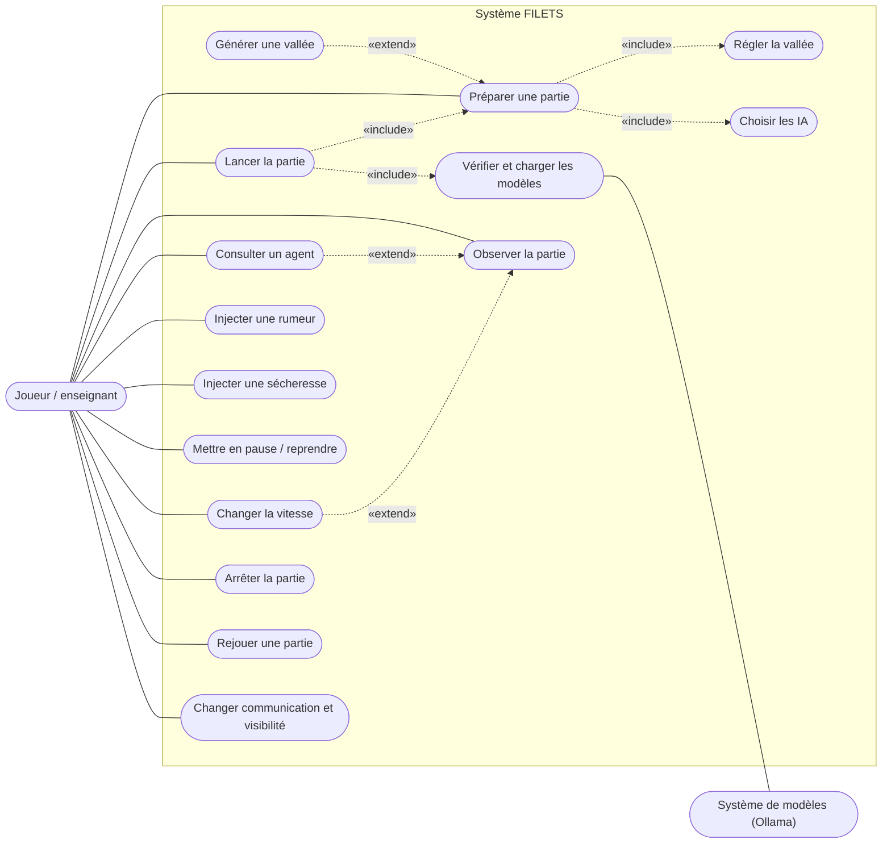
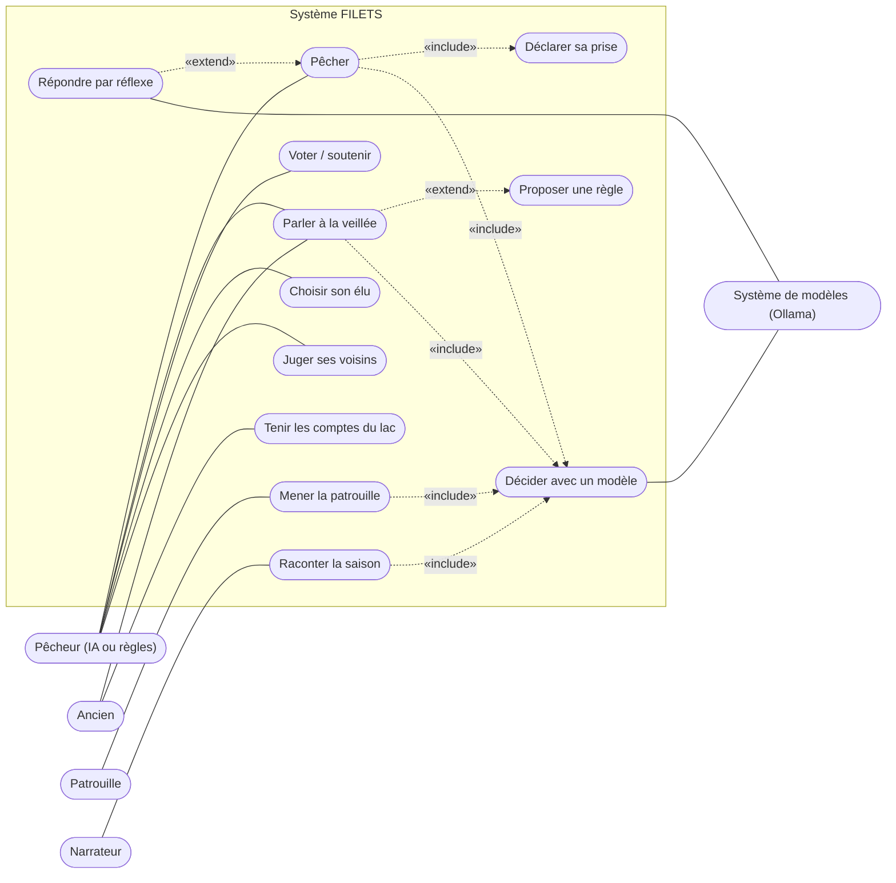

# Diagramme de cas d'utilisation

Mermaid n'a pas de diagramme de cas d'utilisation : on le dessine avec un `flowchart` en lecture de gauche à droite. Les acteurs sont les capsules colorées en dehors du cadre « Système FILETS » ; chaque ovale dans le cadre est un but que l'acteur peut atteindre ; un trait plein relie un acteur à un cas qu'il déclenche. Les traits pointillés étiquetés `«include»` (le cas de départ a toujours besoin de l'autre) et `«extend»` (le cas de départ est une option qui complète l'autre) relient les cas entre eux. Le diagramme est coupé en deux pour rester lisible : ce que fait le joueur (ou l'enseignant, c'est le même acteur), puis ce que font les acteurs « internes » de la simulation.

Les cas sont tous reliés à du code : une commande JSON de Godot (`start_game`, `pause`…), une fonction du moteur (`decide_catch`, `speak`…) ou un script. Un cas sans correspondance dans le code n'a pas été retenu.

## 1. Le joueur / l'enseignant

Le joueur prépare une partie dans le menu de démarrage, la lance, puis la pilote et l'observe depuis la scène principale. « Rejouer une partie » passe par la ligne de commande (`python -m filets replay`) : le joueur lance le rejeu, Godot ne fait que s'y connecter comme à une partie ordinaire, avec la même interface (les injections y sont ignorées).

Dans le code :
- Préparer, régler, choisir les IA : `godot/scripts/start_menu.gd:205` (`_build`), `:1377` (`build_config`, tous les réglages dans un dictionnaire : saisons, graine, communication, conseil, climat, patrouille, `llm`, `reflection`, `speed`, lacs, population).
- Générer une vallée : `godot/scripts/start_menu.gd:1336` (`_on_generate`), `:1353` (`generate_requested.emit`) ; `godot/scripts/main.gd:603-605` (commande `generate_world`) ; `filets/engine.py:376` (`Engine.generate`).
- Lancer : `godot/scripts/start_menu.gd:1402` (`_on_start`) ; `godot/scripts/main.gd:598-600` (commande `start_game`) ; `filets/engine.py:437` (`Engine._play`).
- Vérifier et charger les modèles : `filets/engine.py:416` (`_prepare`), `:207` (`preflight`), `:192` (`used_models`).
- Observer : `godot/scripts/main.gd:757` (`_on_event`), `:1122` (`_on_indicator`), `godot/scripts/world_view.gd:1167` (`on_event`).
- Consulter un agent : `godot/scripts/world_view.gd:1670` (`agent_clicked.emit`), `godot/scripts/main.gd:377` (connecté à `_select`), `:1369` (`_select`), `:1379` (`_render_inspector`).
- Rumeur : `godot/scripts/main.gd:702-705` (`_rumor`, commande `announcement`) ; `filets/world.py:1663` (`handle_command`), branche `announcement`.
- Sécheresse : `godot/scripts/main.gd:511` (commande `drought`, facteur 0,5) ; `filets/world.py:1663`, branche `drought`.
- Pause / vitesse / arrêt : `godot/scripts/main.gd:588-596` (`_toggle_pause`, `_on_stop_pressed` avec boîte de confirmation `:562-567`), `:336-342` (vitesses) ; `filets/world.py:1698` (`_control_command`), `filets/control.py:50` (`pause`), `:58` (`resume`), `:66` (`set_speed`), `:75` (`request_stop`).
- Communication et visibilité : `godot/scripts/main.gd:521`, `:527` ; `filets/world.py:1663`, branches `set_communication`, `set_visibility`.
- Rejouer : `filets/cli.py:162` (`replay`), `:402` (sous-commande `replay`), `:468-471` ; le rejeu republie les événements du journal `events.jsonl` avec `replay: true`, sans appeler de modèle.

## 2. Les acteurs de la simulation

Ces acteurs ne sont pas des humains : ce sont les pêcheurs (joués par une IA ou par des règles d'archétype), l'ancien (arbitre sans pouvoir, lui aussi à IA ou à règles), la patrouille (des capitaines, agents eux aussi), le narrateur (un modèle externe, pas un agent) et le système de modèles (Ollama), que le moteur appelle pour toute décision à IA. Dans tous les cas, l'IA est une réflexion et la règle est un archétype : le moteur, lui, ne fait que compter et appliquer la physique du lac.

Dans le code :
- Pêcher et déclarer : `filets/agents.py:144` (`decide_catch`, renvoie la prise et la déclaration à l'ancien, `said`), `filets/scheduler.py:160` (`depart`), `filets/world.py:1506` (`plan_trip`), `:1570` (`finish_trip`, « la déclaration à l'ancien »).
- Parler et proposer : `filets/agents.py:232` (`speak`), `filets/world.py:2066` (`post_utterance`), `:2094` (événement `proposal`), `:2181` (`propose_sanction`), `:2195` (`propose_patrol`).
- Voter, soutenir : `filets/agents.py:289` (`ballot`), `:302` (`_sanction_ballot`), `:404` (`_quota_ballot`), `filets/world.py:2285` (`_support`, événement `support`), `:2222` (`vote_sanction`).
- Choisir son élu : `filets/agents.py:329` (`ballot_election`), `filets/world.py:1771` (`elect`).
- Juger ses voisins : `filets/agents.py:349` (`debrief_villager`), `filets/world.py:1809` (`debrief`), les villageois apprennent « par l'ancien » les décisions du conseil.
- Ancien : membre du conseil (`filets/world.py:2029`, `council_members`), fait les comptes du lac (`:772` `investigate`, événement `lake_audit` émis avec l'ancien comme acteur, `:834`).
- Patrouille : `filets/world.py:1819` (`plan_patrol`), `filets/agents.py:376` (`patrol_decision`), `filets/world.py:2004` (`patrol_report`).
- Narrateur : `filets/world.py:2847` (`narrate`, passe par le grand modèle sous le nom « narrateur », `:2859`), lancé par `filets/scheduler.py:222` (`regrowth`) ; Godot l'affiche dans l'onglet « Récit du narrateur » (`godot/scripts/main.gd:33`).
- Décider avec un modèle, répondre par réflexe : `filets/agents.py:79` (`_ask_llm`), `filets/routing.py:53` (`choose_system`, système 1 = réflexe, système 2 = réflexion), `filets/llm.py:365` (`LLMRouter.complete`), `:176` (`OpenAICompatClient.complete`, `/chat/completions`), `:269` (`SystemOneClient.complete`, `/v1/systemone`).

## Tableau des cas

| Cas | Acteur | But | Déclencheur | Résultat |
|---|---|---|---|---|
| Préparer une partie | Joueur / enseignant | Composer la partie : saisons, graine, lacs, population, communication, climat, patrouille | Ouverture du menu de démarrage | Un dictionnaire de configuration prêt à envoyer (`build_config`) |
| Régler la vallée | Joueur | Fixer les villages, les lacs (capacité, repeuplement), les pêcheurs (hameau, archétype, bateau, cerveau) | Réglages du menu | Les valeurs correspondantes dans la configuration |
| Générer une vallée | Joueur | Obtenir une vallée complète d'après quelques nombres et une graine | Bouton de génération du menu (`generate_world`) | Le moteur republie un catalogue avec la nouvelle composition ; le menu l'affiche |
| Choisir les IA | Joueur | Choisir le fournisseur de modèles, la réflexion, la vitesse conseillée | Listes déroulantes du menu | `llm`, `reflection`, `speed` dans la configuration |
| Lancer la partie | Joueur | Démarrer la simulation | Bouton « Démarrer » (`start_game`) | Le moteur passe de `idle` à `starting`, vérifie les modèles, puis `running` ; le menu se ferme |
| Vérifier et charger les modèles | Système de modèles | S'assurer que chaque modèle demandé existe et le charger en mémoire | Début de la préparation (`preflight`) | Prêt, ou erreur affichée dans le menu (le salon reste ouvert) |
| Observer la partie | Joueur | Suivre la carte, le fil des interactions, les courbes, les indicateurs | Événements et indicateurs reçus par WebSocket | Carte animée, fil, jauges, courbe par saison |
| Consulter un agent | Joueur | Voir la fiche, la dernière décision, la confiance d'un pêcheur | Clic sur un pion de la carte | Panneau « inspecteur » rempli (`_render_inspector`) |
| Injecter une rumeur | Joueur | Faire courir une phrase dans la vallée | Champ « rumeur » + « Diffuser » (`announcement`) | Événement `injection` ; chaque agent l'enregistre en mémoire ; elle figure dans leur contexte de décision |
| Injecter une sécheresse | Joueur | Diviser le stock des lacs par deux | Bouton « Sécheresse » (`drought`) | Événement `injection` ; chaque lac subit le choc ; les agents s'en souviennent |
| Mettre en pause / reprendre | Joueur | Figer le monde, y compris les appels aux IA | Bouton « Pause » ou barre d'espace | État `paused` ; l'horloge s'arrête ; reprise à l'identique |
| Changer la vitesse | Joueur | Accélérer ou ralentir l'affichage (de x 1/16 à x 16, ou « max ») | Boutons de vitesse (`set_speed`) | La vitesse change (le moteur la republie dans son état) |
| Arrêter la partie | Joueur | Terminer définitivement la partie | Bouton « Arrêter » puis confirmation (`stop`) | `run_end`, état `ended`, écran de fin |
| Changer communication et visibilité | Joueur | Choisir qui s'entend (vallée, hameau, personne) et si les prises sont visibles | Réglages de la barre (`set_communication`, `set_visibility`) | Le monde adopte la nouvelle valeur ; événement `injection` |
| Rejouer une partie | Joueur | Revoir une partie passée sans appeler de modèle | Commande `python -m filets replay RUN_ID --ws` | Les événements du journal sont republiés (`replay: true`) ; Godot les affiche comme en direct |
| Pêcher | Pêcheur | Décider sa prise de la saison (et son lac, son coin, ses sorties) | Son jour de départ (ouverture de la pêche + décalage) | Un événement `decision` puis `catch` ; le stock du lac baisse |
| Déclarer sa prise | Pêcheur | Dire à l'ancien ce qu'on a pêché (vrai ou non) | Retour de pêche | La déclaration, jamais supérieure à la prise réelle ; vérifiable plus tard |
| Parler à la veillée | Pêcheur, ancien | Dire quelque chose à tous ou à quelqu'un | Veillée du soir (J25 18 h) | Événement `utterance` ; l'adressé peut répondre |
| Proposer une règle | Pêcheur | Suggérer un quota, une zone, une sanction ou une patrouille | Pendant sa réplique (extension de « Parler ») | Événement `proposal` |
| Voter / soutenir | Pêcheur | Soutenir une proposition, voter une sanction | Fin de la veillée (bulletins) | Événements `support` ; règle adoptée ou non à la clôture |
| Choisir son élu | Pêcheur | Désigner qui parlera pour son village au conseil | Entre deux saisons (`elect`) | Un élu par village |
| Juger ses voisins | Pêcheur | Réviser sa confiance envers chacun d'après ce que l'ancien rapporte | Entre deux saisons (`debrief`) | Confiance mise à jour |
| Tenir les comptes du lac | Ancien | Faire les comptes, relever les écarts, dire ce que la patrouille a vu | Soir de la veillée (`investigate`) | Événement `lake_audit` et indices |
| Mener la patrouille | Patrouille | Choisir sa route sur le lac et relever les barques | Avant la saison, si le conseil en a voté une | Route de la patrouille, indices recueillis |
| Raconter la saison | Narrateur | Raconter au joueur ce que la vallée a vécu | Fin de saison (repeuplement) | Récit affiché dans l'onglet « Récit du narrateur » |
| Décider avec un modèle | Système de modèles (Ollama) | Répondre à une demande du moteur dans le format JSON imposé | Appel du moteur (`LLMRouter.complete`) | Une réponse validée ou un incident (`unparseable`, `no_response`…) |
| Répondre par réflexe | Système de modèles (Ollama) | Donner une décision simple sans réflexion longue (système 1) | Routage : lac sain et stable, engagement ou règle à suivre | Une prise rapide ; en cas d'échec, reprise par la réflexion ou une règle de repli |

Simplifié ou laissé de côté : les services Kafka (`indicators`, `store`, `bridge`) ne sont pas des acteurs mais de la plomberie ; l'API REST (`/api/runs`, `/api/commands`) offre les mêmes ordres au script ou au navigateur, elle n'a pas de cas propre ici.
