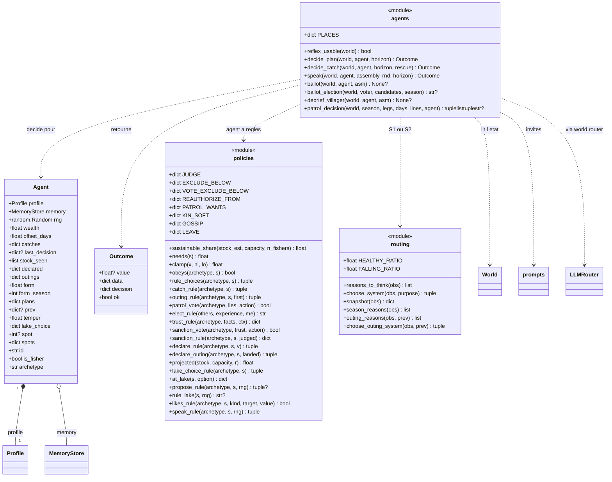
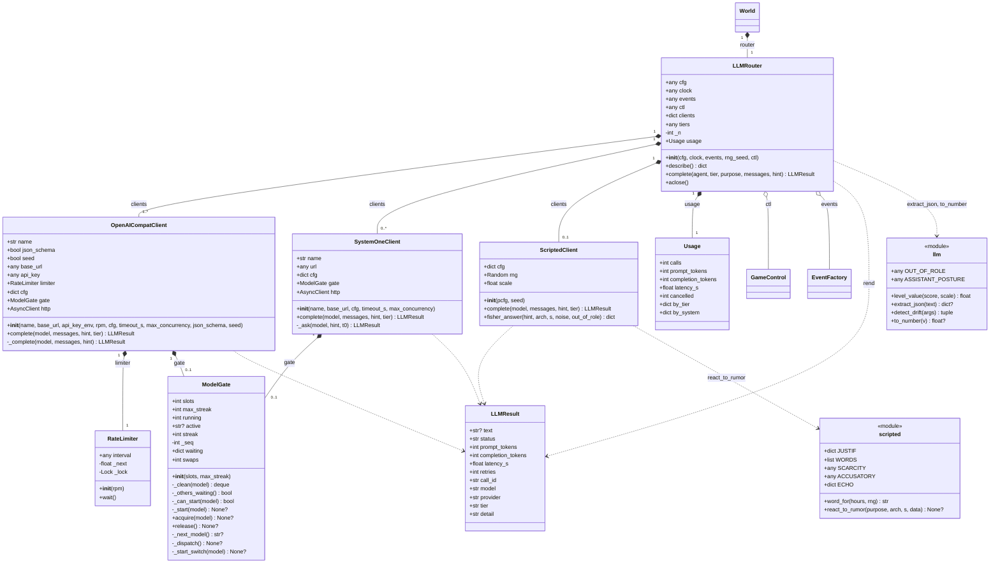
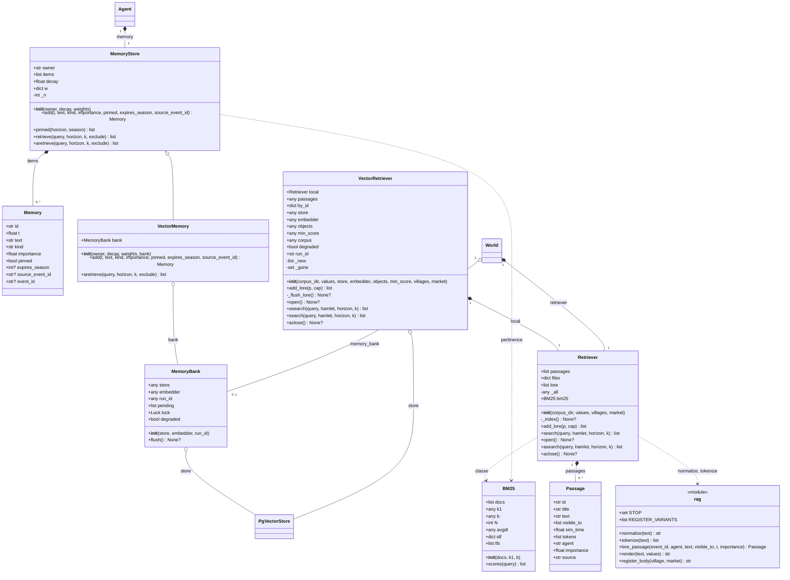
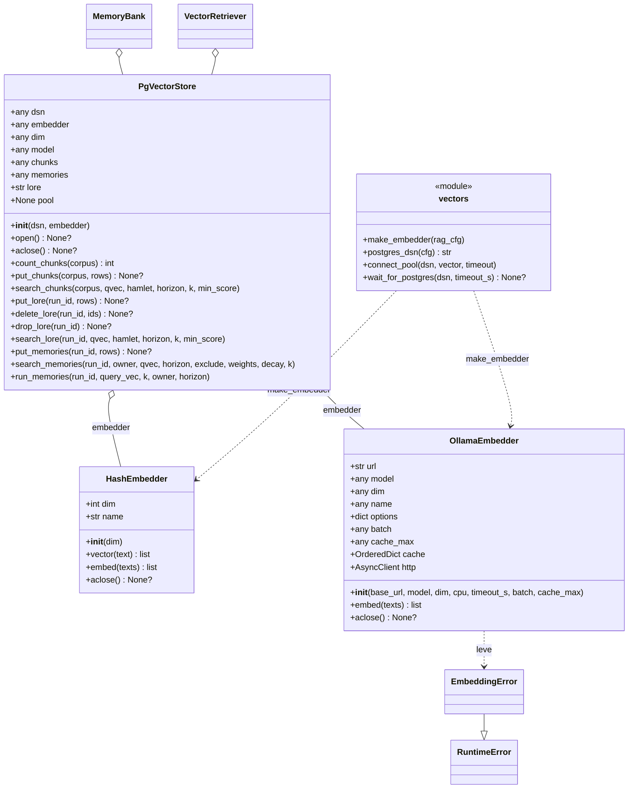

# Décisions, IA et mémoire

Cette partie répond à « **comment un pêcheur décide-t-il ?** ». Une décision vient soit d'un modèle de langage (`agents.py` construit
l'invite avec `prompts.py`, `llm.py` l'envoie), soit d'une règle de son archétype (`policies.py`). Le moteur ne décide jamais à leur
place. Autour : la mémoire de l'agent, la recherche de contexte (RAG) et les vecteurs. Les fichiers qui ne contiennent que des
fonctions sont montrés comme `<<module>>` (fonctions et constantes publiques). Même légende que `classes-monde.md`.

## 1. Fonctions de décision, règles d'archétype et routage

`agents.py` offre les fonctions de décision (`decide_plan` : le plan de la saison ; `decide_catch` : chaque sortie, avec ce qu'il déclare à son retour ; `speak`, `ballot`…). Chacune choisit son chemin : réflexe ou réflexion (`routing.py`), règle d'archétype (`policies.py`) ou appel au modèle via `world.router`. `Outcome` est le résultat commun.

**Pour aller plus loin**
- `filets/agents.py:26` (`Agent`)
- `filets/agents.py:62` (`Outcome`)
- `filets/agents.py:171` (`decide_plan`)
- `filets/agents.py:265` (`decide_catch`)
- `filets/agents.py:363` (`speak`)
- `filets/agents.py:420` (`ballot`)
- `filets/policies.py:55` (`catch_rule`)
- `filets/policies.py:95` (`outing_rule`)
- `filets/policies.py:264` (`declare_outing`)
- `filets/policies.py:420` (`speak_rule`)
- `filets/policies.py:344` (`propose_rule`)
- `filets/routing.py:24` (`reasons_to_think`)
- `filets/routing.py:89` (`outing_reasons`)
- `filets/routing.py:53` (`choose_system`)

## 2. Les invites (`prompts.py`)

Toutes les invites vues par les agents (en français simple) et les schémas de réponse attendus. Module de fonctions pures : même état, même texte.

```mermaid
classDiagram
    class prompts {
        <<module>>
        +str WORLD
        +str STYLE
        +str BRIEF_STYLE
        +dict BRIEF_MAX_TOKENS
        +int REFLEX_MAX_TOKENS
        +dict REFLEX_SCHEMA
        +dict REFLEX_OUTING_SCHEMA
        +list LIEUX
        +str PATROL_WHO
        +str WORLD_LAKES
        +list RULE_KINDS
        +any WHEN_HELP
        +int BALLOT_MAX_TOKENS
        +dict NARRATION_SCHEMA
        +int NARRATION_MAX_TOKENS
        +float NARRATION_TEMPERATURE
        +int NARRATION_WIDTH
        +int SANCTION_MAX_TOKENS
        +int ELECTION_MAX_TOKENS
        +int DEBRIEF_MAX_TOKENS
        +any DEBRIEF_SCHEMA
        +int PATROL_MAX_TOKENS
        +is_brief(cfg_llm) bool
        +is_adaptive(cfg_llm) bool
        +cap_text(x, digits) str
        +villages_text(villages) str
        +day_line(obs) str
        +boat_line(obs) str
        +catch_range(obs) str
        +reflex_messages(p, obs) list
        +lake_ref(label) str
        +lakes_text(lakes) str
        +persona(p, capacity, brief, villages, world) str
        +lake_level(est, capacity, collapse_ratio) str
        +lake_trend(est, capacity, history) str
        +lake_block(obs) str
        +social_line(obs) str
        +surplus_line(obs) str
        +lake_reminder(obs) str
        +rule_reminder(obs) str
        +fishing_rules_reminder(obs) str
        +rule_review(obs) str
        +rule_types_help(obs, brief) str
        +trust_word(v) str
        +trust_line(obs) str
        +carnet_block(obs) str
        +clues_block(obs) str
        +trust_schema(ids) dict
        +answer_schema(purpose, brief, fisher, ids, lakes, extras) dict
        +time_lines(obs) list
        +context_block(obs, brief) str
        +lake_options_block(obs) str
        +hide_stakes(obs) str
        +season_block(obs) str
        +catch_messages(p, obs, capacity, brief, plan) list
        +veillee_block(obs) str
        +speak_messages(p, obs, capacity, brief) list
        +ballot_schema(ids) dict
        +ballot_messages(p, table, est, capacity, collapse_ratio) list
        +narration_messages(facts) list
        +narration_numbers_message(extra) str
        +repeated_line_message(text, who, season) str
        +catch_levels(boat_capacity, n, lo) list
        +reflex_system_one(p, obs) dict
        +sanction_schema(ids) dict
        +sanction_messages(p, items, situation) list
        +sanction_system_one(p, items, situation) dict
        +ballot_system_one(p, proposals, est, capacity, collapse_ratio) dict
        +election_schema(ids) dict
        +election_messages(p, items, situation) list
        +election_system_one(p, items, situation) dict
        +debrief_schema(ids) dict
        +debrief_messages(p, lines, trust, situation) list
        +debrief_system_one(p, lines, trust, situation, ids) dict
        +patrol_schema(targets, legs, days) dict
        +patrol_messages(p, capacity, villages, lines, legs, days, world) list
    }
    class agents
    class LLMRouter
    class World
    agents ..> prompts
    World ..> prompts : narration
    prompts ..> LLMRouter : fournit les messages
```

**Pour aller plus loin**
- `filets/prompts.py:748` (`narration_messages`), `:765` (`narration_numbers_message`), `:714` (`repeated_line_message`)
- `filets/prompts.py:755` (`reflex_system_one`)

## 3. Modèles : routeur, clients, limiteurs

`LLMRouter` reçoit chaque demande d'un agent et la confie au client du fournisseur associé à son niveau (`tier`). Les clients parlent à Ollama ou à une API compatible OpenAI ; `ScriptedClient` est le faux modèle des tests. `RateLimiter` borne le débit, `ModelGate` regroupe les requêtes locales par modèle. Les clients ne partagent aucune classe de base : seulement la méthode `complete`.

**Pour aller plus loin**
- `filets/llm.py:335` (`LLMRouter`)
- `filets/llm.py:30` (`LLMResult`)
- `filets/llm.py:325` (`Usage`)
- `filets/llm.py:154` (`OpenAICompatClient`)
- `filets/llm.py:250` (`SystemOneClient`)
- `filets/llm.py:44` (`RateLimiter`)
- `filets/llm.py:61` (`ModelGate`)
`filets/scripted.py:48` (`ScriptedClient`)

## 4. Mémoire et recherche de contexte (RAG)

Chaque `Agent` a un `MemoryStore` (liste de `Memory`, classés par récence, importance et pertinence BM25). Avec PostgreSQL + pgvector c'est un `VectorMemory`, adossé à une `MemoryBank`. Le `Retriever` cherche dans le corpus (`Passage`) par BM25 ; `VectorRetriever` fait de même avec les vecteurs, avec un `Retriever` local en secours.

**Pour aller plus loin**
- `filets/memory.py:29` (`Memory`)
- `filets/memory.py:41` (`MemoryStore`)
- `filets/memory.py:80` (`MemoryBank`)
- `filets/memory.py:104` (`VectorMemory`)
- `filets/rag.py:81` (`Passage`)
- `filets/rag.py:54` (`BM25`)
- `filets/rag.py:136` (`Retriever`)
- `filets/rag.py:204` (`VectorRetriever`)

## 5. Vecteurs et base pgvector (`vectors.py`)

Les deux calculateurs de vecteurs (`HashEmbedder` sans réseau, `OllamaEmbedder` via Ollama) et `PgVectorStore`, qui range passages, lore et souvenirs dans PostgreSQL. `make_embedder` choisit l'un ou l'autre selon la configuration.

**Pour aller plus loin**
- `filets/vectors.py:34` (`HashEmbedder`)
- `filets/vectors.py:57` (`OllamaEmbedder`)
- `filets/vectors.py:134` (`PgVectorStore`)
- `filets/vectors.py:101` (`make_embedder`)
