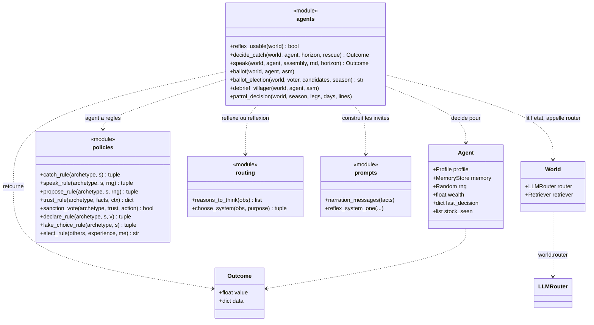
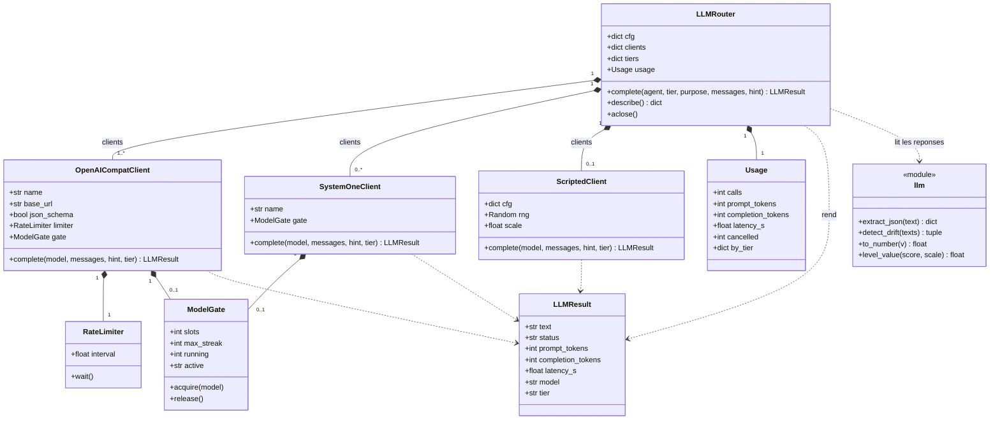
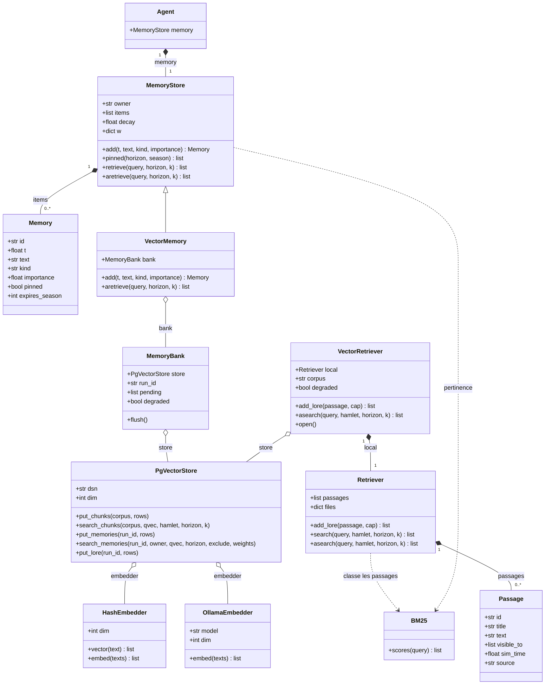

# Décisions, IA et mémoire

Cette partie répond à la question « **comment un pêcheur décide-t-il ?** ». Une décision vient soit d'un modèle de langage
(chemin LLM : `agents.py` construit l'invite, `llm.py` l'envoie), soit d'une règle de son archétype (`policies.py`, agents « à
règles »). Le moteur ne décide jamais à leur place. Autour de la décision : la mémoire de l'agent, la recherche de contexte
(RAG) et les vecteurs. Les fichiers qui ne contiennent que des fonctions sont montrés comme `<<module>>`.

## 1. Les décisions : agents, règles et routage

`agents.py` offre les fonctions de décision (`decide_catch`, `speak`, `ballot`…). Chacune choisit son chemin : réflexe
(`routing.py` dit s'il faut réfléchir ou non), règle d'archétype (`policies.py`), ou appel au modèle via le routeur du monde.

`Outcome` (valeur + données de la décision) est le résultat commun des fonctions de décision. Les fonctions de `policies.py`
sont pures : même état, même réponse.

**Pour aller plus loin**
- `filets/agents.py:25` (`Agent`), `:58` (`Outcome`), `:144` (`decide_catch`), `:232` (`speak`), `:289` (`ballot`)
- `filets/policies.py:55` (`catch_rule`), `:384` (`speak_rule`), `:308` (`propose_rule`)
- `filets/routing.py:24` (`reasons_to_think`), `:53` (`choose_system`) ; `filets/prompts.py` (toutes les invites)

## 2. Les modèles : routeur, clients, limiteurs

`LLMRouter` reçoit chaque demande d'un agent et la confie au client du fournisseur associé à son niveau (`tier` : grand ou
petit). Les clients parlent à Ollama ou à une API compatible OpenAI ; `ScriptedClient` est le faux modèle des tests (réponses
fabriquées, latences simulées). `RateLimiter` borne le débit et `ModelGate` regroupe les requêtes locales par modèle pour éviter
les échanges de modèle en mémoire graphique. Aucun lien d'héritage : les clients partagent seulement la méthode `complete`.

Ce que renvoie un client est un `LLMResult` ; c'est le routeur qui tient les comptes (`Usage`), publie les événements d'appel et
gère erreurs, pauses et annulations. Le fournisseur « scripted » est choisi dans la configuration (`llm.tiers`).

**Pour aller plus loin**
- `filets/llm.py:335` (`LLMRouter`), `:30` (`LLMResult`), `:154` (`OpenAICompatClient`), `:250` (`SystemOneClient`)
- `filets/llm.py:44` (`RateLimiter`), `:61` (`ModelGate`), `:325` (`Usage`)
- `filets/scripted.py:33` (`ScriptedClient`)

## 3. Mémoire, recherche de contexte (RAG) et vecteurs

Chaque `Agent` a un `MemoryStore` (liste de `Memory` classés par récence, importance et pertinence). Avec PostgreSQL + pgvector,
c'est un `VectorMemory`, qui garde aussi la liste locale et se replie sur BM25 si la base tombe. Le `Retriever` cherche dans le
corpus de documents (`Passage`) par BM25 ; `VectorRetriever` fait la même chose avec les vecteurs, en s'appuyant sur un
`Retriever` local comme filet de sécurité. `PgVectorStore` range passages, lore et souvenirs ; les embedders calculent les vecteurs.

`HashEmbedder` (sac de mots haché, sans réseau) et `OllamaEmbedder` (modèle d'Ollama) jouent le même rôle ; `make_embedder`
(dans `vectors.py`) choisit l'un ou l'autre selon la configuration. `rag.py` contient aussi des fonctions utilitaires
(`normalize`, `tokenize`, `lore_passage`, `render`).

**Pour aller plus loin**
- `filets/memory.py:29` (`Memory`), `:41` (`MemoryStore`), `:80` (`MemoryBank`), `:104` (`VectorMemory`)
- `filets/rag.py:81` (`Passage`), `:54` (`BM25`), `:136` (`Retriever`), `:204` (`VectorRetriever`)
- `filets/vectors.py:34` (`HashEmbedder`), `:57` (`OllamaEmbedder`), `:134` (`PgVectorStore`), `:101` (`make_embedder`)
- `filets/world.py:249` (création de `MemoryBank` / `VectorMemory`), `:320` (création du retriever)
