# Diagrammes de classes de l'interface Godot

L'interface Godot 4.7 ne décide de rien : elle affiche ce que le moteur Python publie et lui envoie les ordres du joueur. Elle tient en huit scripts GDScript (`godot/scripts/`). En GDScript, un script est une classe : `extends` donne l'héritage, `preload(...)` puis `.new()` fait qu'un script en crée un autre (composition : l'objet créé vit et meurt avec son propriétaire), et les appels `Art.xxx(...)` sont des appels statiques (dépendance, rien n'est possédé).

Conventions de lecture : `+` = attribut ou méthode publique, `-` = privée (nom commençant par `_`). Dans les sections 3 à 11, chaque script est détaillé avec toutes ses variables, constantes, signaux et fonctions (les noms en majuscules sont des constantes `const`). `Control`, `Node` et `RefCounted` sont des classes du moteur Godot, pas du projet.

## 1. Qui possède qui

Ce diagramme montre l'héritage des scripts vers les classes Godot et la propriété : `Main` (la scène principale) crée la carte, la courbe, la légende, le menu et le client WebSocket ; le menu crée à son tour sa mini-carte. Les flèches pointillées étiquetées « signal » vont de l'émetteur vers celui qui l'écoute : c'est ainsi que le menu et la carte remontent les actions du joueur à `Main`.


Dans le code :
- `godot/scripts/main.gd:8` (`extends Control`), `:10-14` (les cinq `preload`), `:24-27` et `:45` (attributs `ws`, `world`, `chart`, `menu`, `legend`).
- `godot/scripts/main.gd:109` et `:130-132` (création de `ws`, `add_child(ws)`, `ws.message.connect(_on_message)`) ; `:375` (`WorldView.new()`) ; `:436` (`Chart.new()`) ; `:546` (`Legend.new()`) ; `:550` (`StartMenu.new()`).
- `godot/scripts/main.gd:377` (`world.agent_clicked.connect(_select)`), `:552-554` (`menu.start_requested`, `menu.generate_requested`, `menu.cancelled`).
- `godot/scripts/ws_client.gd:3` (`extends Node`), `:5-6` (signaux), `:58` (`send`), `:65` (`pending`).
- `godot/scripts/world_view.gd:15` (`extends Control`), `:17` (signal), `:1075` (`reset_world`), `:1167` (`on_event`), `:272` (`zoom_at`) ; attributs `:70-91`.
- `godot/scripts/chart.gd:3`, `:18`, `:29`, `:49` ; `godot/scripts/legend.gd:3`, `:8`.
- `godot/scripts/start_menu.gd:10` (`extends Control`), `:12` (`preload` de `MenuMap`), `:14-16` (signaux), `:624-626` (`map = MenuMap.new()` et connexion des signaux), `:650` (`set_catalog`), `:1377` (`build_config`), `:1417` (`open`), `:1424` (`close`).
- `godot/scripts/menu_map.gd:3`, `:5` (`preload` de `world_view.gd`, alias `WV`), `:7-8` (signaux), `:31` (`set_data`), `:63` (`token_positions`), `:11` (`hamlets = WV.DEFAULT_HAMLETS`).

## 2. Dépendances statiques : `Art` et le shader de la vallée

`Art` n'est jamais instanciée : toutes les classes d'affichage appellent ses fonctions statiques. `WorldView` possède en plus un `ShaderMaterial` (attribut `mat`) construit sur le shader `valley.gdshader` : ce shader dessine le sol (eau, poissons, sécheresse, mailles) et reçoit ses `uniform` depuis `WorldView`. Les membres complets de `Art` et du shader sont donnés aux sections 3 et 12.

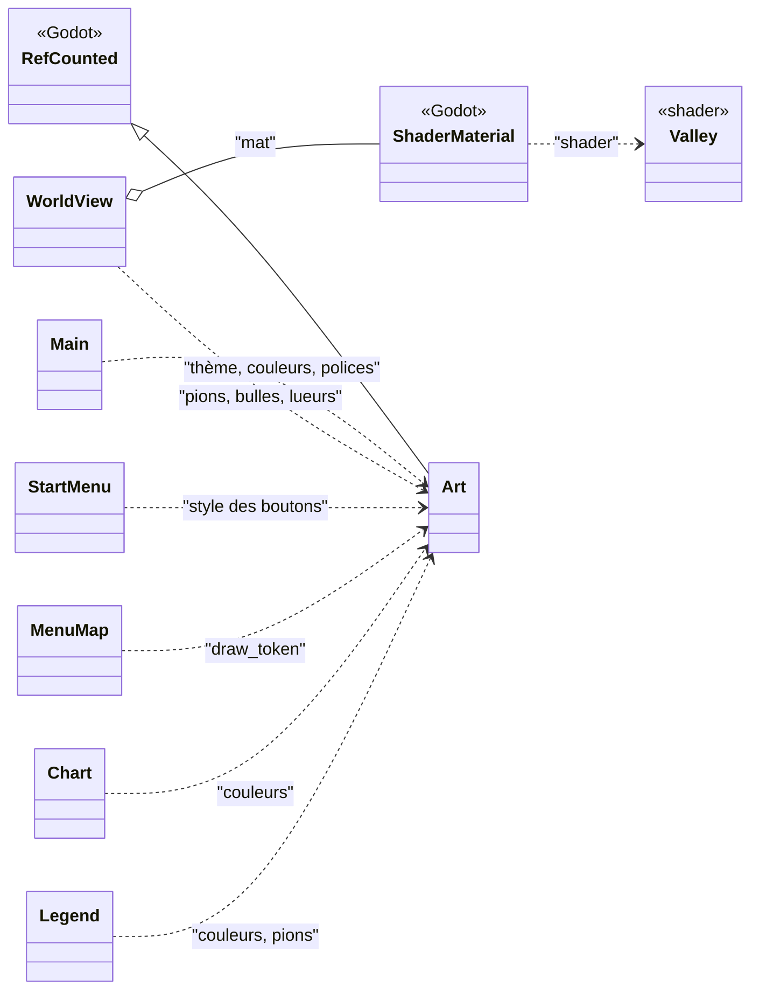

Dans le code :
- `godot/scripts/art.gd:4-5` (`class_name Art`, `extends RefCounted`).
- `godot/scripts/world_view.gd:68` (`var mat: ShaderMaterial`), `:155-159` (création du matériau, `terrain` est le `ColorRect` qui le porte).
- Occurrences de `Art.` (mesurées) : `world_view.gd` 98, `main.gd` 66, `start_menu.gd` 37, `menu_map.gd` 12, `legend.gd` 9, `chart.gd` 6.

## 3. `Art` (art.gd)

### 3.1 Constantes et fonctions statiques

Palette de l'interface, couleurs d'interaction, couleurs des hameaux, polices et dessin des pions : une seule source pour toute l'interface.

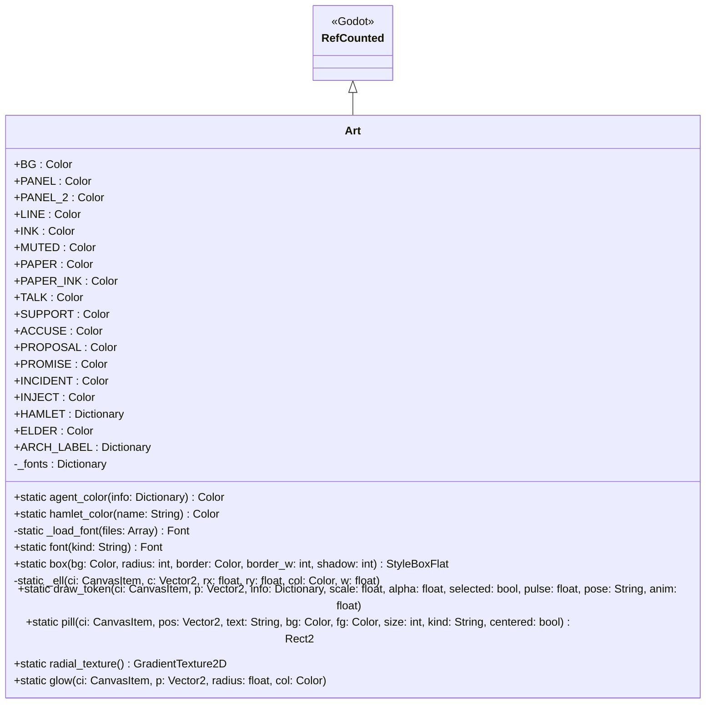

Dans le code :
- `godot/scripts/art.gd` fonctions (10) : `agent_color` :52, `hamlet_color` :59, `_load_font` :67, `font` :90, `box` :111, `_ell` :129, `draw_token` :143, `pill` :230, `radial_texture` :241, `glow` :259.
- `godot/scripts/art.gd` variables (1) : `_fonts` :48.
- `godot/scripts/art.gd` constantes (18) : `BG` :8, `PANEL` :9, `PANEL_2` :10, `LINE` :11, `INK` :12, `MUTED` :13, `PAPER` :14, `PAPER_INK` :15, `TALK` :18, `SUPPORT` :19, `ACCUSE` :20, `PROPOSAL` :21, `PROMISE` :22, `INCIDENT` :23, `INJECT` :24, `HAMLET` :27, `ELDER` :41, `ARCH_LABEL` :43.

## 4. `WsClient` (ws_client.gd)

### 4.1 Le client WebSocket

Se connecte au pont, lit au plus `MAX_PER_FRAME` paquets par image, émet un signal par message et retente toutes les 2 s si la connexion tombe.

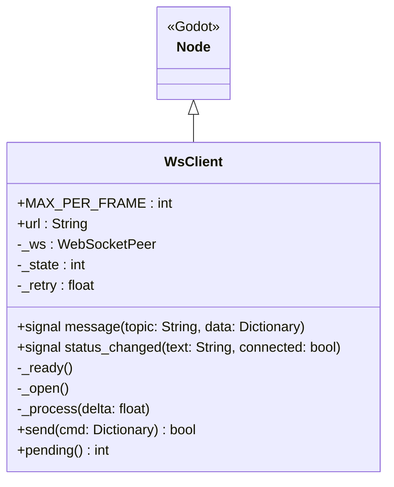

Dans le code :
- `godot/scripts/ws_client.gd` fonctions (5) : `_ready` :15, `_open` :19, `_process` :28, `send` :58, `pending` :65.
- `godot/scripts/ws_client.gd` variables (4) : `url` :8, `_ws` :9, `_state` :10, `_retry` :11.
- `godot/scripts/ws_client.gd` constantes (1) : `MAX_PER_FRAME` :12.
- `godot/scripts/ws_client.gd` signaux (2) : `message` :5, `status_changed` :6.

## 5. `Chart` (chart.gd) et `Legend` (legend.gd)

### 5.1 Chart : les courbes par saison

Dessine le stock (aire), l'indice de norme et la part des promesses tenues, saison par saison.

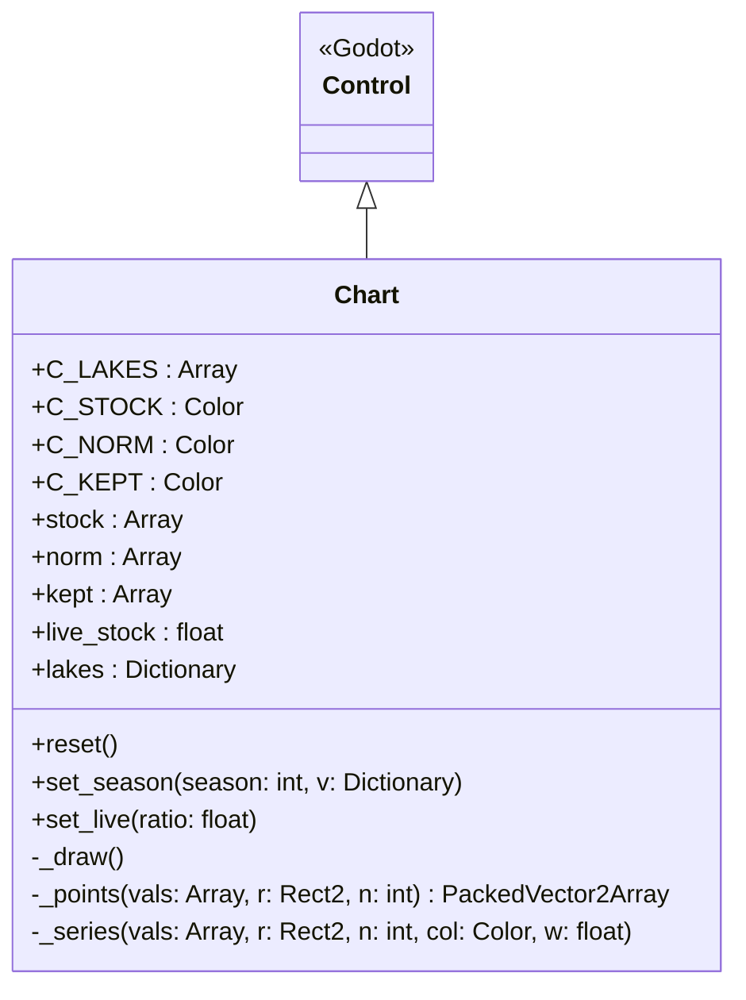

Dans le code :
- `godot/scripts/chart.gd` fonctions (6) : `reset` :18, `set_season` :29, `set_live` :49, `_draw` :54, `_points` :101, `_series` :111.
- `godot/scripts/chart.gd` variables (5) : `stock` :5, `norm` :6, `kept` :7, `live_stock` :8, `lakes` :9.
- `godot/scripts/chart.gd` constantes (4) : `C_LAKES` :11, `C_STOCK` :13, `C_NORM` :14, `C_KEPT` :15.

### 5.2 Legend : la légende de la carte

Légende dessinée avec les mêmes fonctions que la carte.

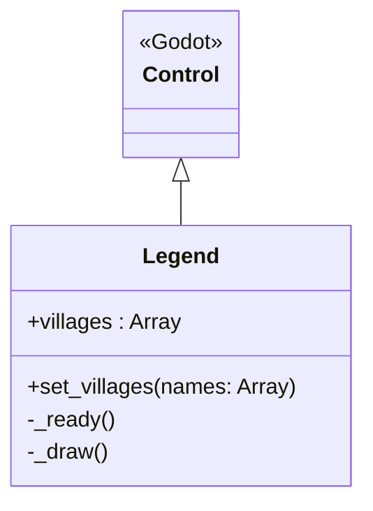

Dans le code :
- `godot/scripts/legend.gd` fonctions (3) : `set_villages` :8, `_ready` :13, `_draw` :17.
- `godot/scripts/legend.gd` variables (1) : `villages` :5.

## 6. `MenuMap` (menu_map.gd)

### 6.1 L'aperçu de la vallée dans le menu

Les hameaux, le lac et les pêcheurs tels qu'ils seront placés ; un pion se glisse d'un hameau à l'autre, le clic le sélectionne.

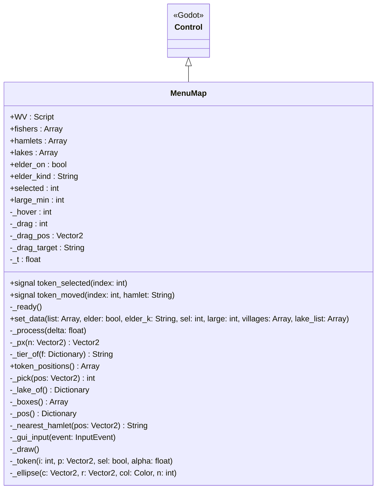

Dans le code :
- `godot/scripts/menu_map.gd` fonctions (15) : `_ready` :25, `set_data` :31, `_process` :43, `_px` :49, `_tier_of` :53, `token_positions` :63, `_pick` :88, `_lake_of` :100, `_boxes` :108, `_pos` :112, `_nearest_hamlet` :116, `_gui_input` :127, `_draw` :158, `_token` :212, `_ellipse` :226.
- `godot/scripts/menu_map.gd` variables (12) : `fishers` :10, `hamlets` :11, `lakes` :12, `elder_on` :13, `elder_kind` :14, `selected` :15, `large_min` :16, `_hover` :18, `_drag` :19, `_drag_pos` :20, `_drag_target` :21, `_t` :22.
- `godot/scripts/menu_map.gd` constantes (1) : `WV` :5.
- `godot/scripts/menu_map.gd` signaux (2) : `token_selected` :7, `token_moved` :8.

## 7. `Main` (main.gd)

### 7.1 Constantes, signaux et variables

Tout l'état de la scène principale : widgets gardés, état reconstruit des événements, options de ligne de commande de test.

```mermaid
classDiagram
    class Main {
        +WS : Script
        +WorldView : Script
        +Chart : Script
        +Legend : Script
        +StartMenu : Script
        +SPEEDS : Array
        +INCIDENT_LABELS : Dictionary
        +BREACH_WORD : Dictionary
        +KPI_SUB : Dictionary
        +ws : Variant
        +world : Variant
        +chart : Variant
        +menu : Variant
        +lbl_run : Label
        +lbl_clock : Label
        +lbl_status : Label
        +ind_labels : Dictionary
        +feed : RichTextLabel
        +narration : RichTextLabel
        +trust_view : RichTextLabel
        +trust_dirty : bool
        +trust_mode : String
        +trust_observer : String
        +trust_who : OptionButton
        +feed_only_selected : CheckBox
        +inspector : RichTextLabel
        +rules_view : RichTextLabel
        +tabs : TabContainer
        +comm_opt : OptionButton
        +vis_check : CheckButton
        +legend : Control
        +lbl_weather : Label
        +weather_days : Array
        +weather_season : int
        +lbl_patrol : Label
        +patrol_texts : Dictionary
        +lake_labels : Dictionary
        +patrol_text_season : int
        +patrol_installed : bool
        +reps : Dictionary
        +rumor_edit : LineEdit
        +run : Dictionary
        +agents : Dictionary
        +feed_lines : Array
        +proposals : Dictionary
        +norms : Array
        +norms_now : Array
        +selected : String
        +inspector_dirty : bool
        +feed_dirty : bool
        +catching_up : int
        +t0_ms : int
        +n_events : int
        +n_indicators : int
        +last_sim_label : String
        +selftest : float
        +shot_path : String
        +shots : Array
        +shot_dir : String
        +autostart : float
        +view_zoom : float
        +view_mesh : bool
        +autostart_at : float
        +menu_shot : String
        +catalog : Dictionary
        +engine : Dictionary
        +engine_seen_ms : int
        +engine_state : String
        +ws_ok : bool
        +last_error : String
        +transport : PanelContainer
        +btn_pause : Button
        +btn_stop : Button
        +btn_stop_top : Button
        +stop_dlg : ConfirmationDialog
        +btn_new : Button
        +speed_buttons : Dictionary
        +lbl_progress : Label
        +lbl_thinking : Label
        +end_overlay : Control
        +end_title : Label
        +end_text : Label
        +end_new : Button
        +ind_sub : Dictionary
        +ind_title : Dictionary
        +end_status : Dictionary
        -_acc : float
    }
    Control <|-- Main
    class Control {
        <<Godot>>
    }
```

Dans le code :
- `godot/scripts/main.gd` variables (78) : `ws` :24, `world` :25, `chart` :26, `menu` :27, `lbl_run` :28, `lbl_clock` :29, `lbl_status` :30, `ind_labels` :31, `feed` :32, `narration` :33, `trust_view` :34, `trust_dirty` :35, `trust_mode` :36, `trust_observer` :37, `trust_who` :38, `feed_only_selected` :39, `inspector` :40, `rules_view` :41, `tabs` :42, `comm_opt` :43, `vis_check` :44, `legend` :45, `lbl_weather` :46, `weather_days` :47, `weather_season` :48, `lbl_patrol` :49, `patrol_texts` :50, `lake_labels` :51, `patrol_text_season` :52, `patrol_installed` :53, `reps` :54, `rumor_edit` :55, `run` :58, `agents` :59, `feed_lines` :60, `proposals` :61, `norms` :62, `norms_now` :63, `selected` :66, `inspector_dirty` :67, `feed_dirty` :68, `catching_up` :69, `t0_ms` :70, `n_events` :71, `n_indicators` :72, `last_sim_label` :73, `selftest` :74, `shot_path` :75, `shots` :76, `shot_dir` :77, `autostart` :78, `view_zoom` :79, `view_mesh` :80, `autostart_at` :81, `menu_shot` :82, `catalog` :85, `engine` :86, `engine_seen_ms` :87, `engine_state` :88, `ws_ok` :89, `last_error` :90, `transport` :91, `btn_pause` :92, `btn_stop` :93, `btn_stop_top` :94, `stop_dlg` :95, `btn_new` :96, `speed_buttons` :97, `lbl_progress` :98, `lbl_thinking` :99, `end_overlay` :100, `end_title` :101, `end_text` :102, `end_new` :103, `ind_sub` :145, `ind_title` :146, `end_status` :642, `_acc` :1539.
- `godot/scripts/main.gd` constantes (9) : `WS` :10, `WorldView` :11, `Chart` :12, `Legend` :13, `StartMenu` :14, `SPEEDS` :17, `INCIDENT_LABELS` :20, `BREACH_WORD` :64, `KPI_SUB` :1108.

### 7.2 Les nœuds Godot gardés par `Main`

Les widgets créés par le code (`.new()`) et conservés dans une variable : `Main` en est propriétaire (agrégation). Les autres nœuds (conteneurs intermédiaires, séparateurs) sont ajoutés à l'arbre sans être gardés.

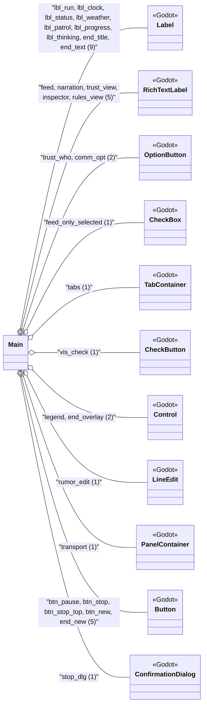

Dans le code :
- `godot/scripts/main.gd` : Label `lbl_run` :28, `lbl_clock` :29, `lbl_status` :30, `lbl_weather` :46, `lbl_patrol` :49, `lbl_progress` :98, `lbl_thinking` :99, `end_title` :101, `end_text` :102; RichTextLabel `feed` :32, `narration` :33, `trust_view` :34, `inspector` :40, `rules_view` :41; OptionButton `trust_who` :38, `comm_opt` :43; CheckBox `feed_only_selected` :39; TabContainer `tabs` :42; CheckButton `vis_check` :44; Control `legend` :45, `end_overlay` :100; LineEdit `rumor_edit` :55; PanelContainer `transport` :91; Button `btn_pause` :92, `btn_stop` :93, `btn_stop_top` :94, `btn_new` :96, `end_new` :103; ConfirmationDialog `stop_dlg` :95.

### 7.3 Initialisation et construction de l'interface

Les fonctions de `Main` de cette zone du fichier (les en-têtes de section du script délimitent les zones).

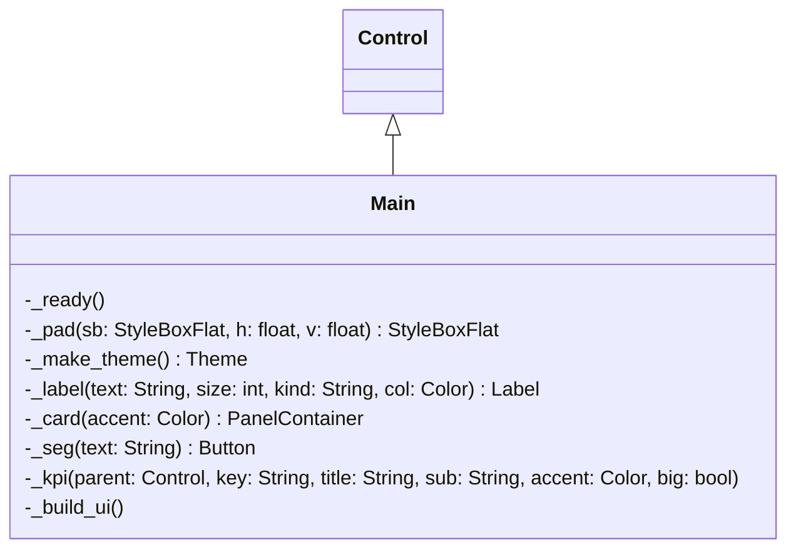

Dans le code :
- `godot/scripts/main.gd` fonctions (8) : `_ready` :106, `_pad` :149, `_make_theme` :157, `_label` :211, `_card` :220, `_seg` :231, `_kpi` :247, `_build_ui` :271.

### 7.4 Pilotage de la partie (pause, vitesse, arrêt, menu)

Les fonctions de `Main` de cette zone du fichier (les en-têtes de section du script délimitent les zones).

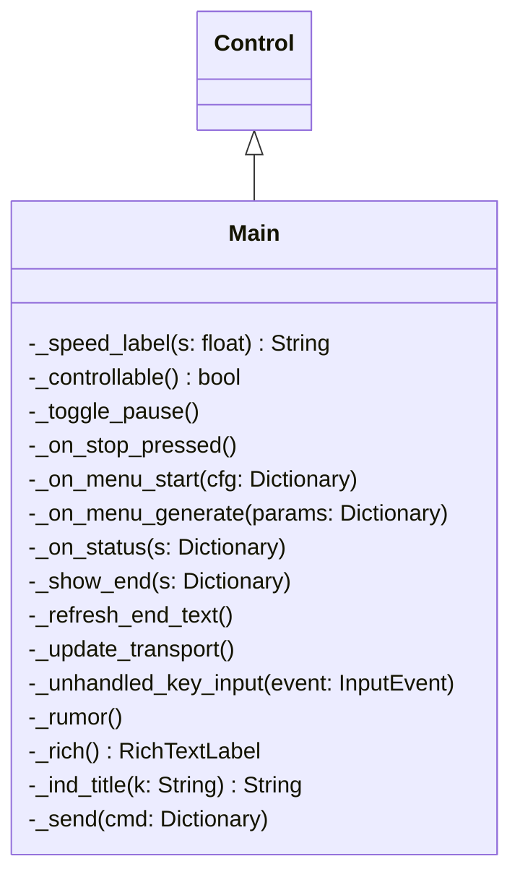

Dans le code :
- `godot/scripts/main.gd` fonctions (15) : `_speed_label` :572, `_controllable` :584, `_toggle_pause` :588, `_on_stop_pressed` :594, `_on_menu_start` :598, `_on_menu_generate` :603, `_on_status` :608, `_show_end` :645, `_refresh_end_text` :653, `_update_transport` :665, `_unhandled_key_input` :695, `_rumor` :702, `_rich` :708, `_ind_title` :716, `_send` :723.

### 7.5 Messages reçus du moteur et événements

Les fonctions de `Main` de cette zone du fichier (les en-têtes de section du script délimitent les zones).

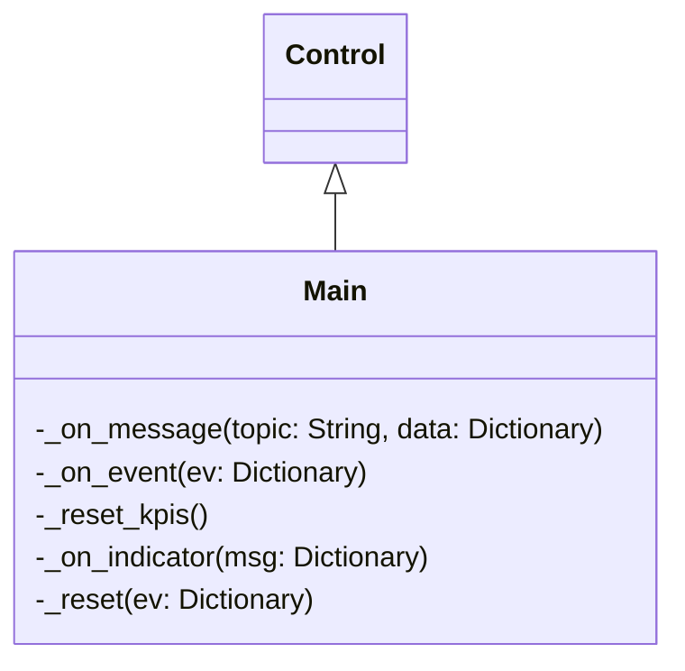

Dans le code :
- `godot/scripts/main.gd` fonctions (5) : `_on_message` :729, `_on_event` :757, `_reset_kpis` :1113, `_on_indicator` :1122, `_reset` :1161.

### 7.6 Fil des interactions, règles, confiance

Les fonctions de `Main` de cette zone du fichier (les en-têtes de section du script délimitent les zones).

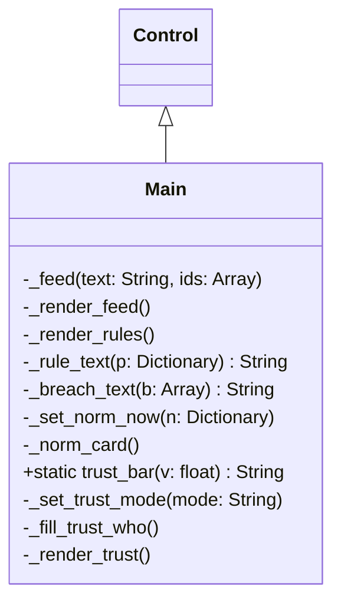

Dans le code :
- `godot/scripts/main.gd` fonctions (11) : `_feed` :1206, `_render_feed` :1219, `_render_rules` :1230, `_rule_text` :1265, `_breach_text` :1272, `_set_norm_now` :1280, `_norm_card` :1291, `trust_bar` :1304, `_set_trust_mode` :1312, `_fill_trust_who` :1319, `_render_trust` :1331.

### 7.7 Inspecteur d'agent

Les fonctions de `Main` de cette zone du fichier (les en-têtes de section du script délimitent les zones).

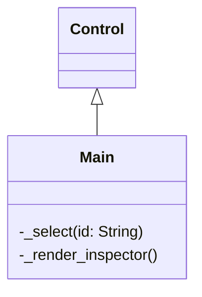

Dans le code :
- `godot/scripts/main.gd` fonctions (2) : `_select` :1369, `_render_inspector` :1379.

### 7.8 Utilitaires et boucle d'image

Les fonctions de `Main` de cette zone du fichier (les en-têtes de section du script délimitent les zones).

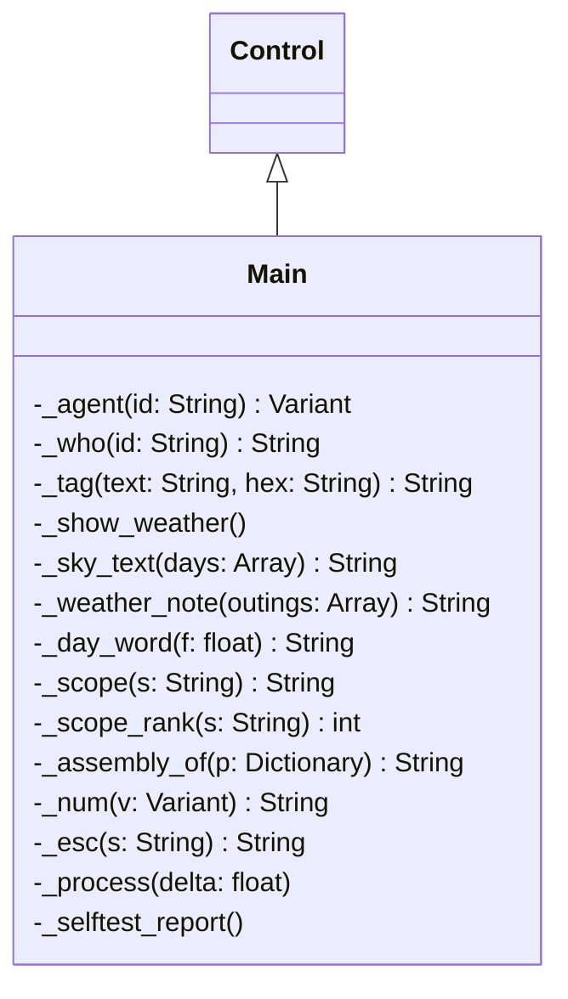

Dans le code :
- `godot/scripts/main.gd` fonctions (14) : `_agent` :1448, `_who` :1452, `_tag` :1462, `_show_weather` :1467, `_sky_text` :1481, `_weather_note` :1493, `_day_word` :1509, `_scope` :1513, `_scope_rank` :1521, `_assembly_of` :1526, `_num` :1530, `_esc` :1535, `_process` :1542, `_selftest_report` :1610.

## 8. `StartMenu` (start_menu.gd)

### 8.1 Constantes, signaux et variables

L'état du menu de démarrage : réglages, lignes de pêcheurs, lacs, état du moteur.

```mermaid
classDiagram
    class StartMenu {
        +signal start_requested(config: Dictionary)
        +signal cancelled()
        +signal generate_requested(params: Dictionary)
        +MenuMap : Script
        +W_IDX : int
        +W_NAME : int
        +W_HAMLET : int
        +W_ARCH : int
        +W_BOAT : int
        +W_EXP : int
        +W_WEALTH : int
        +W_DEBT : int
        +W_BRAIN : int
        +W_DEL : int
        +BRAINS : Array
        +catalog : Dictionary
        +fishers : Array
        +selected : int
        +capacity_auto : bool
        +speed_touched : bool
        +reflection_touched : bool
        +can_cancel : bool
        +engine_state : String
        +engine_detail : String
        +engine_online : bool
        +busy : bool
        +busy_since : int
        -_rows : Array
        -_updating : bool
        -_pending_generation : String
        -_pending_since : int
        -_pending_params : Dictionary
        -_regenerate : bool
        -_gen_timer : Timer
        +sheet : PanelContainer
        +lbl_engine : Label
        +spin_seasons : SpinBox
        +spin_seed : SpinBox
        +spin_rounds : SpinBox
        +spin_capacity : SpinBox
        +btn_cap_auto : Button
        +spin_growth : SpinBox
        +btn_growth_default : Button
        +chk_stop_empty : CheckButton
        +lbl_cap_hint : Label
        +opt_comm : OptionButton
        +opt_council : OptionButton
        +chk_climate : CheckButton
        +chk_patrol : CheckButton
        +spin_events : SpinBox
        +spin_luck : SpinBox
        +spin_villages : SpinBox
        +spin_fishers : SpinBox
        +opt_fleet : OptionButton
        +btn_other : Button
        +opt_genmode : OptionButton
        +spin_lakes : SpinBox
        +spin_patrols : SpinBox
        +spin_hold : SpinBox
        +row_cap : Control
        +row_growth : Control
        +row_travel : Control
        +spin_travel_days : SpinBox
        +spin_travel_cost : SpinBox
        +lakes_box : VBoxContainer
        +lakes_state : Array
        +lake_spins : Array
        +btn_generate : Button
        +chk_visible : CheckButton
        +opt_llm : OptionButton
        +lbl_llm_desc : Label
        +opt_reflection : OptionButton
        +lbl_reflection_desc : Label
        +opt_speed : OptionButton
        +lbl_speed_hint : Label
        +chk_elder : CheckButton
        +opt_elder : OptionButton
        +rows_box : VBoxContainer
        +lbl_count : Label
        +lbl_lake : Label
        +btn_add : Button
        +map : Control
        +detail : RichTextLabel
        +lbl_error : Label
        +btn_start : Button
        +btn_cancel : Button
    }
    Control <|-- StartMenu
    class Control {
        <<Godot>>
    }
```

Dans le code :
- `godot/scripts/start_menu.gd` variables (71) : `catalog` :32, `fishers` :33, `selected` :34, `capacity_auto` :35, `speed_touched` :36, `reflection_touched` :37, `can_cancel` :38, `engine_state` :39, `engine_detail` :40, `engine_online` :41, `busy` :42, `busy_since` :43, `_rows` :45, `_updating` :46, `_pending_generation` :47, `_pending_since` :48, `_pending_params` :49, `_regenerate` :50, `_gen_timer` :51, `sheet` :53, `lbl_engine` :54, `spin_seasons` :55, `spin_seed` :56, `spin_rounds` :57, `spin_capacity` :58, `btn_cap_auto` :59, `spin_growth` :60, `btn_growth_default` :61, `chk_stop_empty` :62, `lbl_cap_hint` :63, `opt_comm` :64, `opt_council` :65, `chk_climate` :66, `chk_patrol` :67, `spin_events` :68, `spin_luck` :69, `spin_villages` :70, `spin_fishers` :71, `opt_fleet` :72, `btn_other` :73, `opt_genmode` :74, `spin_lakes` :75, `spin_patrols` :76, `spin_hold` :77, `row_cap` :78, `row_growth` :79, `row_travel` :80, `spin_travel_days` :81, `spin_travel_cost` :82, `lakes_box` :83, `lakes_state` :84, `lake_spins` :85, `btn_generate` :86, `chk_visible` :87, `opt_llm` :88, `lbl_llm_desc` :89, `opt_reflection` :90, `lbl_reflection_desc` :91, `opt_speed` :92, `lbl_speed_hint` :93, `chk_elder` :94, `opt_elder` :95, `rows_box` :96, `lbl_count` :97, `lbl_lake` :98, `btn_add` :99, `map` :100, `detail` :101, `lbl_error` :102, `btn_start` :103, `btn_cancel` :104.
- `godot/scripts/start_menu.gd` constantes (12) : `MenuMap` :12, `W_IDX` :18, `W_NAME` :19, `W_HAMLET` :20, `W_ARCH` :21, `W_BOAT` :22, `W_EXP` :23, `W_WEALTH` :24, `W_DEBT` :25, `W_BRAIN` :26, `W_DEL` :27, `BRAINS` :29.
- `godot/scripts/start_menu.gd` signaux (3) : `start_requested` :14, `cancelled` :15, `generate_requested` :16.

### 8.2 Les nœuds Godot gardés par `StartMenu`

Les champs, listes et boutons du menu conservés dans une variable (agrégation).

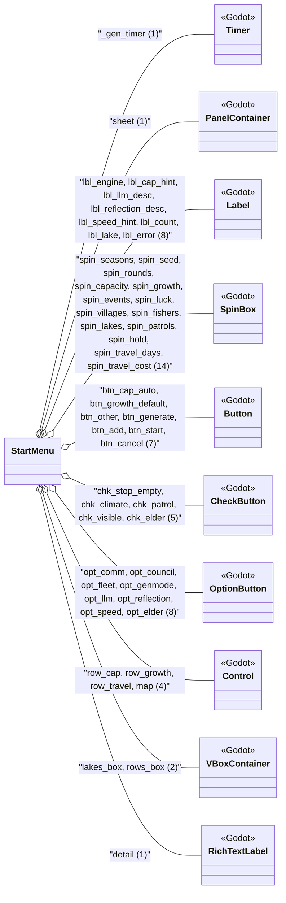

Dans le code :
- `godot/scripts/start_menu.gd` : Timer `_gen_timer` :51; PanelContainer `sheet` :53; Label `lbl_engine` :54, `lbl_cap_hint` :63, `lbl_llm_desc` :89, `lbl_reflection_desc` :91, `lbl_speed_hint` :93, `lbl_count` :97, `lbl_lake` :98, `lbl_error` :102; SpinBox `spin_seasons` :55, `spin_seed` :56, `spin_rounds` :57, `spin_capacity` :58, `spin_growth` :60, `spin_events` :68, `spin_luck` :69, `spin_villages` :70, `spin_fishers` :71, `spin_lakes` :75, `spin_patrols` :76, `spin_hold` :77, `spin_travel_days` :81, `spin_travel_cost` :82; Button `btn_cap_auto` :59, `btn_growth_default` :61, `btn_other` :73, `btn_generate` :86, `btn_add` :99, `btn_start` :103, `btn_cancel` :104; CheckButton `chk_stop_empty` :62, `chk_climate` :66, `chk_patrol` :67, `chk_visible` :87, `chk_elder` :94; OptionButton `opt_comm` :64, `opt_council` :65, `opt_fleet` :72, `opt_genmode` :74, `opt_llm` :88, `opt_reflection` :90, `opt_speed` :92, `opt_elder` :95; Control `row_cap` :78, `row_growth` :79, `row_travel` :80, `map` :100; VBoxContainer `lakes_box` :83, `rows_box` :96; RichTextLabel `detail` :101.

### 8.3 Construction de l'interface

Les fonctions de `StartMenu` de cette zone du fichier.

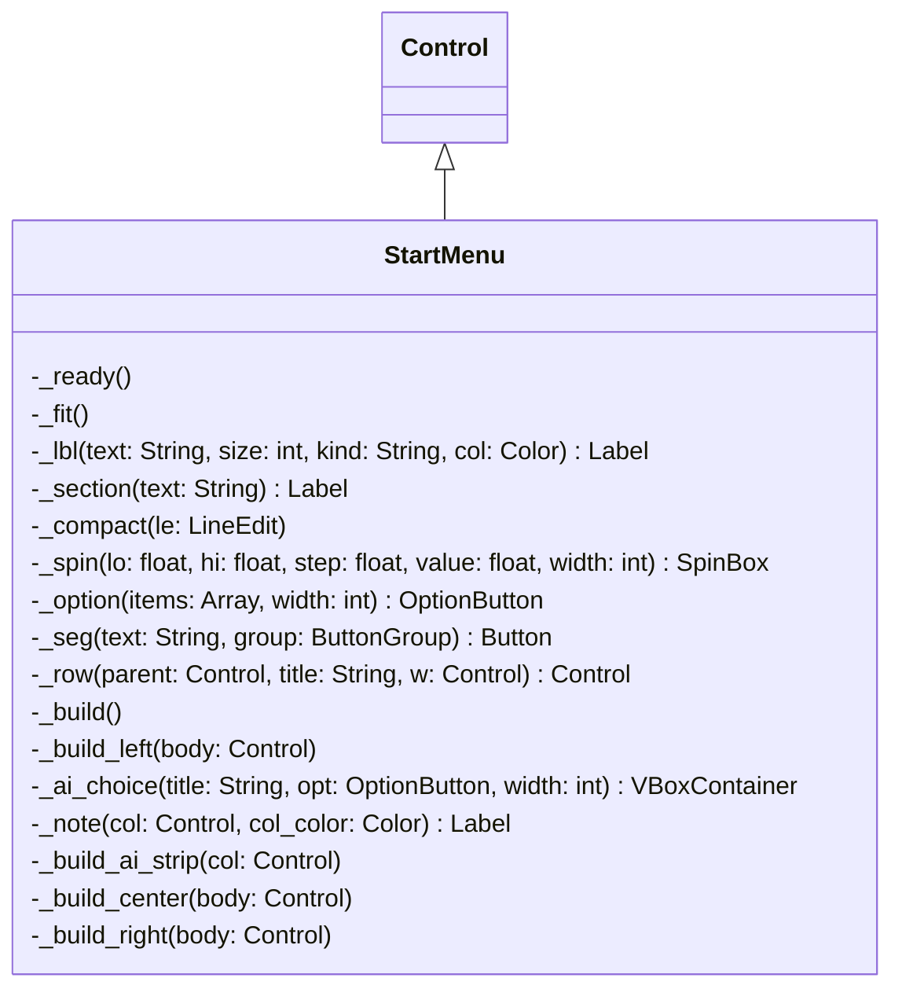

Dans le code :
- `godot/scripts/start_menu.gd` fonctions (16) : `_ready` :107, `_fit` :118, `_lbl` :123, `_section` :132, `_compact` :136, `_spin` :148, `_option` :160, `_seg` :173, `_row` :192, `_build` :205, `_build_left` :292, `_ai_choice` :455, `_note` :464, `_build_ai_strip` :473, `_build_center` :503, `_build_right` :612.

### 8.4 Catalogue et réinitialisation

Les fonctions de `StartMenu` de cette zone du fichier.

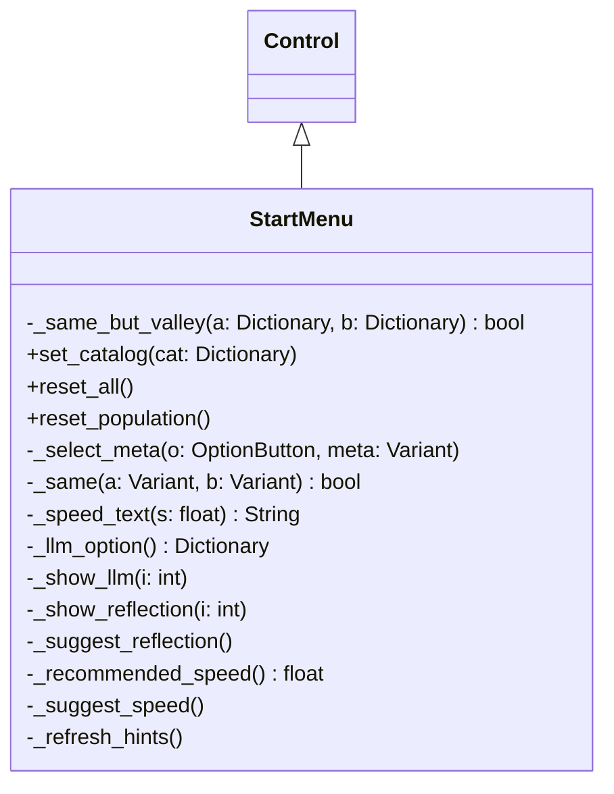

Dans le code :
- `godot/scripts/start_menu.gd` fonctions (14) : `_same_but_valley` :641, `set_catalog` :650, `reset_all` :728, `reset_population` :773, `_select_meta` :783, `_same` :791, `_speed_text` :799, `_llm_option` :811, `_show_llm` :817, `_show_reflection` :822, `_suggest_reflection` :829, `_recommended_speed` :840, `_suggest_speed` :844, `_refresh_hints` :855.

### 8.5 Pêcheurs, lacs et génération

Les fonctions de `StartMenu` de cette zone du fichier.

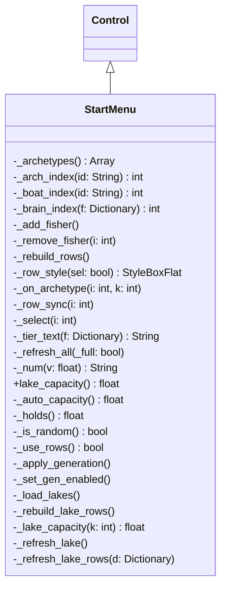

Dans le code :
- `godot/scripts/start_menu.gd` fonctions (26) : `_archetypes` :863, `_arch_index` :867, `_boat_index` :875, `_brain_index` :883, `_add_fisher` :890, `_remove_fisher` :921, `_rebuild_rows` :931, `_row_style` :1023, `_on_archetype` :1032, `_row_sync` :1044, `_select` :1058, `_tier_text` :1065, `_refresh_all` :1076, `_num` :1104, `lake_capacity` :1109, `_auto_capacity` :1113, `_holds` :1120, `_is_random` :1130, `_use_rows` :1135, `_apply_generation` :1140, `_set_gen_enabled` :1160, `_load_lakes` :1171, `_rebuild_lake_rows` :1190, `_lake_capacity` :1240, `_refresh_lake` :1253, `_refresh_lake_rows` :1286.

### 8.6 Envoi de la configuration

Les fonctions de `StartMenu` de cette zone du fichier.

```mermaid
classDiagram
    class StartMenu {
        -_on_gen_spin(_v: float, villages_touched: bool)
        -_sync_generation()
        -_fleet_id() String
        -_on_generate()
        -_lake_request() Dictionary
        +build_config() Dictionary
        -_on_start()
    }
    Control <|-- StartMenu
```

Dans le code :
- `godot/scripts/start_menu.gd` fonctions (7) : `_on_gen_spin` :1313, `_sync_generation` :1325, `_fleet_id` :1332, `_on_generate` :1336, `_lake_request` :1358, `build_config` :1377, `_on_start` :1402.

### 8.7 État du moteur et ouverture

Les fonctions de `StartMenu` de cette zone du fichier.

```mermaid
classDiagram
    class StartMenu {
        +open(cancelable: bool)
        +close()
        +show_error(text: String)
        +set_engine(state: String, online: bool, detail: String)
        -_update_state()
        -_process(_delta: float)
    }
    Control <|-- StartMenu
```

Dans le code :
- `godot/scripts/start_menu.gd` fonctions (6) : `open` :1417, `close` :1424, `show_error` :1429, `set_engine` :1438, `_update_state` :1447, `_process` :1473.

## 9. `WorldView` (world_view.gd) : la carte de la vallée

### 9.1 Constantes et signal

Constantes de mise en page (hameaux, lacs, anneau du conseil, zoom, vitesses) et le signal `agent_clicked`.

```mermaid
classDiagram
    class WorldView {
        +signal agent_clicked(agent_id: String)
        +DEFAULT_HAMLETS : Array
        +SLOTS : Dictionary
        +LAYOUTS : Dictionary
        +ELDER_POS : Vector2
        +LAKE_C : Vector2
        +LAKE_R : Vector2
        +MAX_LAKES : int
        +LAKE_BOXES : Dictionary
        +ROOM : Rect2
        +RING_R : Vector2
        +ISO_LAKE_K : Dictionary
        +LOTS_PER_W : int
        +ZOOM_MAX : float
        +MARGIN_K : float
        +LAND_SPEED : float
        +WATER_SPEED : float
        +DUSK : Color
        +NIGHT : Color
        +BOAT_SCALE : Dictionary
    }
    Control <|-- WorldView
```

Dans le code :
- `godot/scripts/world_view.gd` constantes (19) : `DEFAULT_HAMLETS` :19, `SLOTS` :22, `LAYOUTS` :26, `ELDER_POS` :31, `LAKE_C` :32, `LAKE_R` :33, `MAX_LAKES` :36, `LAKE_BOXES` :37, `ROOM` :44, `RING_R` :45, `ISO_LAKE_K` :48, `LOTS_PER_W` :54, `ZOOM_MAX` :55, `MARGIN_K` :56, `LAND_SPEED` :57, `WATER_SPEED` :58, `DUSK` :59, `NIGHT` :60, `BOAT_SCALE` :1964.
- `godot/scripts/world_view.gd` signaux (1) : `agent_clicked` :17.

### 9.2 Variables

L'état de la carte : couches, personnages, caméra, lacs, mailles, patrouille, salon, effets.

```mermaid
classDiagram
    class WorldView {
        +terrain : ColorRect
        +decor : Control
        +under : Control
        +shade : Control
        +lights : Control
        +over : Control
        +mat : ShaderMaterial
        +agents : Dictionary
        +order : Array
        +stock_ratio : float
        +stock_t : float
        +capacity : float
        +collapsed : bool
        +selected : String
        +hovered : String
        +animate : bool
        +paused : bool
        +thinking : Array
        +time_scale : float
        +effects : Array
        +bubbles : Dictionary
        +badges : Dictionary
        +rules : Array
        +cur_season : int
        -_proposal_author : Dictionary
        +season_days : float
        +sim_time : float
        +light : float
        +phase : String
        +assembly_scope : String
        +hamlet_pos : Variant
        +lakes : Array
        +iso_o : Vector2
        +iso_a : float
        +iso_b : float
        +iso_sq : float
        +iso_ex : Vector2
        +cam : Control
        +top : Control
        +zoom : float
        +zoom_min : float
        +cam_off : Vector2
        +council_c : Variant
        +council_r : Variant
        +elder_pos : Variant
        +world_k : float
        +PARCELS : int
        +n_lots : int
        +n_steps : int
        +world : Vector2
        +dragging : bool
        +glide : bool
        +glide_to : Vector2
        +mini_drag : bool
        +show_mesh : bool
        +lake_cells : Array
        +parcel_lake : PackedInt32Array
        +field : PackedFloat32Array
        +mask_img : Image
        +walk : AStarGrid2D
        +sail : AStarGrid2D
        +hamlet_lake : Dictionary
        +patrol_routes : Dictionary
        +patrol_season : int
        +salon_ids : Array
        +salon : Control
        +btn_salon_min : Button
        +btn_salon_open : Button
        -_salon_draw : bool
        +hamlet_fires : Array
        +dry : float
        +t : float
        +banners : Array
        +deco : Dictionary
        +fish : Array
        +wakes : Array
        +splashes : Array
    }
    Control <|-- WorldView
```

Dans le code :
- `godot/scripts/world_view.gd` variables (77) : `terrain` :62, `decor` :63, `under` :64, `shade` :65, `lights` :66, `over` :67, `mat` :68, `agents` :70, `order` :71, `stock_ratio` :72, `stock_t` :73, `capacity` :74, `collapsed` :75, `selected` :76, `hovered` :77, `animate` :78, `paused` :79, `thinking` :80, `time_scale` :81, `effects` :82, `bubbles` :83, `badges` :84, `rules` :85, `cur_season` :86, `_proposal_author` :87, `season_days` :90, `sim_time` :91, `light` :92, `phase` :93, `assembly_scope` :94, `hamlet_pos` :95, `lakes` :96, `iso_o` :97, `iso_a` :98, `iso_b` :99, `iso_sq` :100, `iso_ex` :101, `cam` :103, `top` :104, `zoom` :105, `zoom_min` :106, `cam_off` :107, `council_c` :108, `council_r` :109, `elder_pos` :110, `world_k` :111, `PARCELS` :112, `n_lots` :113, `n_steps` :114, `world` :115, `dragging` :116, `glide` :117, `glide_to` :118, `mini_drag` :119, `show_mesh` :120, `lake_cells` :122, `parcel_lake` :123, `field` :124, `mask_img` :125, `walk` :126, `sail` :127, `hamlet_lake` :128, `patrol_routes` :129, `patrol_season` :130, `salon_ids` :131, `salon` :132, `btn_salon_min` :133, `btn_salon_open` :134, `_salon_draw` :135, `hamlet_fires` :136, `dry` :137, `t` :138, `banners` :139, `deco` :142, `fish` :143, `wakes` :144, `splashes` :145.

### 9.3 Les nœuds Godot gardés par `WorldView`

Les couches et widgets créés par le code et gardés dans une variable.

```mermaid
classDiagram
    direction LR
    class WorldView
    class ColorRect {
        <<Godot>>
    }
    class Control {
        <<Godot>>
    }
    class ShaderMaterial {
        <<Godot>>
    }
    class Image {
        <<Godot>>
    }
    class Button {
        <<Godot>>
    }
    WorldView o-- ColorRect : "terrain (1)"
    WorldView o-- Control : "decor, under, shade, lights, over, cam, top, salon (8)"
    WorldView o-- ShaderMaterial : "mat (1)"
    WorldView o-- Image : "mask_img (1)"
    WorldView o-- Button : "btn_salon_min, btn_salon_open (2)"
```

Dans le code :
- `godot/scripts/world_view.gd` : ColorRect `terrain` :62; Control `decor` :63, `under` :64, `shade` :65, `lights` :66, `over` :67, `cam` :103, `top` :104, `salon` :132; ShaderMaterial `mat` :68; Image `mask_img` :125; Button `btn_salon_min` :133, `btn_salon_open` :134.

### 9.4 Caméra, mise en page, entrées

Création des couches, ajustement de la caméra (zoom, déplacement, glissement) et touches.

```mermaid
classDiagram
    class WorldView {
        -_ready()
        -_layer(c: Control) Control
        -_on_resized()
        -_set_world(k: float, grid: int)
        -_layout_world()
        -_center_view()
        -_apply_cam()
        +zoom_at(screen: Vector2, factor: float)
        +pan(by: Vector2)
        -_scr(n: Vector2) Vector2
        +glide_to_ground(n: Vector2)
        -_scroll(dt: float)
        -_unhandled_input(event: InputEvent)
        +static iso_boxes(n: int, k: float) Array
        +static lake_boxes(n: int, k: float) Array
        +static layout(names: Array, lake_of: Dictionary, n_lakes: int, kscale: float) Dictionary
        +static lake_shape(th: float) float
    }
    Control <|-- WorldView
```

Dans le code :
- `godot/scripts/world_view.gd` fonctions (17) : `_ready` :148, `_layer` :201, `_on_resized` :208, `_set_world` :227, `_layout_world` :236, `_center_view` :246, `_apply_cam` :256, `zoom_at` :272, `pan` :280, `_scr` :287, `glide_to_ground` :292, `_scroll` :298, `_unhandled_input` :331, `iso_boxes` :351, `lake_boxes` :358, `layout` :368, `lake_shape` :395.

### 9.5 Lacs, eau et champ d'eau

Où est l'eau, quel lac, les parcelles, le masque envoyé au shader, les hameaux et leurs lacs.

```mermaid
classDiagram
    class WorldView {
        +water_at(n: Vector2) float
        +is_water(n: Vector2) bool
        -_lake_at(n: Vector2) int
        -_parcel_pos(c: Vector2i) Vector2
        -_build_lakes()
        -_update_council()
        -_build_field()
        -_refresh_fish_layer()
        +lake_point(th: float, rn: float, k: int) Vector2
        -_lake_of_hamlet(h: String) int
        -_lake_named(zone: String, fallback: int) int
        -_push_lakes()
        -_ratio(k: int) float
        -_px(n: Vector2) Vector2
        -_nm(p: Vector2) Vector2
    }
    Control <|-- WorldView
```

Dans le code :
- `godot/scripts/world_view.gd` fonctions (15) : `water_at` :400, `is_water` :414, `_lake_at` :419, `_parcel_pos` :434, `_build_lakes` :440, `_update_council` :476, `_build_field` :489, `_refresh_fish_layer` :548, `lake_point` :561, `_lake_of_hamlet` :566, `_lake_named` :571, `_push_lakes` :579, `_ratio` :588, `_px` :593, `_nm` :598.

### 9.6 Salon de la veillée et isométrie

Le rectangle du salon, les places assises, la projection isométrique.

```mermaid
classDiagram
    class WorldView {
        -_salon_rect() Rect2
        -_seat(id: String) Vector2
        -_apt(id: String) Vector2
        -_salon_on() bool
        +set_salon(on: bool)
        -_update_iso()
        -_ground_ellipse(ci: CanvasItem, c: Vector2, r: Vector2, col: Color, n: int)
    }
    Control <|-- WorldView
```

Dans le code :
- `godot/scripts/world_view.gd` fonctions (7) : `_salon_rect` :606, `_seat` :611, `_apt` :621, `_salon_on` :625, `set_salon` :630, `_update_iso` :638, `_ground_ellipse` :649.

### 9.7 Mailles et chemins

Les trois mailles (parcelles, lots, pas), les grilles A* pour les marcheurs et les barques, les appontements.

```mermaid
classDiagram
    class WorldView {
        -_step_of(n: Vector2) Vector2i
        -_step_pos(c: Vector2i) Vector2
        -_lot_pos(c: Vector2i) Vector2
        -_build_grids()
        -_free_step(c: Vector2i, g: AStarGrid2D) Vector2i
        -_route(a: Vector2, b: Vector2, g: AStarGrid2D) Array
        -_land_route(a: Vector2, b: Vector2) Array
        -_snap_water(p: Vector2) Vector2
        -_dock(k: int, from: Vector2) Dictionary
    }
    Control <|-- WorldView
```

Dans le code :
- `godot/scripts/world_view.gd` fonctions (9) : `_step_of` :658, `_step_pos` :662, `_lot_pos` :666, `_build_grids` :671, `_free_step` :687, `_route` :707, `_land_route` :723, `_snap_water` :728, `_dock` :737.

### 9.8 Décor

Maisons, arbres, chemins, ponts : génération et dessin.

```mermaid
classDiagram
    class WorldView {
        -_house_at(lot: Vector2i, rng: RandomNumberGenerator, elder: bool) Dictionary
        -_lot_free(lot: Vector2i, homes: Array) bool
        -_generate_decor()
        -_screen_near(a: Vector2, b: Vector2, radius: float) bool
        -_road_px(a: Vector2, b: Vector2) PackedVector2Array
        -_curve(a: Vector2, b: Vector2, bend: float, n: int) PackedVector2Array
        -_draw_decor(ci: CanvasItem)
        -_tree(ci: CanvasItem, tr: Dictionary)
        -_house(ci: CanvasItem, hs: Dictionary)
        -_ellipse(ci: CanvasItem, c: Vector2, r: Vector2, col: Color, n: int)
        -_star(ci: CanvasItem, c: Vector2, r: float, col: Color, n: int)
        -_fire_pos() Vector2
    }
    Control <|-- WorldView
```

Dans le code :
- `godot/scripts/world_view.gd` fonctions (12) : `_house_at` :761, `_lot_free` :779, `_generate_decor` :793, `_screen_near` :902, `_road_px` :908, `_curve` :922, `_draw_decor` :933, `_tree` :989, `_house` :1015, `_ellipse` :1051, `_star` :1059, `_fire_pos` :1068.

### 9.9 État du monde et événements

Remise à zéro à `run_start`, représentants, propositions, et `on_event` qui anime la carte.

```mermaid
classDiagram
    class WorldView {
        +reset_world(agent_list: Array, cap: float, days: float, hamlets: Array, lake_info: Array, map: Dictionary)
        +set_rep(hamlet: String, id: String)
        +remember_proposal(pid: String, author: String)
        +on_event(ev: Dictionary)
    }
    Control <|-- WorldView
```

Dans le code :
- `godot/scripts/world_view.gd` fonctions (4) : `reset_world` :1075, `set_rep` :1157, `remember_proposal` :1163, `on_event` :1167.

### 9.10 Bandeaux, déplacements, trajets, patrouille

Bandeaux, déplacement des personnages, trajets de pêche, route de la patrouille, liens et marques, poissons.

```mermaid
classDiagram
    class WorldView {
        -_banner(title: String, sub: String, col: Color)
        -_move(id: String, target: Vector2, speed: float)
        -_fishing_spot(a: Dictionary, zone: String, cell: Variant) Vector2
        -_trip(a: Dictionary, dk: Dictionary, spot: Vector2) Array
        -_zone_pos(zone: String) Vector2
        -_patrol_pos(legs: Array, idx: int) Vector2
        -_draw_patrol(ci: CanvasItem)
        -_draw_patrol_boat(ci: CanvasItem, p: Vector2, idx: int)
        -_link(a: String, b: String, col: Color, width: float, ttl: float, kind: String)
        -_mark(id: String, txt: String, col: Color, ttl: float)
        -_short(s: String, n: int) String
        -_num(v: Variant) String
        -_sync_fish(instant: bool)
        -_update_fish(dt: float)
    }
    Control <|-- WorldView
```

Dans le code :
- `godot/scripts/world_view.gd` fonctions (14) : `_banner` :1374, `_move` :1385, `_fishing_spot` :1398, `_trip` :1415, `_zone_pos` :1433, `_patrol_pos` :1440, `_draw_patrol` :1455, `_draw_patrol_boat` :1466, `_link` :1486, `_mark` :1493, `_short` :1500, `_num` :1504, `_sync_fish` :1510, `_update_fish` :1542.

### 9.11 Boucle d'image, clics, règles

`_process`, clic et survol, règles en vigueur et leur dessin.

```mermaid
classDiagram
    class WorldView {
        -_process(delta: float)
        -_gui_input(event: InputEvent)
        -_pick(pos: Vector2) String
        -_set_rule(n: Dictionary)
        -_draw_rules(ci: CanvasItem)
        -_draw_lake_rules(ci: CanvasItem)
    }
    Control <|-- WorldView
```

Dans le code :
- `godot/scripts/world_view.gd` fonctions (6) : `_process` :1560, `_gui_input` :1637, `_pick` :1673, `_set_rule` :1686, `_draw_rules` :1697, `_draw_lake_rules` :1746.

### 9.12 Dessin : sol, lumière, feu, salon, liens, barques, pions

Les couches de dessin du sol au pion.

```mermaid
classDiagram
    class WorldView {
        -_draw_under(ci: CanvasItem)
        -_darkness() float
        -_draw_shade(ci: CanvasItem)
        -_draw_lights(ci: CanvasItem)
        -_draw_fire(ci: CanvasItem, p: Vector2, s: float)
        -_draw_salon(ci: CanvasItem)
        -_bez_pts(pa: Vector2, pb: Vector2, bend: float, n: int) PackedVector2Array
        -_draw_links(ci: CanvasItem)
        -_draw_boat(ci: CanvasItem, origin: Vector2, heading: float, col: Color, fishing: float, k: float)
        -_draw_boat_local(ci: CanvasItem, heading: float, col: Color, fishing: float, k: float)
        -_lbl_hit(r: Rect2, placed: Array) bool
        -_draw_tokens(ci: CanvasItem)
    }
    Control <|-- WorldView
```

Dans le code :
- `godot/scripts/world_view.gd` fonctions (12) : `_draw_under` :1758, `_darkness` :1800, `_draw_shade` :1804, `_draw_lights` :1813, `_draw_fire` :1838, `_draw_salon` :1853, `_bez_pts` :1917, `_draw_links` :1921, `_draw_boat` :1967, `_draw_boat_local` :1973, `_lbl_hit` :2001, `_draw_tokens` :2008.

### 9.13 Dessin : marques, bulles, panneaux, HUD, bandeau, mini-carte, mailles

Les couches de dessin du dessus et la mini-carte.

```mermaid
classDiagram
    class WorldView {
        +set_thinking(ids: Array)
        -_draw_marks(ci: CanvasItem)
        -_draw_bubbles(ci: CanvasItem, reserved: Array)
        -_draw_signs(ci: CanvasItem)
        -_draw_hud(ci: CanvasItem)
        -_draw_lake_gauges(ci: CanvasItem, gw: float)
        -_draw_banner(ci: CanvasItem)
        -_draw_top(ci: CanvasItem)
        -_draw_over(ci: CanvasItem)
        -_mini_rect() Rect2
        -_mini_pt(p: Vector2, r: Rect2) Vector2
        -_mini_goto(pos: Vector2)
        -_draw_mini(ci: CanvasItem)
        -_cell_poly(c: Vector2, side: float) PackedVector2Array
        -_draw_mesh(ci: CanvasItem)
    }
    Control <|-- WorldView
```

Dans le code :
- `godot/scripts/world_view.gd` fonctions (15) : `set_thinking` :2056, `_draw_marks` :2062, `_draw_bubbles` :2084, `_draw_signs` :2143, `_draw_hud` :2160, `_draw_lake_gauges` :2221, `_draw_banner` :2244, `_draw_top` :2270, `_draw_over` :2282, `_mini_rect` :2300, `_mini_pt` :2307, `_mini_goto` :2311, `_draw_mini` :2319, `_cell_poly` :2343, `_draw_mesh` :2349.

## 10. Le shader `valley.gdshader`

Le shader est un élément du diagramme (stéréotype `<<shader>>`) : ses `uniform` sont les paramètres que `WorldView` lui envoie (`mat.set_shader_parameter`), ses fonctions sont les fonctions GLSL de Godot. `fragment()` calcule la couleur de chaque pixel du sol.

```mermaid
classDiagram
    class Valley {
        <<shader>>
        +uniform lake_mask : sampler2D
        +uniform lake_n : int
        +uniform grid : int
        +uniform mesh : bool
        +uniform px_size : vec2
        +uniform iso_o : vec2
        +uniform iso_ab : vec2
        +uniform world_k : float
        +uniform dry : float
        +uniform t_offset : float
        +hash(vec2 p) float
        +noise(vec2 p) float
        +fbm(vec2 p) float
        +to_ground(vec2 s) vec2
        +on_ground(vec2 g) bool
        +fragment() void
    }
    class WorldView
    WorldView ..> Valley : "set_shader_parameter"
```

Dans le code :
- `godot/shaders/valley.gdshader` uniforms (10) : `lake_mask` :8, `lake_n` :9, `grid` :10, `mesh` :11, `px_size` :12, `iso_o` :13, `iso_ab` :14, `world_k` :15, `dry` :16, `t_offset` :17.
- Fonctions (6) : `hash` :19, `noise` :20, `fbm` :27, `to_ground` :34, `on_ground` :38, `fragment` :40.

## 11. Couverture : fonctions du code et des diagrammes

Comptage mécanique : les `func` nommées de chaque script (en début de ligne, `static` compris) contre les méthodes écrites dans les diagrammes des sections 3 à 9. Les fonctions anonymes (`func() -> void:` passées à `connect`) ne sont pas des méthodes et ne sont pas comptées. Les scripts de test de `godot/tests/` ne font pas partie de ces diagrammes.

| Script | `func` dans le code | fonctions dans les diagrammes | variables (code / diagrammes) | constantes (code / diagrammes) | signaux (code / diagrammes) |
|---|---|---|---|---|---|
| `art.gd` | 10 | 10 | 1 / 1 | 18 / 18 | 0 / 0 |
| `chart.gd` | 6 | 6 | 5 / 5 | 4 / 4 | 0 / 0 |
| `legend.gd` | 3 | 3 | 1 / 1 | 0 / 0 | 0 / 0 |
| `main.gd` | 55 | 55 | 78 / 78 | 9 / 9 | 0 / 0 |
| `menu_map.gd` | 15 | 15 | 12 / 12 | 1 / 1 | 2 / 2 |
| `start_menu.gd` | 69 | 69 | 71 / 71 | 12 / 12 | 3 / 3 |
| `world_view.gd` | 111 | 111 | 77 / 77 | 19 / 19 | 1 / 1 |
| `ws_client.gd` | 5 | 5 | 4 / 4 | 1 / 1 | 2 / 2 |
| Total | 274 | 274 | | | |
