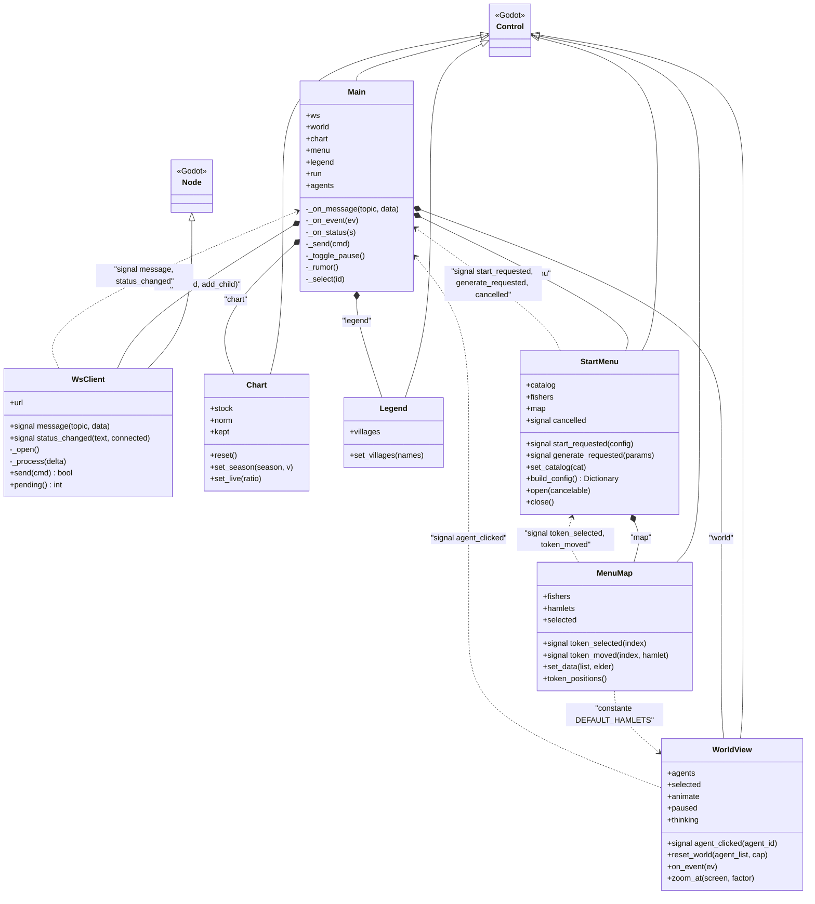
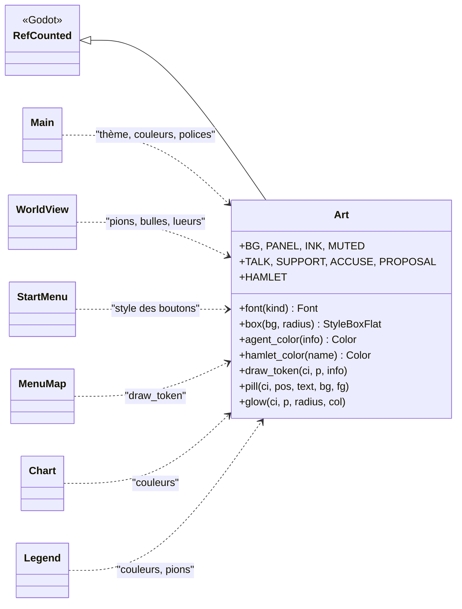
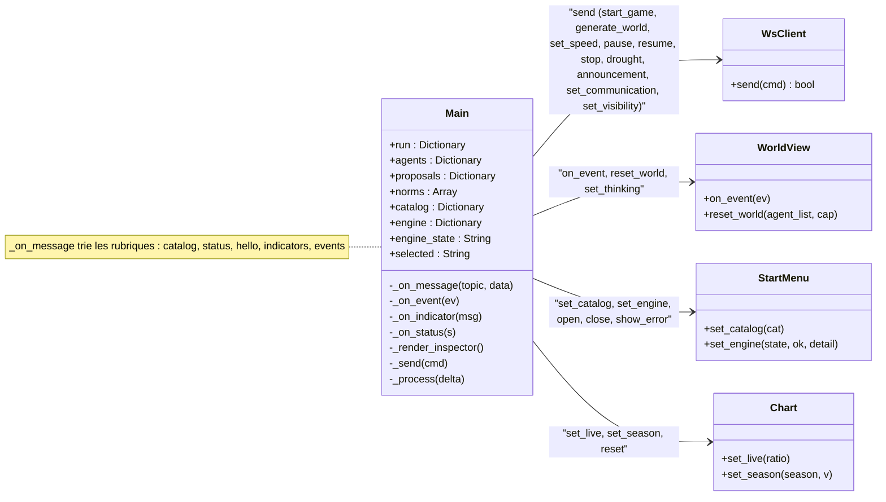

# Diagrammes de classes de l'interface Godot

L'interface Godot 4.7 ne décide de rien : elle affiche ce que le moteur Python publie et lui envoie les ordres du joueur. Elle tient en huit scripts GDScript (`godot/scripts/`). En GDScript, un script est une classe : `extends` donne l'héritage, `preload(...)` puis `.new()` fait qu'un script en crée un autre (composition : l'objet créé vit et meurt avec son propriétaire), et les appels `Art.xxx(...)` sont des appels statiques (dépendance, rien n'est possédé).

Conventions de lecture : `+` = attribut ou méthode publique, `-` = privée (nom commençant par `_`). Les méthodes sont des extraits (8 au plus par classe). `Control`, `Node` et `RefCounted` sont des classes du moteur Godot, pas du projet.

## 1. Qui possède qui

Ce diagramme montre l'héritage des scripts vers les classes Godot et la propriété : `Main` (la scène principale) crée la carte, la courbe, la légende, le menu et le client WebSocket ; le menu crée à son tour sa mini-carte. Les flèches pointillées étiquetées « signal » vont de l'émetteur vers celui qui l'écoute : c'est ainsi que le menu et la carte remontent les actions du joueur à `Main`.

Dans le code :
- `godot/scripts/main.gd:8` (`extends Control`), `:10-14` (les cinq `preload`), `:24-27` et `:45` (attributs `ws`, `world`, `chart`, `menu`, `legend`).
- `godot/scripts/main.gd:109` et `:130-132` (création de `ws`, `add_child(ws)`, `ws.message.connect(_on_message)`) ; `:375` (`WorldView.new()`) ; `:436` (`Chart.new()`) ; `:546` (`Legend.new()`) ; `:550` (`StartMenu.new()`).
- `godot/scripts/main.gd:377` (`world.agent_clicked.connect(_select)`), `:552-554` (`menu.start_requested`, `menu.generate_requested`, `menu.cancelled`).
- `godot/scripts/ws_client.gd:3` (`extends Node`), `:5-6` (signaux), `:58` (`send`), `:65` (`pending`).
- `godot/scripts/world_view.gd:15` (`extends Control`), `:17` (signal), `:1075` (`reset_world`), `:1167` (`on_event`), `:272` (`zoom_at`) ; attributs `:70-91`.
- `godot/scripts/chart.gd:3`, `:18`, `:29`, `:49` ; `godot/scripts/legend.gd:3`, `:8`.
- `godot/scripts/start_menu.gd:10` (`extends Control`), `:12` (`preload` de `MenuMap`), `:14-16` (signaux), `:624-626` (`map = MenuMap.new()` et connexion des signaux), `:650` (`set_catalog`), `:1377` (`build_config`), `:1417` (`open`), `:1424` (`close`).
- `godot/scripts/menu_map.gd:3`, `:5` (`preload` de `world_view.gd`, alias `WV`), `:7-8` (signaux), `:31` (`set_data`), `:63` (`token_positions`), `:11` (`hamlets = WV.DEFAULT_HAMLETS`).

Simplifié : seuls les attributs et méthodes qui servent à comprendre les liaisons sont listés (`main.gd` compte environ 60 attributs et 70 méthodes, `world_view.gd` plus de 100 méthodes de dessin et d'itinéraires). Les nœuds standards créés à la volée (`Label`, `Button`, `RichTextLabel`, `TabContainer`…) sont omis.

## 2. Le rôle d'`Art` : une dépendance statique partagée

`Art` est la seule classe nommée (`class_name Art`) : elle hérite de `RefCounted` et n'est jamais instanciée. Elle rassemble les couleurs (constantes), les polices et le dessin des pions, pour que les mêmes couleurs veuillent dire la même chose sur la carte, la légende, la courbe et le fil des événements. Toute classe d'affichage l'appelle directement (`Art.font`, `Art.box`, `Art.draw_token`, `Art.pill`, `Art.glow`…) : c'est une dépendance (flèche pointillée), pas une possession.

Dans le code :
- `godot/scripts/art.gd:4-5` (`class_name Art`, `extends RefCounted`) ; constantes `:8-30` ; `HAMLET` `:33` ; fonctions statiques `agent_color` `:52`, `hamlet_color` `:59`, `font` `:90`, `box` `:111`, `draw_token` `:143`, `pill` `:230`, `glow` `:259`.
- Nombre d'occurrences de `Art.` par script (mesuré) : `world_view.gd` 98, `main.gd` 66, `start_menu.gd` 37, `menu_map.gd` 12, `legend.gd` 9, `chart.gd` 6. Exemples : `main.gd:159` (`Art.font("ui")` dans `_make_theme`), `menu_map.gd:2` (en-tête : « mêmes pions que dans le jeu (`Art.draw_token`) »), `world_view.gd:1479` (`Art.draw_token` pour la patrouille).

## 3. La classe `Main` en détail : ce qu'elle garde, ce qu'elle envoie

`Main` reconstruit tout l'état affiché à partir des messages reçus (identique en direct et en rejeu) et ne le déduit jamais d'elle-même. Ce diagramme sépare l'état qu'elle tient (dictionnaires reconstruits depuis les événements) des appels qu'elle fait vers ses quatre collaborateurs. Les commandes envoyées au moteur sont de simples dictionnaires JSON `{"type": ...}`, pas des classes : elles sont listées dans l'étiquette de la flèche vers `WsClient`.

Dans le code :
- Commandes : `godot/scripts/main.gd:336` et `:342` (`set_speed`, `"max"`), `:511` (`drought`), `:521` (`set_communication`), `:527` (`set_visibility`), `:567` (`stop`), `:590` (`pause`/`resume`), `:599` (`start_game`), `:604` (`generate_world`), `:704` (`announcement`, la rumeur).
- Aiguillage : `godot/scripts/main.gd:729-755` (`_on_message`), `:757` (`_on_event`), `:1122` (`_on_indicator`), `:608` (`_on_status`), `:1379` (`_render_inspector`, la fiche d'un agent), `:1542` (`_process`).
- Appels vers les autres classes : `main.gd:763` (`world.on_event`), `:1079` (`chart.set_live`), `:1158` (`chart.set_season`), `:1175` (`world.reset_world`), `:1181` (`legend.set_villages`), `:732` (`menu.set_catalog`), `:621` (`menu.set_engine`), `:614` (`world.set_thinking`).
- Variables d'état : `main.gd:58-66`, `:85-89`.
