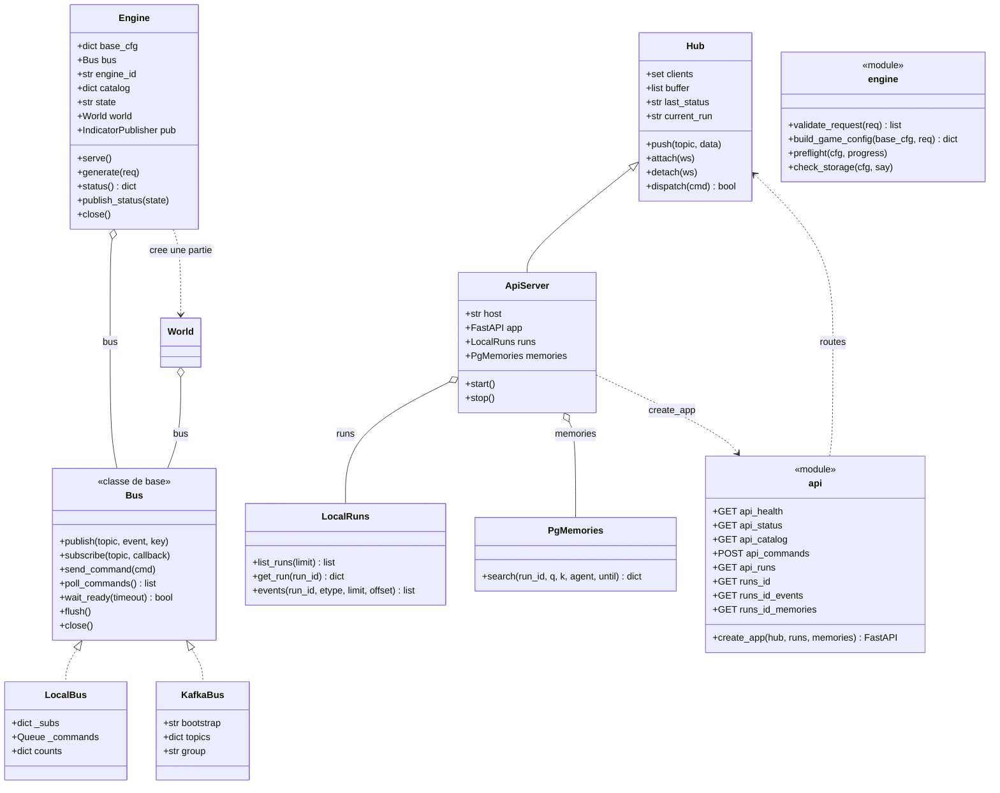
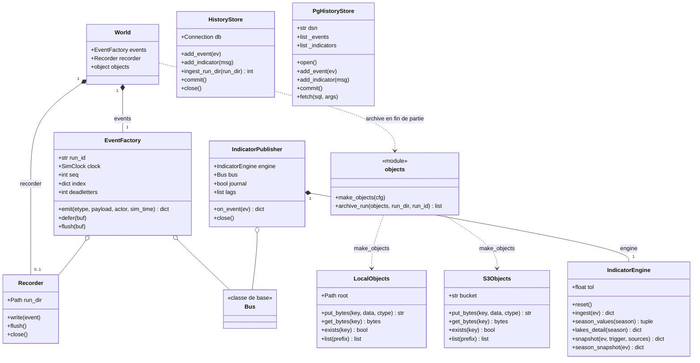
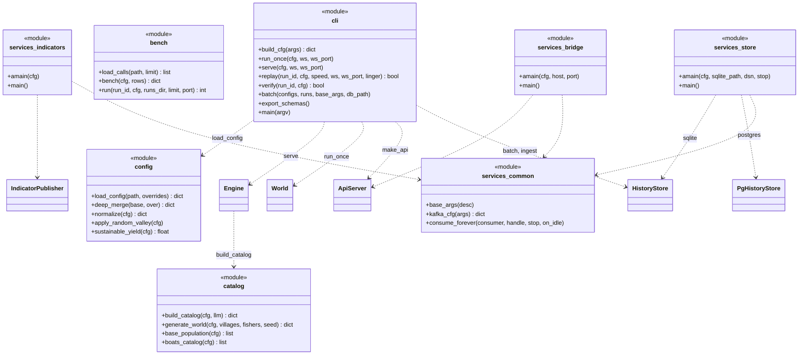

# Infrastructure : salon, API, bus, événements, indicateurs, stockage

Cette partie est tout ce qui **entoure la simulation** : le salon qui lance les parties (`Engine`), l'API HTTP/WebSocket
qui parle à l'interface Godot, le bus par lequel passent les événements, l'enregistrement de ces événements, le calcul des
indicateurs (KPI) et le stockage de l'historique. Les fichiers de fonctions (`api.py` pour ses routes, `cli.py`, `config.py`,
`catalog.py`, `bench.py`, `services/`) sont montrés comme `<<module>>`.

## 1. Le salon, l'API et le bus

`Engine` est la boucle du salon : il attend une demande de partie, construit la configuration, crée un `World` et publie son
état. L'`ApiServer` (un `Hub` + FastAPI) relaie les messages vers les clients WebSocket et reçoit les commandes. Le bus
(`LocalBus` en local, `KafkaBus` en mode distribué) transporte événements et commandes ; `Bus` est le contrat commun.

Dans `cli.py`, `serve` crée le bus et l'`ApiServer` puis donne la commande reçue à l'`Engine`. En mode Kafka, l'API et le
pont (`services/bridge.py`) tournent dans un autre processus que le moteur.

**Pour aller plus loin**
- `filets/engine.py:304` (`Engine`), `:44` (`validate_request`), `:152` (`build_game_config`)
- `filets/api.py:173` (`Hub`), `:422` (`ApiServer`), `:312` (`create_app` et routes), `:80` (`LocalRuns`), `:134` (`PgMemories`)
- `filets/bus.py:40` (`Bus`), `:50` (`LocalBus`), `:106` (`KafkaBus`), `:177` (`make_bus`)

## 2. Événements, indicateurs et stockage

Tout ce qui se passe est un **événement** : `EventFactory` les fabrique (numérotés, horodatés), les envoie sur le bus et les
écrit via le `Recorder` dans `runs/<run>/events.jsonl`. `IndicatorPublisher` écoute le bus, nourrit un `IndicatorEngine` qui
calcule les KPI (Gini, stock, quotas…) et les republie. L'historique de plusieurs parties va dans une base (`HistoryStore`
SQLite ou `PgHistoryStore` PostgreSQL) ; les fichiers volumineux vont au stockage objet (`LocalObjects` ou `S3Objects`).

`IndicatorPublisher` vit dans `pipeline.py` (et non dans `indicators.py`, qui ne contient que `IndicatorEngine`). Le schéma
de chaque événement est dans `schemas.py`. `LocalObjects` et `S3Objects` ont les mêmes méthodes sans classe commune.

**Pour aller plus loin**
- `filets/events.py:35` (`EventFactory`), `:14` (`Recorder`) ; `filets/schemas.py` (un schéma par événement)
- `filets/pipeline.py:16` (`IndicatorPublisher`) ; `filets/indicators.py:36` (`IndicatorEngine`)
- `filets/store.py:76` (`HistoryStore`) ; `filets/pgstore.py:71` (`PgHistoryStore`)
- `filets/objects.py:36` (`LocalObjects`), `:76` (`S3Objects`), `:119` (`make_objects`), `:135` (`archive_run`)

## 3. Services, configuration, catalogue, ligne de commande

Les modules de service (`services/`) sont des processus séparés du mode Kafka : l'un calcule les indicateurs, l'autre range
l'historique, le dernier relie le bus à l'interface. Chacun a une fonction `main` et une boucle `amain`. `config.py` charge
et normalise la configuration YAML ; `catalog.py` fabrique le menu de démarrage ; `cli.py` expose les commandes
(`run`, `serve`, `replay`, `verify`, `batch`, `schemas`…) ; `bench.py` rejoue des appels enregistrés pour comparer des modèles.

**Pour aller plus loin**
- `filets/cli.py:359` (`main`), `:86` (`run_once`), `:131` (`serve`), `:162` (`replay`), `:219` (`verify`)
- `filets/config.py:26` (`load_config`), `:64` (`normalize`) ; `filets/catalog.py:145` (`build_catalog`)
- `filets/bench.py:48` (`bench`), `:77` (`run`)
- `filets/services/indicators.py:20`, `store.py:43`, `bridge.py:23` (les trois `amain`) ; `services/_common.py:26`
