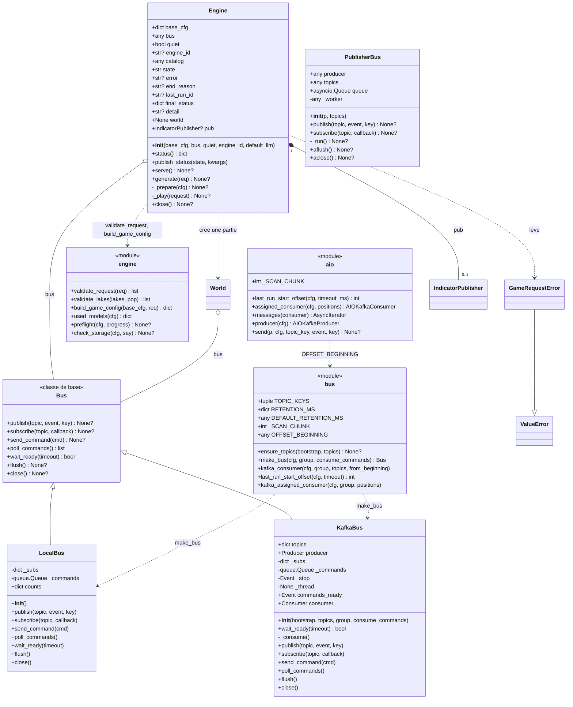
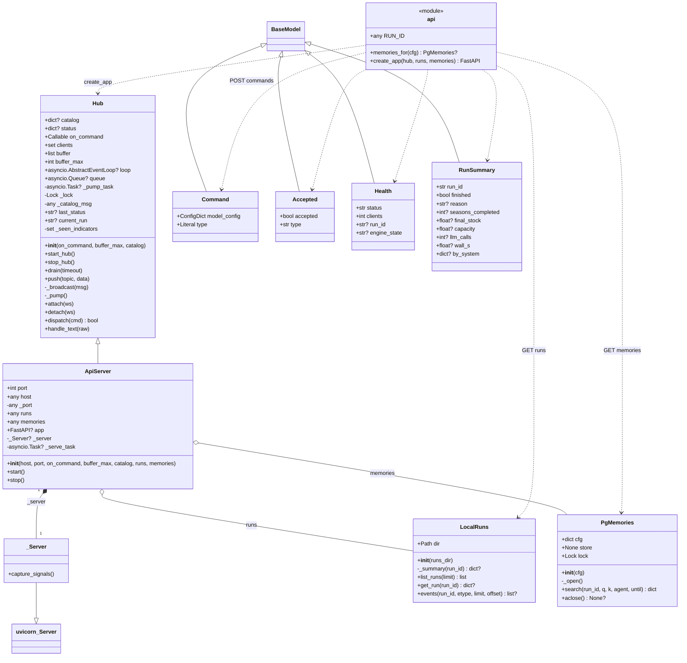
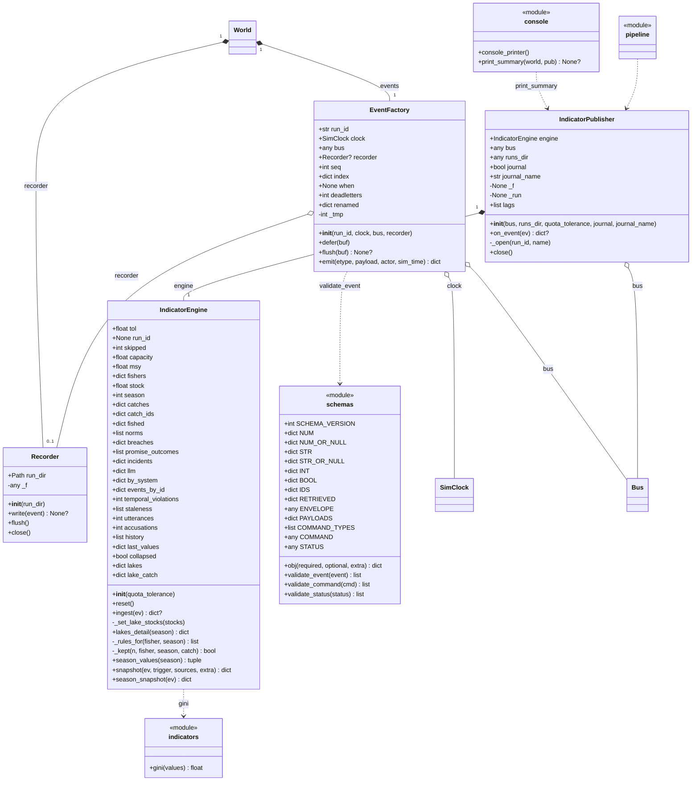
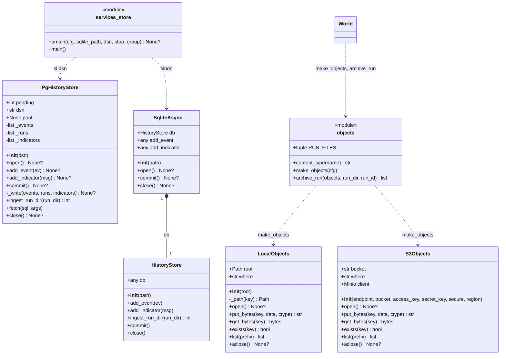
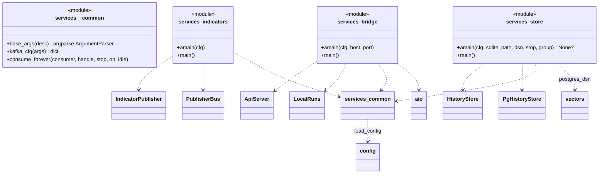
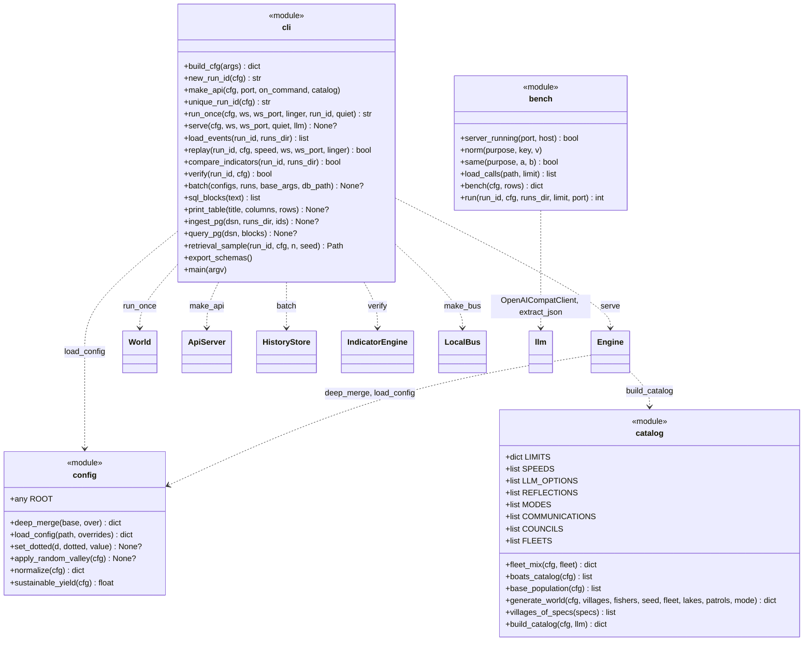

# Infrastructure : salon, API, bus, événements, indicateurs, stockage

Cette partie est tout ce qui **entoure la simulation** : le salon qui lance les parties (`Engine`), l'API HTTP/WebSocket qui parle à
l'interface Godot, le bus qui transporte les événements, leur enregistrement, le calcul des indicateurs (KPI) et le stockage.
Les fichiers de fonctions (`api.py` pour ses routes, `cli.py`, `config.py`, `catalog.py`, `bench.py`, `services/`) sont montrés
comme `<<module>>`. Même légende que `classes-monde.md`.

Fichiers Python couverts ailleurs : `world.py`, `lake.py`, `lakes.py`, `rules.py`, `climate.py`, `clock.py`, `control.py`, `scheduler.py`,
`profiles.py`, `agents.py` (voir `classes-monde.md`) ; `policies.py`, `routing.py`, `prompts.py`, `llm.py`, `scripted.py`, `memory.py`, `rag.py`,
`vectors.py` (voir `classes-decisions.md`). Les paquets `__init__.py` ne contiennent que la version (`__version__`) ou une docstring.

## 1. Le salon et le bus

`Engine` est la boucle du salon : il attend une demande de partie, construit la configuration, crée un `World` et publie son état. Le bus (`LocalBus` en local, `KafkaBus` distribué) transporte événements et commandes ; `Bus` est le contrat commun. `PublisherBus` (`aio.py`) est le même contrat pour les services asynchrones, sans hériter de `Bus`.

**Pour aller plus loin**
- `filets/engine.py:304` (`Engine`)
- `filets/engine.py:44` (`validate_request`)
- `filets/engine.py:152` (`build_game_config`)
- `filets/bus.py:40` (`Bus`)
- `filets/bus.py:50` (`LocalBus`)
- `filets/bus.py:106` (`KafkaBus`)
- `filets/bus.py:177` (`make_bus`)
`filets/aio.py:103` (`PublisherBus`)

## 2. L'API HTTP / WebSocket (`api.py`)

`Hub` partage entre tous les clients le catalogue, le dernier état, l'historique du run et les abonnés en direct ; `ApiServer` y ajoute le serveur FastAPI. Les routes (`/api/health`, `/api/status`, `/api/catalog`, `/api/commands`, `/api/runs`, `/api/runs/{id}`, `/api/runs/{id}/events`, `/api/runs/{id}/memories`, et le WebSocket) sont définies dans `create_app`. `Command`, `Accepted`, `Health`, `RunSummary` sont les modèles Pydantic des échanges.

**Pour aller plus loin**
- `filets/api.py:173` (`Hub`)
- `filets/api.py:422` (`ApiServer`)
- `filets/api.py:312` (`create_app`)
- `filets/api.py:80` (`LocalRuns`)
- `filets/api.py:134` (`PgMemories`)
- `filets/api.py:46` (`Command`)

## 3. Événements et indicateurs

Tout ce qui se passe est un **événement** : `EventFactory` les fabrique (numérotés, horodatés, validés par `schemas.py`), les envoie sur le bus et les écrit via `Recorder` dans `runs/<run>/events.jsonl`. `IndicatorPublisher` (dans `pipeline.py`) écoute le bus et nourrit un `IndicatorEngine` qui calcule les KPI, puis les republie. `console.py` affiche les événements et le bilan en texte.

**Pour aller plus loin**
- `filets/events.py:35` (`EventFactory`)
- `filets/events.py:14` (`Recorder`)
`filets/pipeline.py:16` (`IndicatorPublisher`)
`filets/indicators.py:36` (`IndicatorEngine`)
- `filets/schemas.py:234` (`validate_event`)
`filets/console.py:5` (`console_printer`)

## 4. Stockage : historique et objets

L'historique de plusieurs parties va dans une base : `HistoryStore` (SQLite) ou `PgHistoryStore` (PostgreSQL). `_SqliteAsync` (dans `services/store.py`) donne à SQLite la même interface asynchrone que `PgHistoryStore`. Les fichiers volumineux vont au stockage objet : `LocalObjects` (disque) ou `S3Objects` (MinIO/S3), qui ont les mêmes méthodes sans classe commune.

**Pour aller plus loin**
`filets/store.py:76` (`HistoryStore`)
`filets/pgstore.py:71` (`PgHistoryStore`)
- `filets/objects.py:36` (`LocalObjects`)
- `filets/objects.py:76` (`S3Objects`)
- `filets/objects.py:119` (`make_objects`)
- `filets/objects.py:135` (`archive_run`)
`filets/services/store.py:26` (`_SqliteAsync`)

## 5. Services du mode distribué (`services/`)

En mode Kafka, trois processus séparés du moteur : `indicators` (calcule les KPI), `store` (range l'historique), `bridge` (relie le bus à l'interface Godot par l'API). `_common` leur fournit les arguments de ligne de commande et la boucle de consommation.

**Pour aller plus loin**
- `filets/services/indicators.py:20` (`amain`)
- `filets/services/store.py:43` (`amain`)
- `filets/services/bridge.py:23` (`amain`)
- `filets/services/_common.py:26` (`consume_forever`)

## 6. Configuration, catalogue, ligne de commande et banc d'essai

`config.py` charge et normalise la configuration YAML ; `catalog.py` fabrique le menu de démarrage ; `cli.py` expose les commandes (`run`, `serve`, `replay`, `verify`, `batch`, `schemas`…) ; `bench.py` rejoue des appels enregistrés pour comparer des modèles. `__main__.py` ne fait qu'appeler `cli.main()`.

**Pour aller plus loin**
- `filets/cli.py:359` (`main`)
- `filets/cli.py:86` (`run_once`)
- `filets/cli.py:131` (`serve`)
- `filets/cli.py:162` (`replay`)
- `filets/cli.py:219` (`verify`)
- `filets/config.py:26` (`load_config`)
- `filets/config.py:64` (`normalize`)
- `filets/catalog.py:145` (`build_catalog`)
- `filets/bench.py:48` (`bench`)
- `filets/bench.py:77` (`run`)
