# Le monde et le temps

Cette partie du moteur Python décrit **ce qui existe dans la simulation** : le monde (`World`), ses lacs, ses pêcheurs, les règles
votées et le conseil du soir, puis **la façon dont le temps s'écoule** (horloge, pause, saisons, veillées). `World` est le chef
d'orchestre : il possède presque tout le reste.

Comment lire les diagrammes : `+` public, `-` interne (nom commençant par `_`). Un losange plein (`*--`) veut dire « possède et fait
vivre », un losange vide (`o--`) « garde une référence », `<|--` l'héritage, `..>` « utilise ». Quand le code n'annote pas le type
d'un attribut, il est déduit de la valeur affectée (`any` si on ne peut pas savoir) ; `X?` veut dire « X ou rien » ; les types
génériques sont réduits à leur base (`dict`, `list`). Les méthodes `async` ne sont pas marquées. Rien n'est volontairement omis :
l'union des vues de `World` couvre toutes ses définitions (147 : 146 méthodes plus la propriété `boat_names`, montrée comme attribut).

## 1. `World` : structure, attributs et utilitaires

Tous les attributs de `World` (l'état de la partie) et les petites méthodes de service : identité des agents, noms, mémoire, lore,
stock des lacs. Les autres vues de `World` (sections 2 à 9) détaillent ses méthodes par domaine ; ici on voit de quoi il est fait.

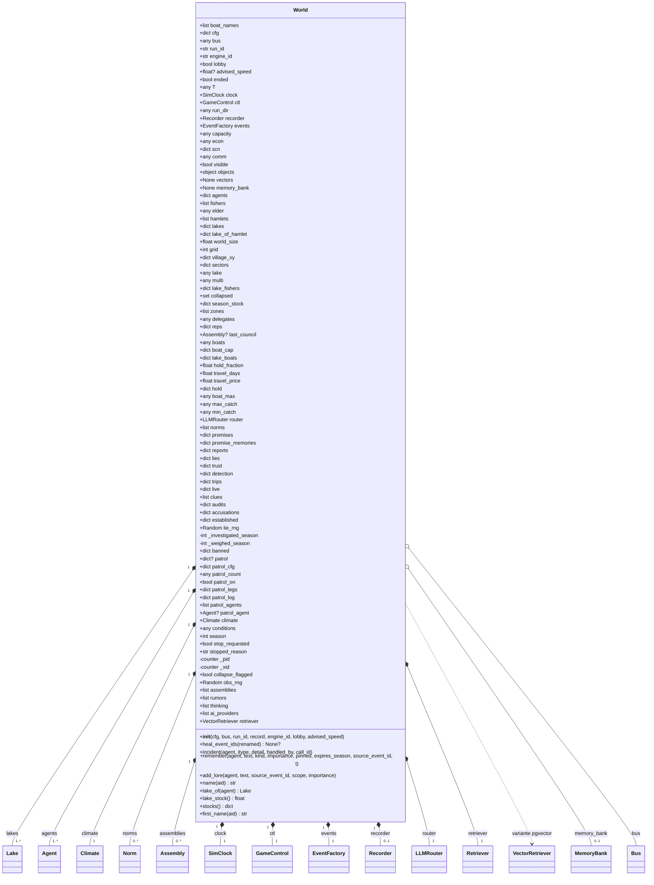

Sections suivantes : une vue de `World` par domaine.

**Pour aller plus loin**
- `filets/world.py:205` (`World`)
- `filets/agents.py:26` (`Agent`)
- `filets/lake.py:19` (`Lake`)

## 2. `World` : lacs, zones et déplacements

Où l'on pêche : les zones (rive d'un village, large), les parcelles, les options de lac qu'un pêcheur peut envisager, le coût du trajet et la mise à jour du stock d'un lac. Vue réduite à ce domaine : `World` y est montré sans ses attributs (voir la section 1).

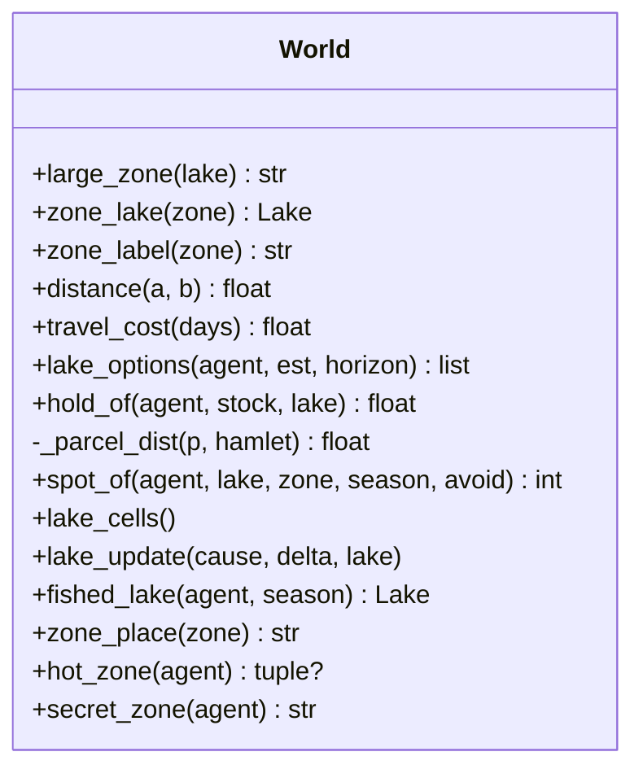

## 3. `World` : règles et normes

Les règles votées (quota, réserve, repos, sorties, bateau) : quelle règle s'applique à quel pêcheur, comment on la dit en mots, comment une proposition est lue et rapprochée d'une autre. Vue réduite à ce domaine : `World` y est montré sans ses attributs (voir la section 1).

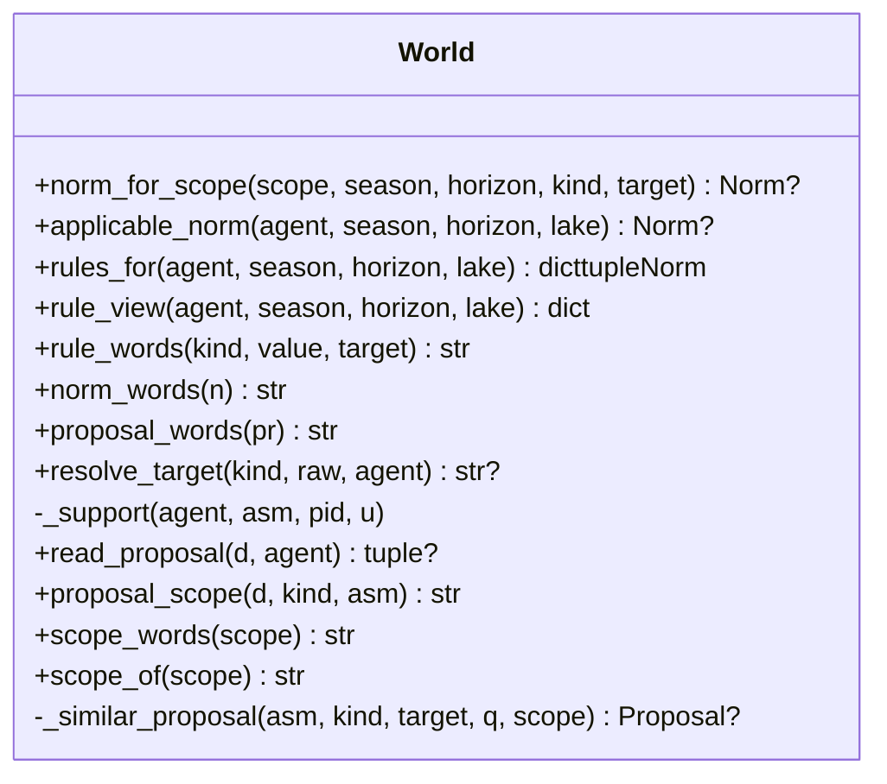

## 4. `World` : pêche, sorties et météo

Le déroulement physique de la pêche de saison : jours de sortie, météo, ouverture de la pêche (`open_trip`, d'après le plan que le pêcheur a décidé), puis, pour chaque sortie qu'il décide, départ (`start_outing`, `fishing_start` : pas de pêche la nuit), cale du bateau (`cale_of`), prise (`outing_row`), retour (`land_outing`), déclaration de ce retour (`report_outing`) et bilan de saison (`finish_trip`). Le moteur ne fait que compter et appliquer la physique ; le plan, le moment, le lieu, la quantité et la déclaration de chaque sortie viennent de la décision du pêcheur. Vue réduite à ce domaine : `World` y est montré sans ses attributs (voir la section 1).

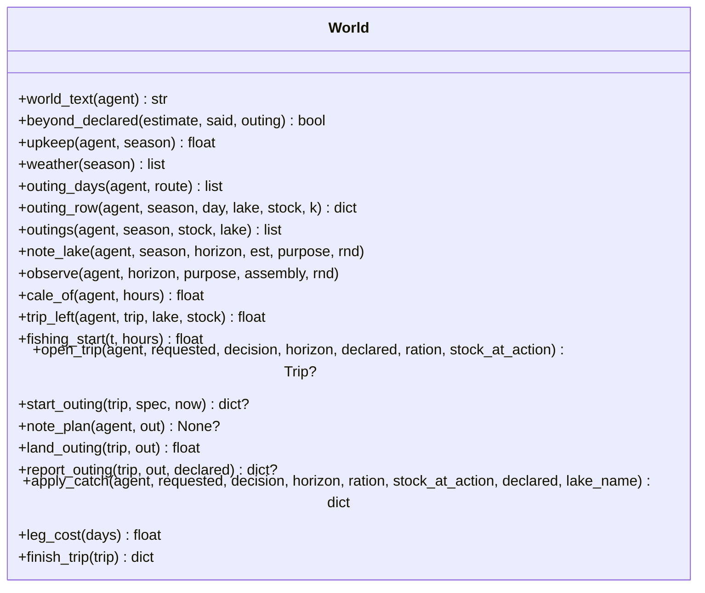

## 5. `World` : indices, mensonges, confiance et sanctions

Ce que chacun sait ou croit des autres : rumeurs, prises connues, mensonges et triche (livre des mensonges établis : `lie_words`, `lie_lines`), réputation, enquête et preuves, faits de confiance, carnet de l'agent et dossier remis avant les sanctions. Vue réduite à ce domaine : `World` y est montré sans ses attributs (voir la section 1).

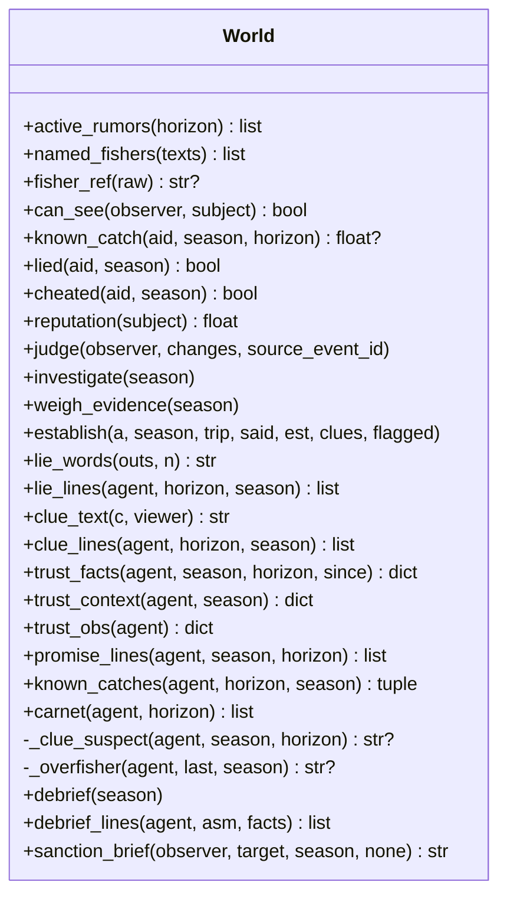

## 6. `World` : patrouille

La patrouille du lac : coût, couverture des zones, planning des tournées, soupçons, règle de répartition, rapport, et les textes que voient les agents. Vue réduite à ce domaine : `World` y est montré sans ses attributs (voir la section 1).

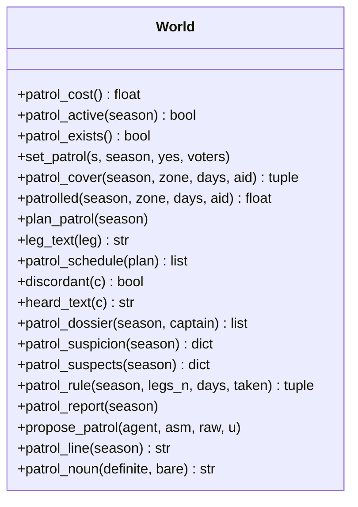

## 7. `World` : veillée, propositions et votes

Le conseil du soir : qui siège, qui parle, propositions de sanctions, votes, élection du délégué et clôture de l'assemblée. Vue réduite à ce domaine : `World` y est montré sans ses attributs (voir la section 1).

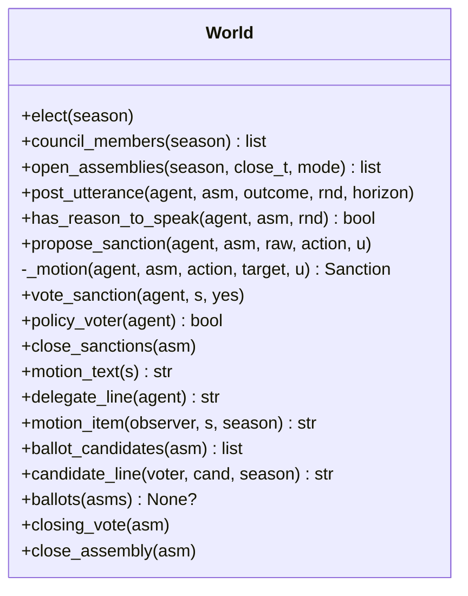

## 8. `World` : calendrier, saison, fin de saison et récit

Le temps vu par les agents (date, phase du jour, ciel), les événements programmés, le début et la fin d'une saison, la narration, le démarrage et la fin de la partie, le stockage. Vue réduite à ce domaine : `World` y est montré sans ses attributs (voir la section 1).

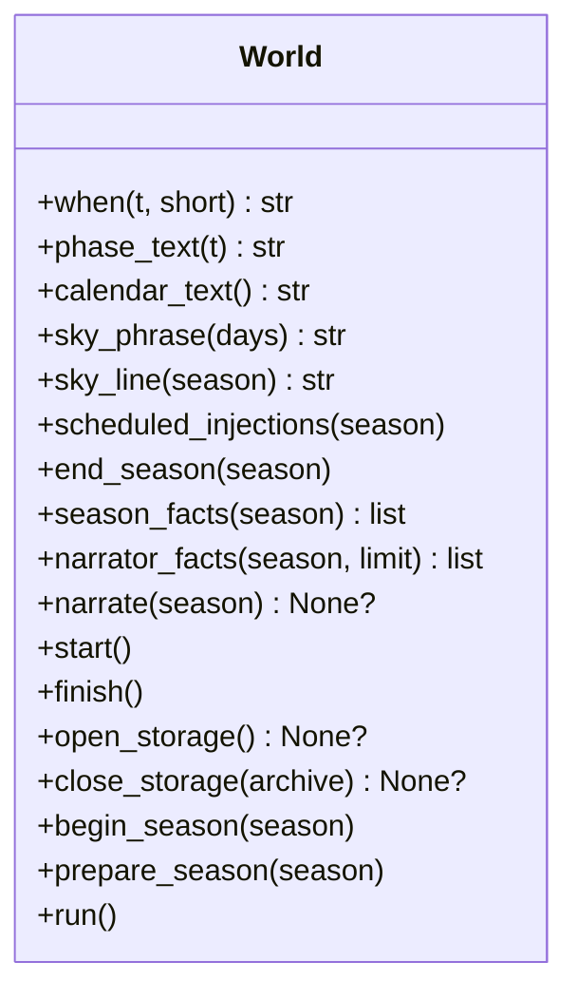

## 9. `World` : statut et commandes

La liaison avec l'extérieur : commandes reçues de l'interface (pause, vitesse, arrêt…), publication de l'état de la partie. Vue réduite à ce domaine : `World` y est montré sans ses attributs (voir la section 1).

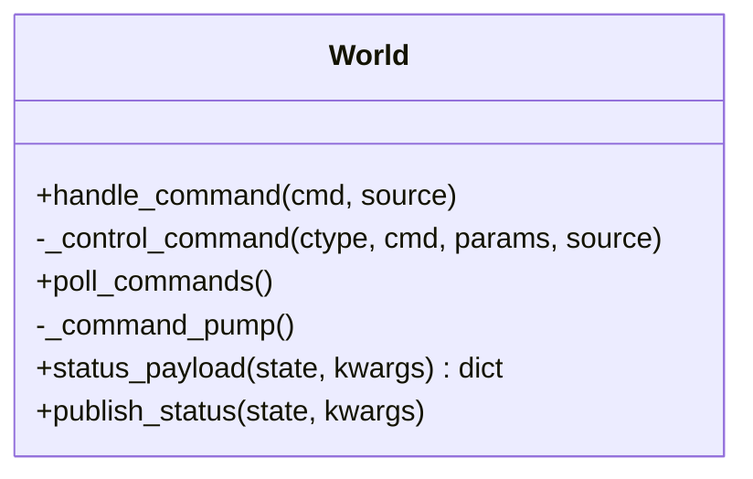

## 10. Données du conseil, du voyage et du pêcheur

`Proposal`, `Sanction`, `Assembly`, `Trip` et `Norm` sont des `dataclass` de `world.py` (`Trip` est la pêche d'un pêcheur pour toute la saison : son plan, la liste de ses sorties `outs` décidées l'une après l'autre, ce que chacune a rapporté, et le bilan à son dernier retour) ; `Agent` et `Outcome` viennent de `agents.py`,
`Profile` de `profiles.py`. Un `Norm` est une `Proposal` devenue règle après le vote (il garde son `proposal_id`). Une `Assembly`
regroupe les paroles, les propositions et les sanctions soumises au vote d'une veillée.

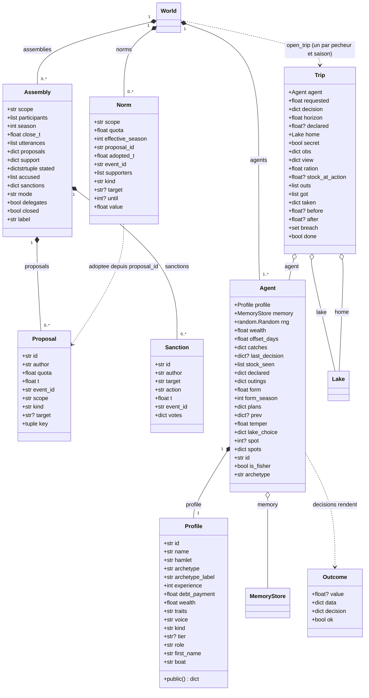

**Pour aller plus loin**
- `filets/world.py:111` (`Proposal`)
- `filets/world.py:128` (`Sanction`)
- `filets/world.py:141` (`Assembly`)
- `filets/world.py:164` (`Trip`)
- `filets/world.py:188` (`Norm`)
- `filets/agents.py:26` (`Agent`)
- `filets/agents.py:62` (`Outcome`)
- `filets/profiles.py:92` (`Profile`)

## 11. Population : fonctions de `profiles.py`

`profiles.py` construit la population de pêcheurs (profils, archétypes, bateaux) à partir de la configuration ou d'une liste
personnalisée. Ses fonctions sont regroupées en un bloc `<<module>>`.

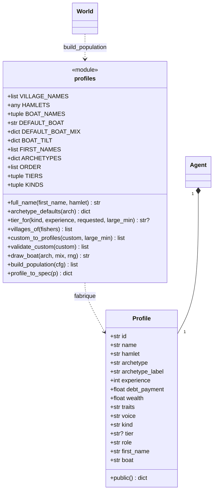

**Pour aller plus loin**
`filets/profiles.py:92` (`Profile`)
`filets/profiles.py:195` (`build_population`)

## 12. Lac, climat, règles et géographie

`Lake` porte la physique du poisson (stock par parcelle, prise, repousse, choc) ; `Climate` tire les événements climatiques et leur
effet sur la pêche. `rules.py` (types de règle) et `lakes.py` (géographie : mailles, parcelles, villages, distances) sont des
modules de fonctions, ainsi que les deux fonctions utilitaires de `world.py`.

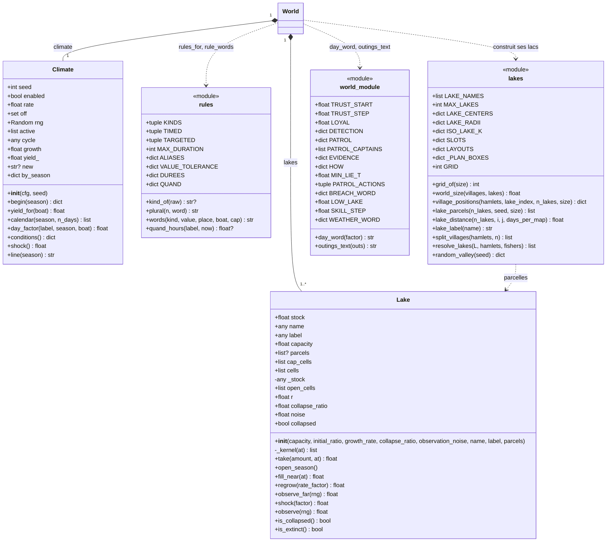

**Pour aller plus loin**
`filets/lake.py:19` (`Lake`)
`filets/climate.py:54` (`Climate`)
- `filets/lakes.py:118` (`lake_parcels`)
- `filets/lakes.py:211` (`resolve_lakes`)
- `filets/lakes.py:254` (`random_valley`)
`filets/rules.py:36` (`words`)

## 13. Horloge et pilotage

`SimClock` compte le temps simulé (en jours) et sa vitesse ; `GameControl` y ajoute pause, reprise et arrêt (`StopRun` est levée à
l'arrêt). `clock.py` offre aussi trois fonctions de mise en forme du temps.

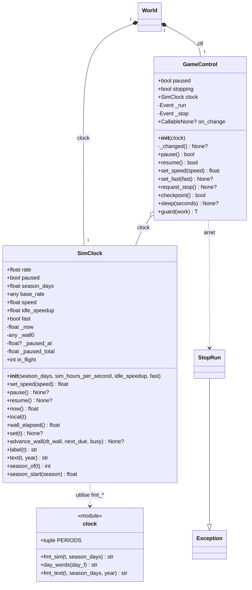

**Pour aller plus loin**
`filets/clock.py:60` (`SimClock`)
- `filets/control.py:28` (`GameControl`)
- `filets/control.py:24` (`StopRun`)

## 14. Saison, file d'événements et veillées

À chaque saison, `World` crée un `SeasonScheduler` : une file d'événements datés (départs en mer, décisions d'agents, repousse du
lac). Le soir, une `Village` joue la veillée d'un village (ou du conseil de la vallée) jusqu'à la clôture de l'`Assembly`. Le
scheduler et les veillées ne décident rien : ils ordonnent les appels de `agents.py` (voir `classes-decisions.md`) et appliquent
leurs résultats via `World`.

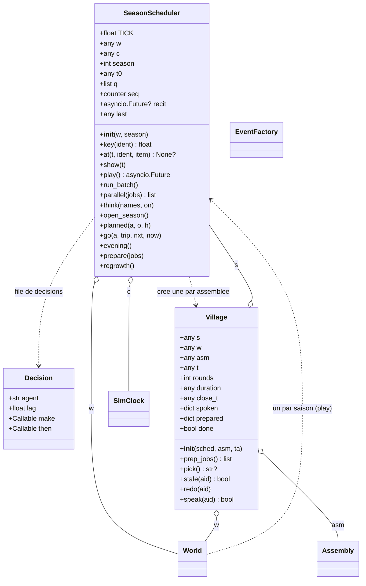

**Pour aller plus loin**
- `filets/scheduler.py:49` (`SeasonScheduler`)
- `filets/scheduler.py:41` (`Decision`)
- `filets/scheduler.py:252` (`Village`)
- `filets/world.py:3158` : une saison = un `SeasonScheduler(...).play()`
