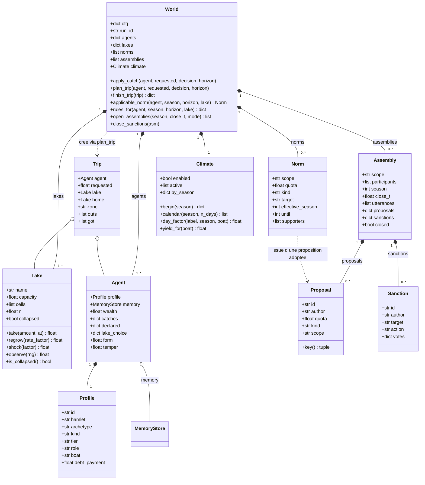
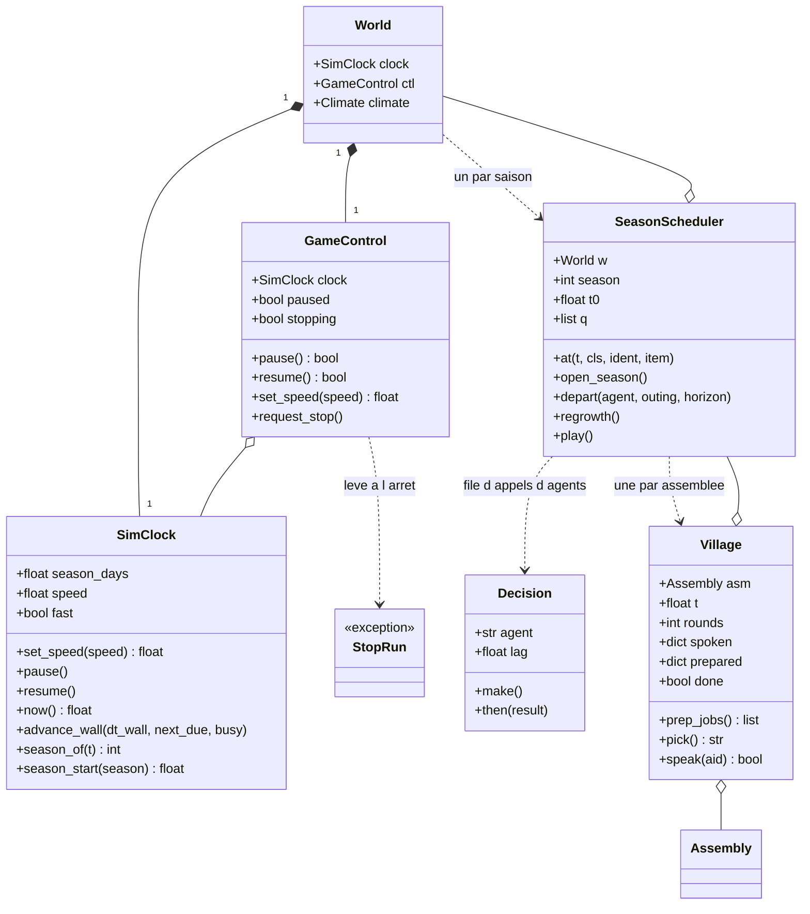
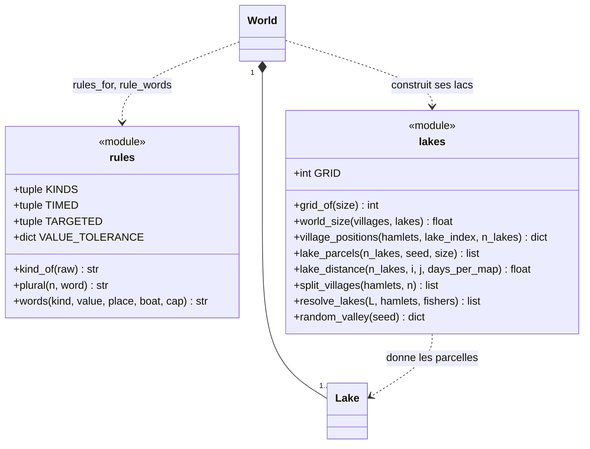

# Le monde et le temps

Cette partie du moteur Python décrit **ce qui existe dans la simulation** : le monde (`World`), ses lacs, ses pêcheurs,
les règles votées et le conseil du soir, puis **la façon dont le temps s'écoule** (horloge, pause, saisons, veillées).
`World` est le chef d'orchestre : il possède presque tout le reste. Lecture : un losange plein (`*--`) veut dire « possède et
fait vivre », un losange vide (`o--`) « garde une référence », une flèche pointillée (`..>`) « utilise ».

## 1. Le modèle du monde

`Proposal`, `Sanction`, `Assembly`, `Trip` et `Norm` sont de simples `dataclass` rangées dans `world.py` ; `Agent` est dans
`agents.py` et `Profile` dans `profiles.py`. Un `Norm` est une `Proposal` devenue règle après le vote du conseil
(il garde son `proposal_id`). `Lake` stocke le poisson par parcelle (`cells`) et applique la physique (prise, repousse, choc).

**Pour aller plus loin**
- `filets/world.py:213` (`World`), `:111` (`Proposal`), `:128` (`Sanction`), `:141` (`Assembly`), `:164` (`Trip`), `:196` (`Norm`)
- `filets/lake.py:19` (`Lake`) ; `filets/agents.py:25` (`Agent`) ; `filets/profiles.py:92` (`Profile`)
- `filets/climate.py:54` (`Climate`)

## 2. Le temps : horloge, pause, saisons et veillées

`SimClock` compte le temps simulé (en jours) et sa vitesse ; `GameControl` y ajoute la pause et l'arrêt. À chaque saison,
`World` crée un `SeasonScheduler` : une file d'événements datés (départs en mer, décisions des agents, repousse du lac). Le
soir, une `Village` joue la veillée d'un village (ou du conseil de la vallée) : qui parle, qui prépare sa réponse, jusqu'à
la clôture de l'`Assembly`.

Le scheduler et les veillées ne décident rien : ils ordonnent les appels (`agents.decide_catch`, `speak`, `ballot`, voir
`classes-decisions.md`) et appliquent leurs résultats via `World`.

**Pour aller plus loin**
- `filets/clock.py:60` (`SimClock`) ; `filets/control.py:28` (`GameControl`), `:24` (`StopRun`)
- `filets/scheduler.py:46` (`SeasonScheduler`), `:38` (`Decision`), `:233` (`Village`)
- `filets/world.py:2995` : une saison = un `SeasonScheduler(...).play()`

## 3. Les règles et les lacs (modules de fonctions)

`rules.py` et `lakes.py` ne contiennent aucune classe : ce sont des **modules de fonctions** pures, représentés ici avec
`<<module>>`. `rules.py` définit les cinq types de règle que le conseil peut voter ; `lakes.py` fabrique la géographie
(mailles, parcelles de chaque lac, positions des villages, distances).

**Pour aller plus loin**
- `filets/rules.py:1` (types de règle, docstring) ; `:28` `kind_of`, `:36` `words`
- `filets/lakes.py:118` (`lake_parcels`), `:211` (`resolve_lakes`), `:254` (`random_valley`)
- `filets/world.py:46` (`from . import prompts, rules`) et `:55` (imports de `lakes`)
