# Diagrammes de communication

Un diagramme de communication (ou de collaboration) montre les mêmes échanges qu'un diagramme de séquence, mais en mettant en avant la structure : les objets sont placés dans le plan, chaque lien entre deux objets est une arête, et l'ordre des messages n'est porté que par leur numéro. Un numéro décimal (« 3.1 ») veut dire « émis pendant le traitement du message 3 » ; une lettre (« 5a », « 5b ») marque des messages envoyés en même temps ; entre crochets, la condition d'un message. La séquence montre mieux l'ordre et les blocs (`par`, `loop`, `alt`), la communication montre mieux qui parle à qui. Mermaid n'a pas ce type de diagramme : on le dessine avec un `flowchart` dont les nœuds sont les objets (« nom : Classe ») et dont les étiquettes d'arêtes sont les messages numérotés. Un nœud qui s'écrit à lui-même a une boucle sur lui-même.

Cette page reprend **tous** les scénarios de `sequences.md`, avec les mêmes objets, les mêmes messages et les mêmes découpages : (a1 à a3) démarrer une partie, (b1 à b3) la décision de prise, (c1, c2) la veillée, (d) la rumeur, (e1, e2) le rejeu avec le bus local puis avec Kafka, (f1, f2) la fin de saison et le récit, (g) le tirage d'une vallée, (h) l'arrêt. Les listes « Dans le code » de `sequences.md` donnent les `fichier:ligne` de chaque message ; chaque section ci-dessous rappelle les lignes de ses messages.

## (a1) Du clic jusqu'à la commande reçue par le moteur

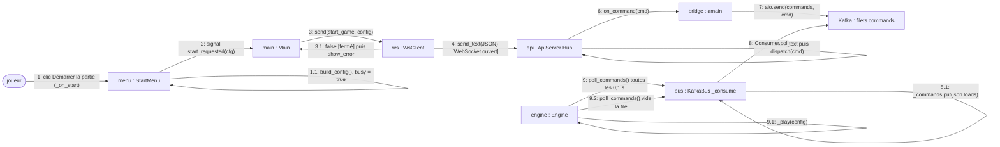

Dans le code : `godot/scripts/start_menu.gd:1402-1413`, `:1377` ; `godot/scripts/main.gd:552`, `:598-600`, `:723-726` ; `godot/scripts/ws_client.gd:58-62` ; `filets/api.py:321-335`, `:293`, `:282` ; `filets/services/bridge.py:28-30` ; `filets/aio.py:97` ; `filets/bus.py:134`, `:158` ; `filets/engine.py:348-374`, `:437`. Variante bus local : l'API reçoit `bus.send_command` (`filets/cli.py:140`), pas de pont ni de Kafka.

## (a2) Le moteur prépare, crée le monde et ouvre la partie

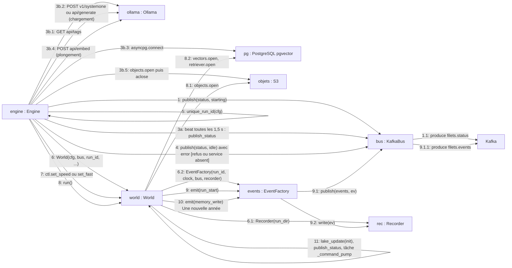

Dans le code : `filets/engine.py:437-479`, `:342`, `:152`, `:416-435`, `:207`, `:229`, `:247-259`, `:263`, `:450-461` ; `filets/cli.py:75` ; `filets/world.py:213`, `:226-233`, `:2976`, `:2918`, `:2873`, `:1732` ; `filets/events.py:71`, `:108`, `:14-28` ; `filets/bus.py:144`.

## (a3) La diffusion de `run_start`

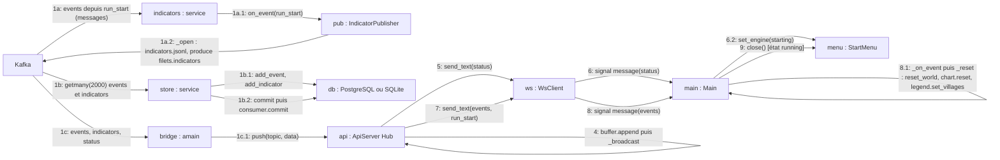

Dans le code : `filets/services/indicators.py:20-43` ; `filets/pipeline.py:28`, `:49-56` ; `filets/services/store.py:43-77` ; `filets/services/bridge.py:36-43` ; `filets/api.py:213`, `:236-266`, `:229` ; `godot/scripts/ws_client.gd:28-56` ; `godot/scripts/main.gd:729-755`, `:608-640`, `:757-762`, `:1161`, `:1175-1182`, `:629-631`.

## (b1) Ordonnancement et observation

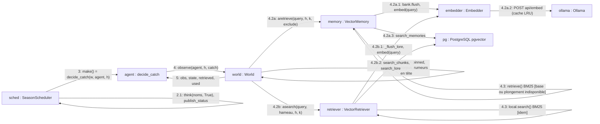

Dans le code : `filets/scheduler.py:147-158`, `:84-115`, `:117-145`, `:38-43`, `:64-67` ; `filets/world.py:1250`, `:1262-1263`, `:1279`, `:1314-1334`, `:684`, `:1200`, `:1020` ; `filets/memory.py:60`, `:119-135`, `:91` ; `filets/rag.py:179`, `:231`, `:257-272` ; `filets/vectors.py:72-95`.

## (b2) Choix système 1 ou 2 et appel du modèle

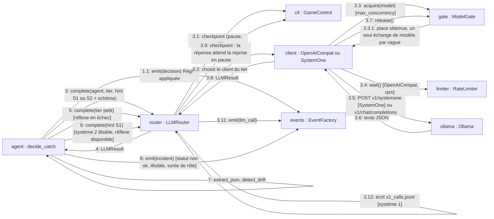

Dans le code : `filets/agents.py:144`, `:154-167`, `:170-186`, `:79-136`, `:108`, `:119`, `:139` ; `filets/routing.py:24`, `:53` ; `filets/llm.py:335-420`, `:154-237`, `:250-322`, `:44-152`, `:406` ; `filets/control.py:83`.

## (b3) Sortie : décision publiée dans l'ordre, puis prise appliquée

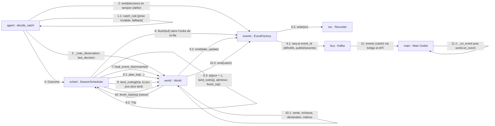

Dans le code : `filets/agents.py:187-231`, `:65-70`, `:58` ; `filets/scheduler.py:117-135`, `:160-171` ; `filets/events.py:50-69` ; `filets/world.py:387`, `:1506`, `:1559-1568`, `:544-555`, `:1570`, `:1595` ; `filets/lake.py:50` ; `godot/scripts/main.gd:757`, `:776` ; `godot/scripts/world_view.gd:1167`, `:1223`.

## (c1) La boucle de préparation et de parole

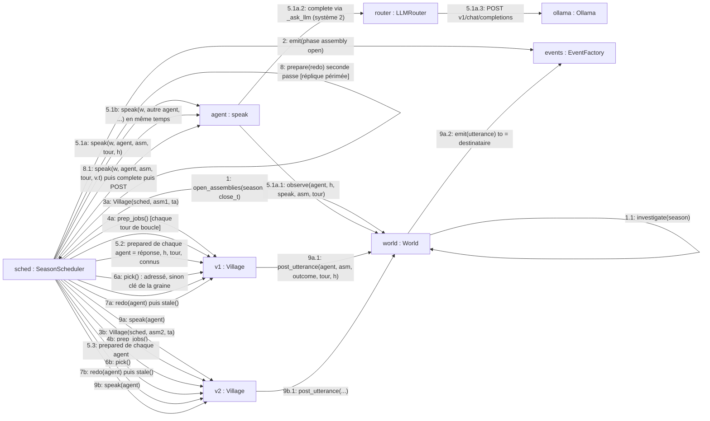

Dans le code : `filets/scheduler.py:173-211` (boucle `:187-202`), `:213-220`, `:233-302` (Village : `prep_jobs` `:245`, `pick` `:258`, `stale` `:268`, `redo` `:280`, `speak` `:289`) ; `filets/agents.py:232`, `:250` ; `filets/world.py:2039`, `:2042`, `:2162`, `:2066`, `:2073`. La boucle recommence (messages 4 à 9) jusqu'à ce qu'aucun village n'ait plus de réplique à dire.

## (c2) Les bulletins, les propositions et la clôture

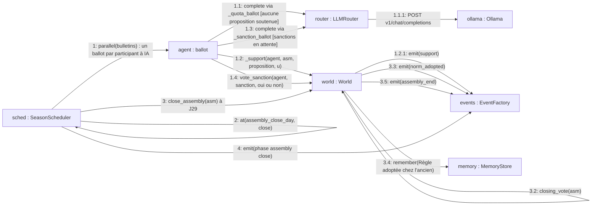

Dans le code : `filets/scheduler.py:204-211` ; `filets/agents.py:289`, `:302`, `:404` ; `filets/world.py:2285-2286`, `:2222`, `:2517`, `:2232`, `:2496`, `:2539`, `:2551`, `:2559`.

## (d) Une injection du joueur : la rumeur

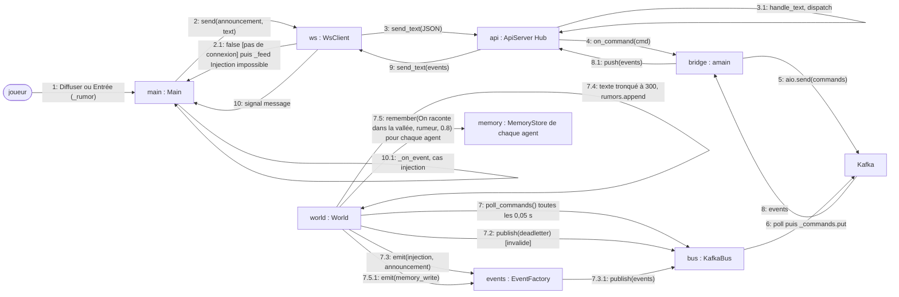

Dans le code : `godot/scripts/main.gd:537-545`, `:702-705`, `:723-726`, `:1052` ; `filets/api.py:293`, `:282` ; `filets/services/bridge.py:28` ; `filets/world.py:1732-1747`, `:1663-1667`, `:1675`, `:1688-1696`, `:399-407` ; `filets/schemas.py:246` ; `filets/memory.py:49`. Plus tard : `filets/world.py:684`, `:1328-1330` (la rumeur en tête de `retrieved`).

## (e1) Rejeu avec le bus local

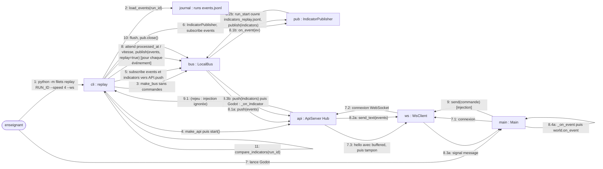

Dans le code : `filets/cli.py:5`, `:156-205`, `:402-403`, `:468-471` ; `filets/pipeline.py:28-56` ; `filets/api.py:268-277` ; `godot/scripts/main.gd:729-755`, `:757`, `:1122`.

## (e2) Rejeu avec Kafka

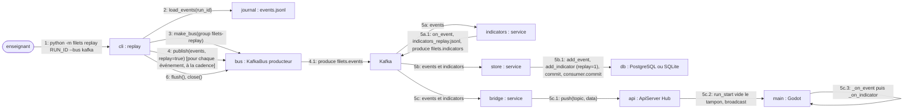

Dans le code : `filets/cli.py:165`, `:162-204` ; `filets/bus.py:177`, `:144`, `:166`, `:169` ; `filets/services/indicators.py:20-43` ; `filets/services/store.py:43-77` ; `filets/services/bridge.py:36-43` ; `filets/api.py:236-266` ; `filets/pipeline.py:30`.

## (f1) La fin de saison

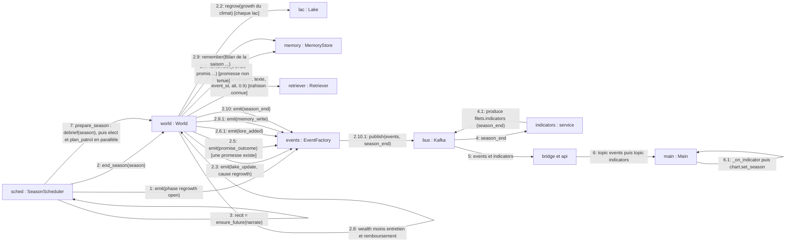

Dans le code : `filets/scheduler.py:222-231` ; `filets/world.py:2563`, `:772`, `:836`, `:544`, `:2573`, `:2577-2580`, `:409-418`, `:2582-2591`, `:2968-2974`, `:1809`, `:1771`, `:1819` ; `filets/lake.py:87` ; `filets/rag.py:167`, `:225` ; `filets/services/indicators.py:30-38` ; `godot/scripts/main.gd:1122`, `:1158`.

## (f2) Le récit du narrateur

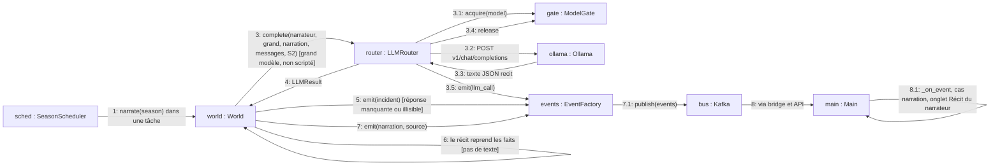

Dans le code : `filets/world.py:2747`, `:2847-2872` ; `filets/llm.py:365-420`, `:109` ; `filets/scheduler.py:227-230`.

## (g) Le tirage d'une vallée depuis le menu

```mermaid
flowchart LR
    J(["joueur"])
    SM["menu : StartMenu"]
    M["main : Main"]
    WS["ws : WsClient"]
    API["api : ApiServer Hub"]
    BR["bridge : amain"]
    K["Kafka"]
    ENG["engine : Engine"]
    CAT["catalog : generate_world"]

    J -->|"1: change un nombre ou clique Générer la vallée"| SM
    SM -->|"1.1: _on_gen_spin, _gen_timer.start"| SM
    SM -->|"1.2: _on_generate : params, id, _pending_generation"| SM
    SM -->|"2: signal generate_requested(params + id) [pas de demande en route depuis moins de 5 s]"| M
    M -->|"3: send(generate_world, config)"| WS
    WS -->|"4: send_text(JSON)"| API
    API -->|"5: on_command(cmd)"| BR
    BR -->|"6: produce filets.commands"| K
    K -->|"7: KafkaBus puis poll_commands [état idle ou ended]"| ENG
    ENG -->|"7.1: generate(req) : valide flotte, mode, bornes, villages au plus pêcheurs, lacs au plus villages"| ENG
    ENG -->|"7.2: publish status avec error [refus]"| K
    ENG -->|"7.3: generate_world(base_cfg, villages, fishers, seed, fleet, lakes, patrols, mode)"| CAT
    CAT -->|"7.3.1: random_valley(seed) [mode random], base_population, resolve_lakes"| CAT
    CAT -->|"7.4: hamlets, base_population, lakes, patrols"| ENG
    ENG -->|"7.5: catalog = ..., generation(id), publish status avec catalog"| K
    K -->|"8: status"| BR
    BR -->|"8.1: push(status)"| API
    API -->|"9: sépare le catalogue : topic catalog"| WS
    WS -->|"10: signal message(catalog)"| M
    M -->|"10.1: set_catalog(cat)"| SM
    SM -->|"10.2: remplace pêcheurs et lacs, _pending_generation vide"| SM
    API -->|"9.1: status avec error"| M
    M -->|"9.2: show_error(texte)"| SM
```

Dans le code : `godot/scripts/start_menu.gd:1313-1323`, `:1336-1354`, `:569`, `:650`, `:641`, `:1171` ; `godot/scripts/main.gd:603-605`, `:729-737` ; `filets/engine.py:360-374`, `:376-414` ; `filets/catalog.py:119-142`, `:145` ; `filets/lakes.py:254` ; `filets/api.py:213-224`, `:236-247`.

## (h) L'arrêt d'une partie

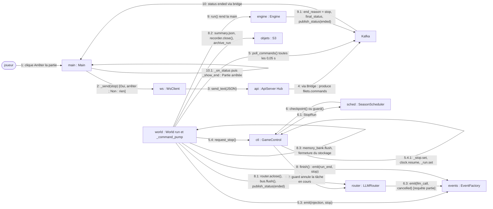

Dans le code : `godot/scripts/main.gd:358`, `:560`, `:594-596`, `:562-568`, `:645-662` ; `filets/world.py:1663`, `:1698-1704`, `:2976-3010`, `:2900`, `:2926`, `:2931` ; `filets/control.py:24`, `:75`, `:83`, `:107` ; `filets/llm.py:384-396` ; `filets/engine.py:458-479`.
