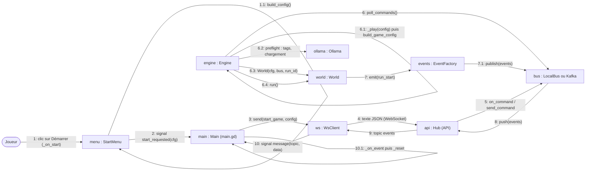
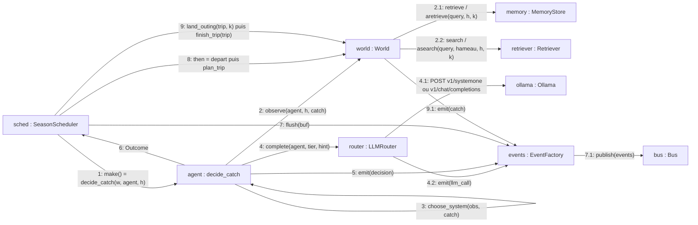
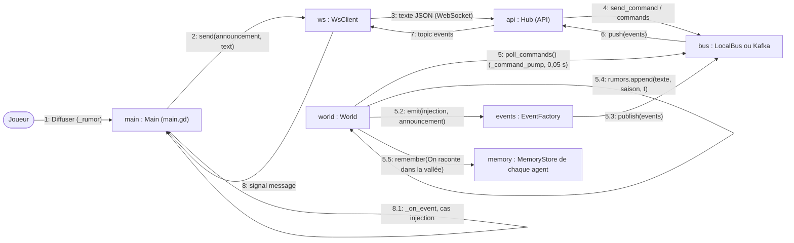

# Diagrammes de communication (collaboration)

Un diagramme de communication montre les mêmes échanges qu'un diagramme de séquence, mais autrement : les objets sont placés dans le plan, les liens entre eux sont les arêtes, et l'ordre des messages n'est porté que par leur numéro (« 1 », « 1.1 », « 2 »…, un numéro décimal signifie « fait partie de l'appel précédent »). On y voit d'un coup d'œil qui parle à qui (la structure), alors que la séquence montre mieux l'ordre et les blocs parallèles (`par`, `loop`, `alt`). Mermaid n'a pas ce type de diagramme : on le dessine avec un `flowchart` dont les nœuds sont les objets et dont les étiquettes d'arêtes sont les messages numérotés. Un nœud qui s'envoie un message à lui-même a une boucle sur lui-même.

Les trois scénarios sont ceux de `sequences.md` : (a) démarrer une partie, (b) la décision de prise, (d) la rumeur du joueur. Les références `fichier:ligne` se trouvent dans `sequences.md` (mêmes messages) ; chaque section ci-dessous donne les lignes de ses propres messages.

## (a) Démarrer une partie depuis le menu

Les objets sont ceux de la séquence (a). Le trajet aller est en haut (de « Joueur » vers « Engine »), le trajet retour (l'événement `run_start`) revient par le bus et l'API jusqu'à `main.gd`. Le lien le plus chargé est celui entre `Engine` et `World` (création, puis `run`).

Dans le code :
- Messages 1, 1.1, 2 : `godot/scripts/start_menu.gd:1402` (`_on_start`), `:1377` (`build_config`), `:1413` (`start_requested.emit`).
- Messages 3 et 4 : `godot/scripts/main.gd:598-600`, `godot/scripts/ws_client.gd:58-62` ; `filets/api.py:321-335`, `:293` (`handle_text`), `:282` (`dispatch`).
- Message 5 : `filets/bus.py:65` (`LocalBus.send_command`, utilisé par `filets/cli.py:140`) ; avec Kafka `filets/services/bridge.py:28-30` (`on_command`).
- Message 6 et sous-messages : `filets/engine.py:348-362` (`serve`), `:437` (`_play`), `:152` (`build_game_config`), `:207` (`preflight`, `GET /api/tags` `:229`), `:416` (`_prepare`), `filets/world.py:213` (`World.__init__`), `:2976` (`run`).
- Messages 7 et 7.1 : `filets/world.py:2873` (`start`), `filets/events.py:71` (`emit`), `:108` (`bus.publish`).
- Messages 8 à 10.1 : `filets/api.py:213` (`push`), `:236` (`_pump`) ; `godot/scripts/main.gd:132`, `:729` (`_on_message`), `:757` (`_on_event`), `:1161` (`_reset`).

## (b) La décision de prise d'un pêcheur

Ici le centre du schéma est l'objet `agent : decide_catch`, qui échange avec quatre voisins : le monde (observation), le routeur de modèles (appel d'Ollama), la fabrique d'événements (traces) et l'ordonnanceur (qui le lance et reçoit son résultat). Les messages 7 et 8 se passent plus tard dans le temps simulé (une sortie dure un jour) : la numérotation, pas la position, le dit.

Dans le code :
- Message 1 : `filets/scheduler.py:147-158` (`open_season`), `:100-115` (`run_batch`), `:117-135` (`parallel`), `filets/agents.py:144` (`decide_catch`).
- Message 2 et sous-messages : `filets/world.py:1250` (`observe`), `:1314-1321` (`retrieve` / `search`, ou `aretrieve` / `asearch` avec PostgreSQL), `filets/memory.py:60`, `:75`, `filets/rag.py:179`, `:194`.
- Message 3 : `filets/agents.py:170` (`routing.choose_system`), `filets/routing.py:53`.
- Messages 4 à 4.2 : `filets/agents.py:79-136` (`_ask_llm`, `world.router.complete` `:108`), `filets/llm.py:365` (`LLMRouter.complete`), `:176` et `:269` (clients), `:406` (`llm_call`).
- Message 5 et 6 : `filets/agents.py:154-167` (règles), `:222-229` (IA), `filets/agents.py:58` (`Outcome`).
- Messages 7 et 7.1 : `filets/scheduler.py:131-135` (`flush`), `filets/events.py:59-69`.
- Messages 8, 9 et 9.1 : `filets/scheduler.py:160-171` (`depart`), `filets/world.py:1506` (`plan_trip`), `:1559` (`land_outing`), `:1570` (`finish_trip`, `emit(catch)` `:1595`).

Simplifié : les branches alternatives de la séquence (agent à règles, repli, reprise par le réflexe) ne sont pas dessinées : un diagramme de communication ne porte pas de `alt`. L'affichage dans Godot (événement `catch` → `world.on_event`) est omis, il suit le chemin du scénario (a), messages 8 à 10.1.

## (d) Une injection du joueur : la rumeur

Même chemin que le démarrage jusqu'au bus, puis le `World` en cours de partie lit la commande (message 5). C'est lui qui la transforme en événement, en rumeur et en souvenirs ; le retour vers Godot (messages 6 à 8.1) est identique à celui de (a).

Dans le code :
- Messages 1 et 2 : `godot/scripts/main.gd:702-705` (`_rumor`), `:723-726` (`_send`), `godot/scripts/ws_client.gd:58`.
- Messages 3 et 4 : `filets/api.py:293`, `:282` ; `filets/bus.py:65` ; `filets/services/bridge.py:28`.
- Message 5 et sous-messages : `filets/world.py:1732-1747` (`_command_pump`), `:1728` (`poll_commands`), `:1663-1667` (`handle_command`, `validate_command`), `:1675` (`emit(injection)`), `:1688-1696` (branche `announcement`, `rumors.append`, `remember` `:399`).
- Messages 6 à 8.1 : `filets/api.py:213`, `:236` ; `godot/scripts/main.gd:729`, `:757`, `:1052` (cas `injection`).

Simplifié : la branche « commande invalide » (publication sur le topic `deadletter`) et l'échec d'envoi côté Godot (« Injection impossible : pas de connexion au pont ») sont décrits dans `sequences.md`, pas ici.
