# Diagrammes de séquence

Un diagramme de séquence se lit de haut en bas : l'ordre des appels descend, chaque colonne est un objet du code. Une flèche pleine `->>` est un appel, une flèche pointillée `-->>` une réponse ou un signal. Les blocs `par` montrent des appels qui se font en même temps, `loop` une répétition, `alt` un choix, `opt` une étape facultative. Les notes `Note` rappellent l'autre temps, le **temps simulé** du monde (la saison dure 30 jours simulés) : réfléchir ne prend pas de temps simulé, agir en prend (`docs/temps.md`).

Huit scénarios, découpés en plusieurs diagrammes quand il y a trop de participants pour un seul : (a) démarrer une partie (a1 à a3), (b) la décision de prise d'un pêcheur (b1 à b3), (c) la veillée (c1, c2), (d) une rumeur injectée par le joueur, (e) le rejeu (e1 bus local, e2 Kafka), (f) la fin de saison, (g) le tirage d'une vallée depuis le menu, (h) l'arrêt d'une partie.

Déploiement représenté : celui de l'architecture complète (`docs/architecture.md`), avec le bus Kafka, le service `bridge` (processus séparé qui porte l'API FastAPI), les services `indicators` et `store`, PostgreSQL + pgvector, le stockage objet S3 (MinIO) et Ollama. Le bus **local** (`LocalBus`, sans Kafka) est la variante des essais rapides : le moteur ouvre lui-même l'API (`filets/cli.py:131-146`), les topics sont des listes d'abonnés en mémoire, et il calcule les indicateurs lui-même (`filets/engine.py:318-322`). Là où la variante change l'ordre des appels, le diagramme le dit.

Vocabulaire des participants : *StartMenu*, *Main* (`main.gd`), *WsClient* : scripts Godot. *ApiServer* : l'API FastAPI (`Hub` + routes, `filets/api.py`), portée par le *Bridge* (`filets/services/bridge.py`) en Kafka. *Kafka* : le courtier, avec cinq topics `filets.events`, `filets.indicators`, `filets.commands`, `filets.status`, `filets.deadletter` (`config/default.yaml:196-204`). *KafkaBus* : l'objet `bus` du moteur. *Engine* : le salon. *World* : la partie. *SeasonScheduler* : l'ordonnanceur d'une saison. *EventFactory* : fabrique et publie les événements ; *Recorder* : écrit `events.jsonl`.

## (a) Démarrer une partie depuis le menu

### a1. Du clic jusqu'à la commande reçue par le moteur

Le joueur règle sa partie dans le menu et clique sur « Démarrer la partie ». Le menu vérifie que chaque pêcheur a un prénom, fabrique le dictionnaire de configuration et le signale à `Main`, qui l'envoie en commande JSON `start_game` par WebSocket. L'API la transmet au pont, qui la dépose dans le topic Kafka `filets.commands`. Côté moteur, un fil du `KafkaBus` lit ce topic et pose la commande dans une file locale ; la boucle du salon (toutes les 0,1 s) la prend.

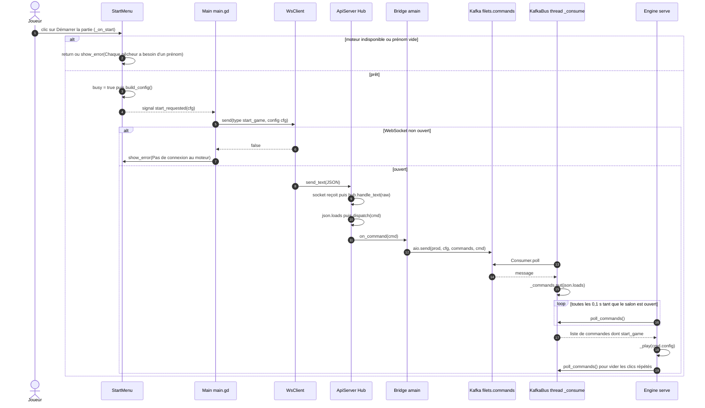

Dans le code :
- Godot : `godot/scripts/start_menu.gd:1402-1413` (`_on_start`), `:1377` (`build_config`), `:14` (signal `start_requested`) ; `godot/scripts/main.gd:552` (connexion), `:598-600` (`_on_menu_start`), `:723-726` (`_send`) ; `godot/scripts/ws_client.gd:58-62` (`send`, refus si non ouvert).
- API : `filets/api.py:321-335` (`socket`), `:293` (`handle_text`), `:282` (`dispatch`, appelle `on_command`).
- Pont : `filets/services/bridge.py:28-30` (`on_command` publie sur `commands`), `filets/aio.py:97` (`send`), `:90` (`producer`).
- Bus du moteur : `filets/bus.py:106` (`KafkaBus`), `:134` (`_consume`, fil), `:158` (`poll_commands`), `:131` (`wait_ready`, partition de commandes reçue avant d'annoncer le salon).
- Moteur : `filets/engine.py:348-374` (`serve`, `poll_commands` `:358`, `start_game` `:360`, vidage de la file après la partie), `:437` (`_play`).
- Variante bus local : `filets/cli.py:140` (`make_api(..., bus.send_command, ...)`), `filets/bus.py:65-74` (`LocalBus.send_command`, `poll_commands`) : le pont et Kafka disparaissent, l'API pose la commande directement dans la file du moteur.

### a2. Le moteur prépare, crée le monde et ouvre la partie

Le moteur annonce `starting`, construit la configuration de la partie (en validant la demande), puis vérifie et charge les modèles, la base et le stockage objet. Pendant ce temps (parfois une minute pour charger un modèle), une tâche republie l'état toutes les 1,5 s pour que Godot ne croie pas le moteur mort. Si tout est prêt, `World` est construit (horloge, contrôle, `EventFactory`, `Recorder`, `LLMRouter`, mémoires, retriever), puis `run()` ouvre le stockage et émet `run_start`.

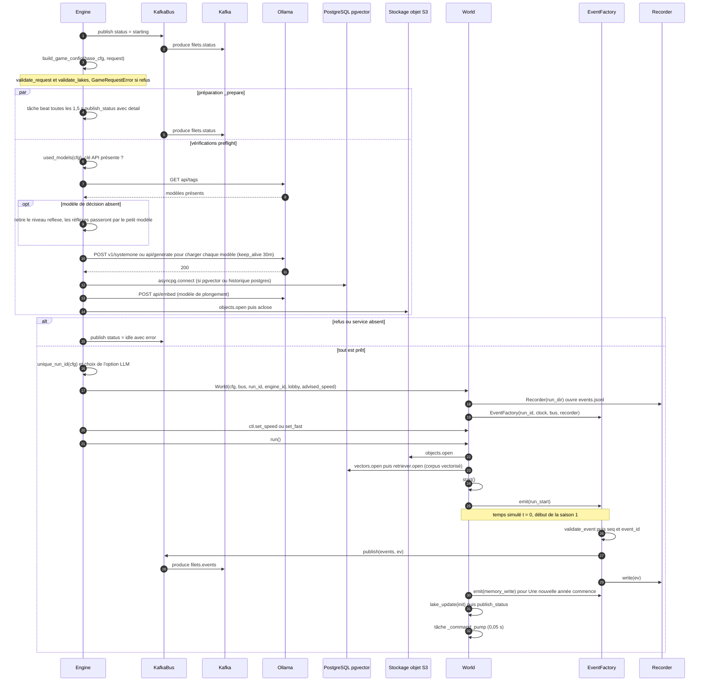

Dans le code :
- Moteur : `filets/engine.py:437-479` (`_play`), `:342-346` (`publish_status`), `:152` (`build_game_config`), `:44` (`validate_request`), `:125` (`validate_lakes`), `:416-435` (`_prepare`, tâche `beat` `:424-428`), `:207` (`preflight`, `GET /api/tags` `:229`, chargement `:247-259`), `:263` (`check_storage` : PostgreSQL, plongement, stockage objet), `filets/cli.py:75` (`unique_run_id`).
- Monde : `filets/world.py:213` (`World.__init__`), `:226-227` (`SimClock`, `GameControl`), `:230` (`Recorder`), `:233` (`EventFactory`), `:253-254` (mémoires), `:320-324` (retriever), `:325` (`LLMRouter`), `:2976` (`run`), `:2918` (`open_storage`), `:2873` (`start`), `:1732` (`_command_pump`).
- Événements : `filets/events.py:35` (`EventFactory`), `:71` (`emit`), `:108` (`bus.publish`), `:14-28` (`Recorder`) ; `filets/bus.py:144` (`KafkaBus.publish`).
- Échec : `filets/engine.py:450-461`.

### a3. La diffusion de `run_start` : services, API, Godot

Le même événement est lu par trois consommateurs Kafka indépendants : le service `indicators` (il se place sur le dernier `run_start` et publie les indicateurs dans `filets.indicators`), le service `store` (il écrit dans la base, puis valide sa position) et le pont (qui alimente le tampon de l'API). L'API ne garde que l'historique du run en cours : à `run_start` elle vide son tampon. Godot reçoit chaque message, remet son affichage à zéro à `run_start` et ferme le menu quand l'état passe à `running`.

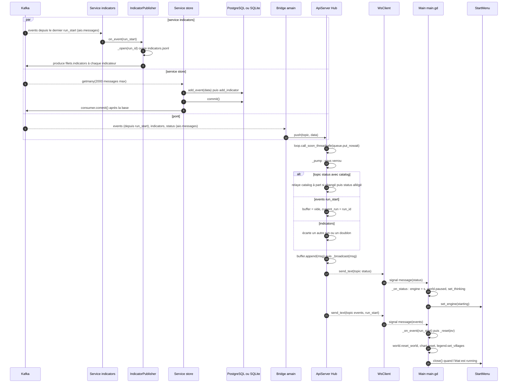

Dans le code :
- Indicateurs : `filets/services/indicators.py:20-43` (`amain`), `:30-31` (`messages`, `on_event`), `filets/pipeline.py:28` (`on_event`), `:49-56` (`_open`), `filets/aio.py:29` (`last_run_start_offset`), `:64` (`assigned_consumer`), `:81` (`messages`), `:103-135` (`PublisherBus`).
- Historique : `filets/services/store.py:43-77` (`amain`, lecture groupée `:56`, `add_event` `:64`, `commit` `:68`, `consumer.commit` `:69`), `filets/pgstore.py:88` et `filets/store.py:82` (`add_event`), `:102`/`:105` (`add_indicator`).
- Pont et API : `filets/services/bridge.py:36-43` (consommateur et `push`), `filets/api.py:213` (`push`), `:236-266` (`_pump`), `:229` (`_broadcast`).
- Godot : `godot/scripts/ws_client.gd:28-56` (`_process` lit les paquets et émet `message`), `godot/scripts/main.gd:729-755` (`_on_message`), `:608-640` (`_on_status`), `:757-762` (`_on_event`), `:1161` (`_reset`), `:1175-1182` (`reset_world`, `chart.reset`, `legend.set_villages`), `:629-631` (fermeture du menu).
- Variante bus local : `filets/engine.py:318-322` (l'`IndicatorPublisher` est dans le moteur et s'abonne à `events`), `filets/cli.py:141-143` (`bus.subscribe(topic, bridge.push)`) : pas de service `indicators`, `store` ni `bridge`, les événements passent par des appels de fonction.

## (b) La décision de prise d'un pêcheur

C'est la décision centrale du jeu : combien pêcher. L'ordonnanceur inscrit pour chaque pêcheur une `Decision` au jour de départ de ce pêcheur, puis les lance par lots en parallèle. Trois diagrammes : b1 l'observation (ce que l'agent sait), b2 le choix système 1 ou 2 et l'appel du modèle (avec le limiteur et la file de modèles), b3 la sortie et l'application de la prise.

### b1. Ordonnancement et observation : mémoire et RAG

Avant tout appel, `observe` assemble ce que l'agent sait à l'instant `horizon` et rien d'autre. Avec PostgreSQL + pgvector, la mémoire de l'agent et le corpus partagé sont interrogés en même temps ; chaque recherche transforme la requête en vecteur (Ollama, `/api/embed`) puis interroge la base. Si la base ou le modèle de plongement tombe, la recherche passe en BM25 en mémoire (`degraded`). Sans base, la recherche se fait directement en mémoire.

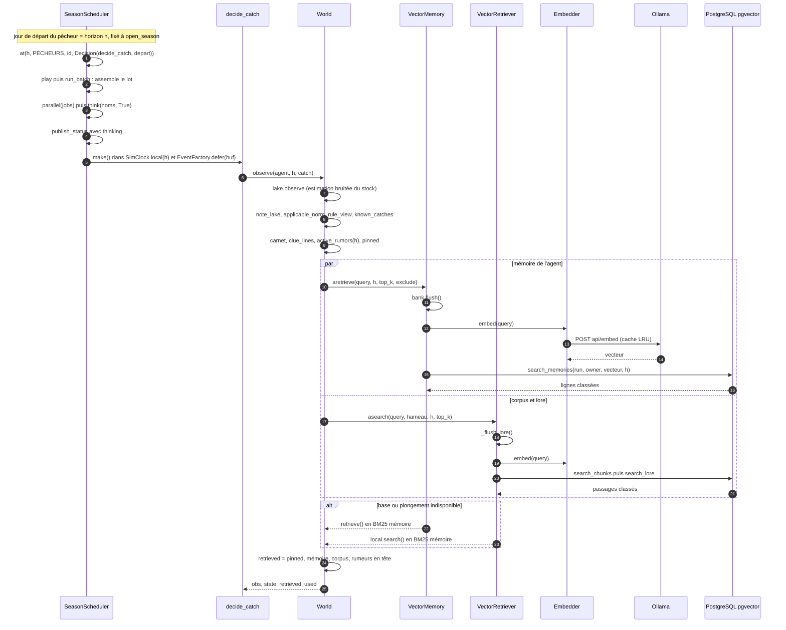

Dans le code :
- Ordonnancement : `filets/scheduler.py:147-158` (`open_season`, `Decision(a.id, 1.0, ...)` à `opening + a.offset_days`), `:84-98` (`play`), `:100-115` (`run_batch`), `:117-135` (`parallel`), `:137-145` (`think`), `:38-43` (`Decision`), `:64-67` (`at`).
- Observation : `filets/world.py:1250` (`observe`), `:1262-1263` (`lake.observe`, `note_lake`), `:1279` (`pinned`), `:1314-1321` (mémoire et corpus : `retrieve`/`search`, ou `aretrieve`/`asearch` en `asyncio.gather` avec la base), `:1322-1334` (assemblage de `retrieved`, rumeurs en tête `:1328`), `:684` (`active_rumors`), `:1200` (`carnet`), `:1020` (`clue_lines`).
- Mémoire : `filets/memory.py:60` (`retrieve`), `:119-135` (`VectorMemory.aretrieve`), `:91` (`MemoryBank.flush`).
- RAG : `filets/rag.py:179` (`Retriever.search`), `:257-272` (`VectorRetriever.asearch`), `:231` (`_flush_lore`).
- Plongement : `filets/vectors.py:72-95` (`embed` : cache, lots, `POST /api/embed` `:65`).

### b2. Le choix système 1 ou système 2 et l'appel du modèle

Un agent à règles ne consulte aucun modèle : sa prise vient de `catch_rule`. Un agent à IA passe par le routage : avec le profil de réflexion « adaptatif », une routine (lac sain et stable) va au système 1 (réflexe, rapide), tout le reste au système 2 (réflexion, schéma JSON imposé). Sans profil adaptatif tout est système 2. L'appel passe par `LLMRouter.complete`, qui choisit le client du niveau, puis par la file `ModelGate` (si le fournisseur est local) et le limiteur de débit, avant le POST vers Ollama.

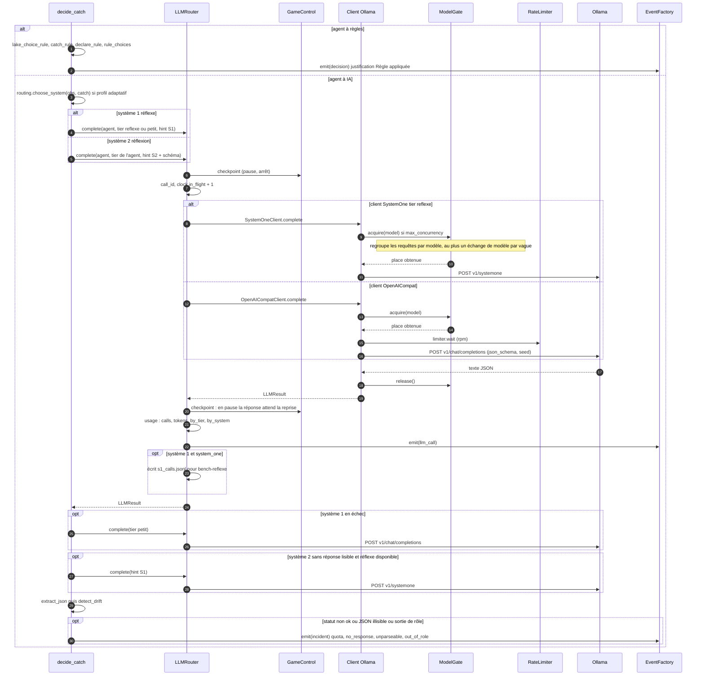

Dans le code :
- Agent : `filets/agents.py:144` (`decide_catch`), `:154-167` (règles), `:170` (`routing.choose_system`), `:171-186` (réflexe et reprise), `:79-136` (`_ask_llm`, `world.router.complete` `:108`, reprise `petit` `:119`, incidents `:121-136`), `:139` (`reflex_usable`).
- Routage : `filets/routing.py:24` (`reasons_to_think`), `:53` (`choose_system`) ; `filets/prompts.py:42` (`is_adaptive`).
- Routeur : `filets/llm.py:335-362` (`LLMRouter.__init__`, `describe`), `:365-420` (`complete`), `:406` (événement `llm_call`), `:384` (cas annulé).
- Clients : `filets/llm.py:154-174` (`OpenAICompatClient`, `gate` `:173`, `limiter` `:167`), `:176-188` (`complete` avec `gate.acquire` `:181`), `:190-237` (`_complete`, `limiter.wait` `:207`, POST `:209`), `:250-322` (`SystemOneClient`, `gate` `:266`, `complete` `:269-278`).
- File et limiteur : `filets/llm.py:44-59` (`RateLimiter`), `:61-152` (`ModelGate` : `acquire` `:109`, `release` `:124`, `_dispatch` `:132`, `_start_switch` `:147`).
- Contrôle : `filets/control.py:83` (`checkpoint`).

### b3. La sortie : décision publiée dans l'ordre, puis prise appliquée

Les événements des décisions d'un lot sont mis en attente et ne sont émis qu'à la fin, dans l'ordre de la file (jamais dans l'ordre où les modèles répondent). Pour chaque décision, `then` appelle `depart`, qui prépare la sortie ; les effets sur le lac sont des événements du futur dans la file. Le poisson sort du lac à la fin de chaque sortie (un jour simulé après le départ), et le retour vend, déclare et laisse des indices.

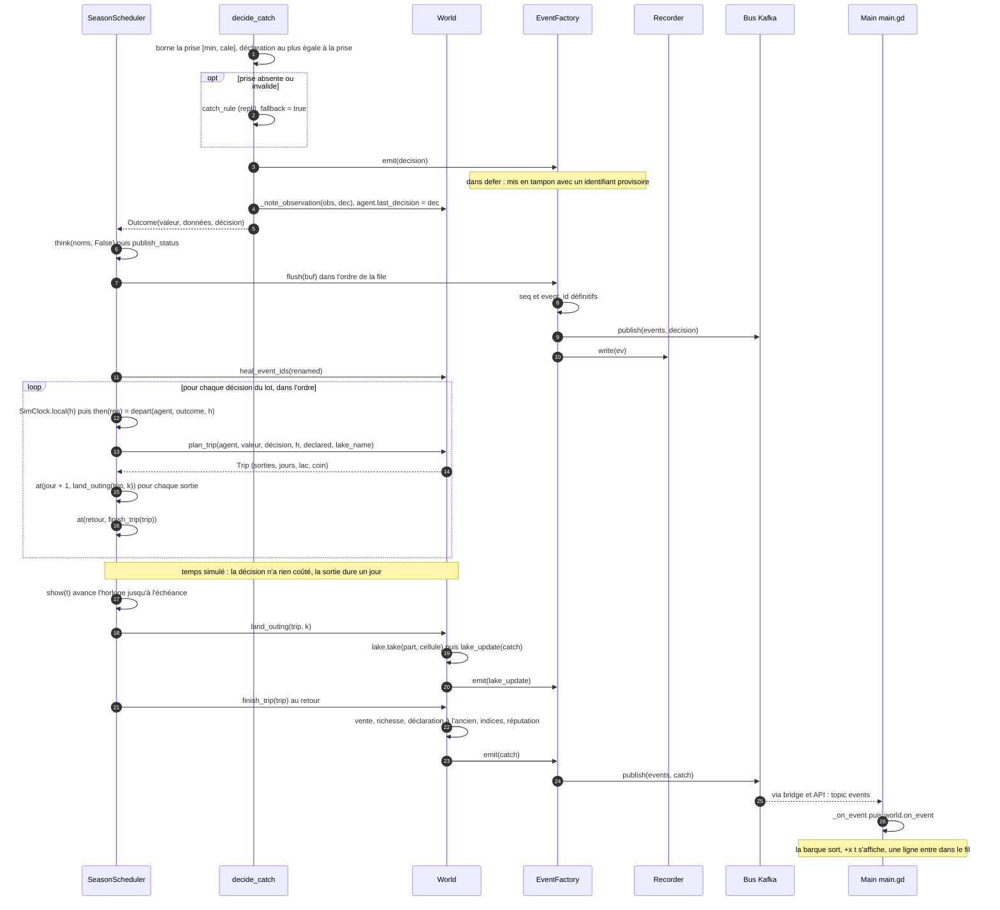

Dans le code :
- Décision : `filets/agents.py:187-231` (bornage, repli, déclaration, événement `decision` `:222`), `:65-70` (`_note_observation`), `:58` (`Outcome`).
- Publication ordonnée : `filets/scheduler.py:117-135` (`parallel`, `flush` `:131`), `filets/events.py:50-57` (`defer`), `:59-69` (`flush`, `heal_event_ids` appelé `scheduler.py:133`), `filets/world.py:387` (`heal_event_ids`).
- Effets : `filets/scheduler.py:160-171` (`depart`, `plan_trip` `:163`), `filets/world.py:1506` (`plan_trip`), `:1559-1568` (`land_outing`), `:544-555` (`lake_update`, `lake_update` émis `:550`), `:1570` (`finish_trip`, événement `catch` `:1595`), `filets/lake.py:50` (`take`).
- Affichage : `godot/scripts/main.gd:757` (`_on_event`, `catch` `:776`), `godot/scripts/world_view.gd:1167` (`on_event`, `catch` `:1223`).

## (c) La veillée au fil de l'eau

À J25 18 h simulé, les pêcheurs se retrouvent chez l'ancien. Il n'y a pas de tours synchrones : l'ordonnanceur prépare en parallèle les répliques de tous ceux qui ont quelque chose à dire (première passe), choisit qui parle (d'abord celui à qui l'on vient de s'adresser, sinon l'ordre tiré de la graine), vérifie si la réplique choisie est périmée et, si oui, la prépare de nouveau (seconde passe). Une seule personne parle à la fois ; sa réplique dure `speech_minutes` (20 minutes simulées par défaut) et ses effets s'appliquent à sa fin. Plusieurs villages tiennent leur veillée de front (une instance `Village` chacun) : leurs préparations partent dans le même lot parallèle.

### c1. La boucle de préparation et de parole

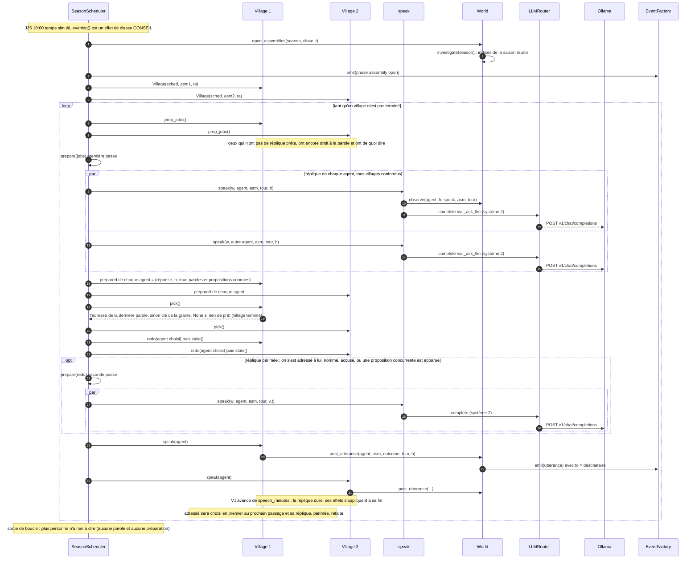

Dans le code :
- Boucle : `filets/scheduler.py:173-211` (`evening`) ; boucle `while True` `:187-202` ; première passe `:190`, `pick` `:191`, `redo` `:193-197`, seconde passe `:198`, `speak` `:199-201`, sortie `:202`.
- `prepare` : `filets/scheduler.py:213-220`.
- Village : `filets/scheduler.py:233-241` (`Village`), `:245-256` (`prep_jobs`), `:258-266` (`pick`), `:268-278` (`stale`), `:280-287` (`redo`), `:289-302` (`speak`, `SimClock.local(end)` `:298`).
- Agent et monde : `filets/agents.py:232` (`speak`, système 2 `:250`), `filets/world.py:2039` (`open_assemblies`, `investigate` appelée `:2042`), `:2162` (`has_reason_to_speak`), `:2066` (`post_utterance`, `utterance` `:2073`).

### c2. Les bulletins, les propositions et la clôture

Après la dernière parole, chaque participant à IA rend un bulletin : la proposition de règle qu'il soutient (s'il n'en a soutenu aucune) puis son vote sur chaque sanction proposée. Ces appels partent tous en parallèle. À la clôture (J29), chaque proposition est tranchée, les règles adoptées entrent en vigueur et chacun en garde un souvenir.

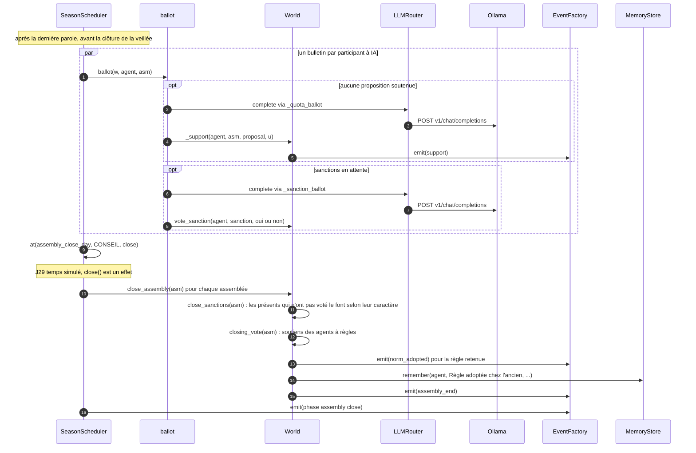

Dans le code :
- Bulletins : `filets/scheduler.py:204-205` (`parallel(ballots)`), `filets/agents.py:289` (`ballot`), `:302` (`_sanction_ballot`), `:404` (`_quota_ballot`), `filets/world.py:2285` (`_support`, événement `support` `:2286`), `:2222` (`vote_sanction`).
- Clôture : `filets/scheduler.py:207-211`, `filets/world.py:2517` (`close_assembly`, `norm_adopted` `:2539`, `remember` `:2551`, `assembly_end` `:2559`), `:2232` (`close_sanctions`), `:2496` (`closing_vote`), `:2492` (`ballots`).

## (d) Une injection du joueur : la rumeur

Le joueur tape une phrase dans le champ « rumeur » de Godot et clique sur « Diffuser » (ou valide avec Entrée). La commande `announcement` suit le même chemin que `start_game` jusqu'au bus, mais c'est maintenant le `World` en cours de partie qui l'écoute (une tâche qui interroge le bus toutes les 0,05 s, même quand le moteur attend un modèle). Le monde enregistre un événement `injection`, garde la rumeur dans sa liste et la glisse dans la mémoire de chaque agent. À la décision suivante, `observe` la remonte en tête des éléments récupérés.

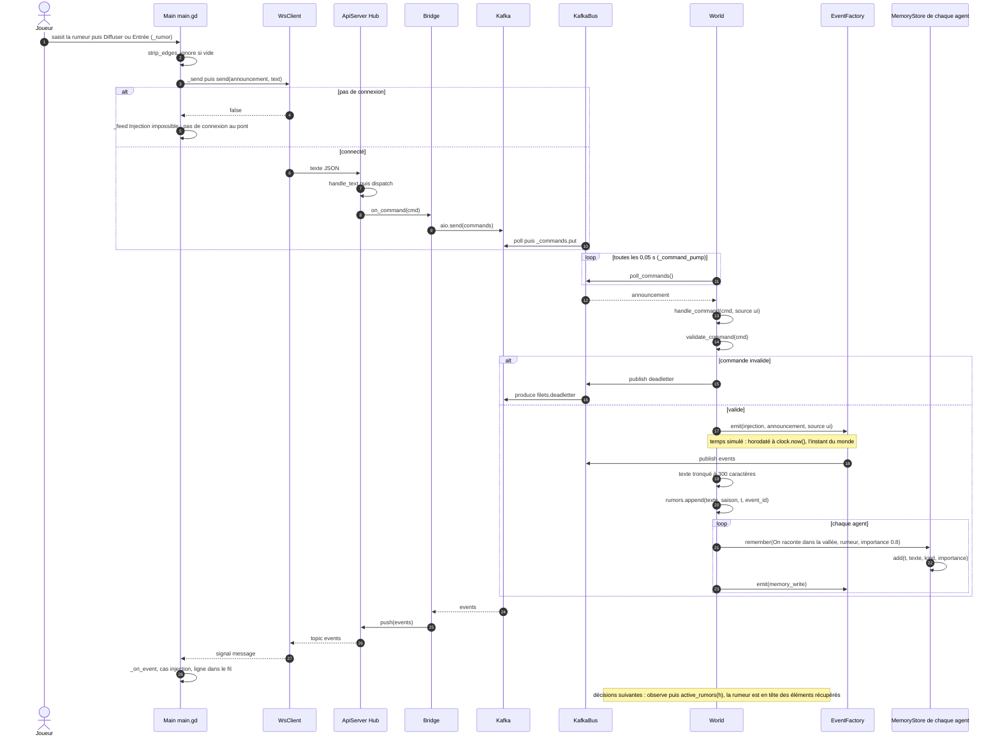

Dans le code :
- Godot : `godot/scripts/main.gd:537-545` (champ, bouton « Diffuser »), `:702-705` (`_rumor`), `:723-726` (`_send`), `:1052` (cas `injection` de `_on_event`).
- Transport : `filets/api.py:293`, `:282` ; `filets/services/bridge.py:28` ; `filets/bus.py:134`, `:158`.
- Monde : `filets/world.py:1732-1747` (`_command_pump`), `:1728` (`poll_commands`), `:1663` (`handle_command`), `:1664-1667` (`validate_command` puis `deadletter`), `filets/schemas.py:246` (`validate_command`), `filets/world.py:1675` (`injection`), `:1688-1696` (branche `announcement`), `:399-407` (`remember`, événement `memory_write`), `filets/memory.py:49` (`add`).
- Récupération : `filets/world.py:684` (`active_rumors`), `:1328-1330` (rumeurs en tête de `retrieved`).
- La sécheresse (`drought`) suit le même chemin : `filets/world.py:1676-1683` (`lake.shock` sur chaque lac, souvenir « Sécheresse »).

## (e) Le rejeu d'une partie

Rejouer ne relance aucun modèle : `python -m filets replay RUN_ID` relit le journal `events.jsonl` enregistré par le `Recorder` et le republie sur le bus, événement après événement, à la cadence d'origine (`processed_at`) divisée par la vitesse, en ajoutant `replay: true` et `replayed_at`. Godot s'y connecte comme à une partie en direct, avec la même interface. Les injections faites pendant un rejeu sont ignorées.

### e1. Rejeu avec le bus local

Le rejeu ouvre lui-même l'API et calcule les indicateurs (`IndicatorPublisher` abonné au bus local), puis compare leur journal à celui de la partie d'origine.

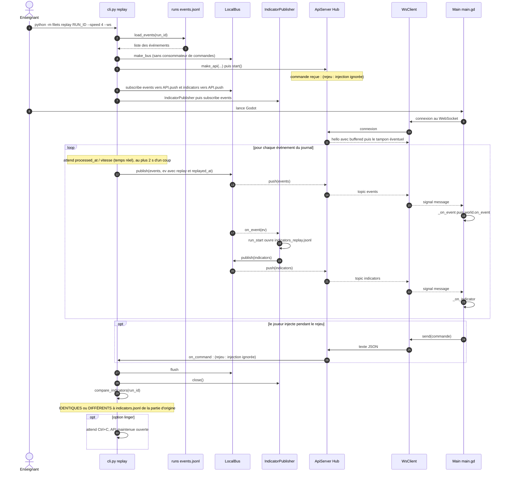

Dans le code :
- Commande : `filets/cli.py:5` (usage), `:402-403` (sous-commande), `:468-471` (appel).
- Rejeu : `filets/cli.py:156-159` (`load_events`), `:162` (`replay`), `:165` (`make_bus(..., consume_commands=False)`), `:168-173` (API, injection ignorée `:169`), `:176-178` (`IndicatorPublisher`), `:179-187` (boucle, attente `processed_at / speed` `:181`, `publish` avec `replay` et `replayed_at` `:186`), `:188` (`flush`), `:189-191` (`close`, `compare_indicators`), `:205` (comparaison).
- Indicateurs : `filets/pipeline.py:28-47` (`on_event`, journal `indicators_replay.jsonl` `:30`), `:35` (`replayed_at`).
- Godot : `filets/api.py:268-277` (`attach`, message `hello`), `godot/scripts/main.gd:729-755`, `:757`, `:1122`.

### e2. Rejeu avec Kafka

Le rejeu produit dans le topic `filets.events` ; les services habituels font le reste : `indicators` recalcule (dans `indicators_replay.jsonl` grâce à l'indicateur `replay`), `store` archive (colonne `replay` à 1 ; les indicateurs d'origine sont gardés à part, `replay = 0`), le pont relaie à Godot. Le rejeu ne calcule pas lui-même les indicateurs (c'est le service) et ne peut donc pas les comparer à ceux de l'original.

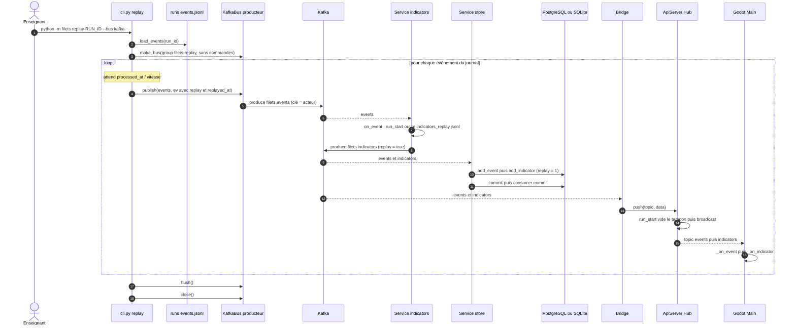

Dans le code :
- Producteur : `filets/cli.py:165` (`make_bus` renvoie un `KafkaBus` si `bus.kind` vaut `kafka`), `filets/bus.py:177` (`make_bus`), `:144` (`KafkaBus.publish`), `:166` (`flush`), `:169` (`close`).
- Services : `filets/services/indicators.py:20-43`, `filets/services/store.py:43-77`, `filets/pipeline.py:30` (journal du rejeu), `filets/pgstore.py:29`, `:89`, `:108` et `filets/store.py:28`, `:83`, `:106` (colonne `replay` des indicateurs).
- Pont : `filets/services/bridge.py:36-43`, `filets/api.py:236-266` (`_pump`).

## (f) La fin de saison

À J29,9 simulé (jour du repeuplement) l'ordonnanceur appelle `regrowth`. Le monde clôt la saison : l'ancien pèse les indices, chaque lac se repeuple, les promesses sont jugées, la richesse est ajustée, les souvenirs et le « lore » (ce que la vallée sait) sont écrits, et l'événement `season_end` est publié. Le récit du narrateur est lancé en tâche de fond et se rédige pendant la préparation de la saison suivante. Le service d'indicateurs transforme `season_end` en indicateurs de fin de saison, que Godot dessine dans la courbe.

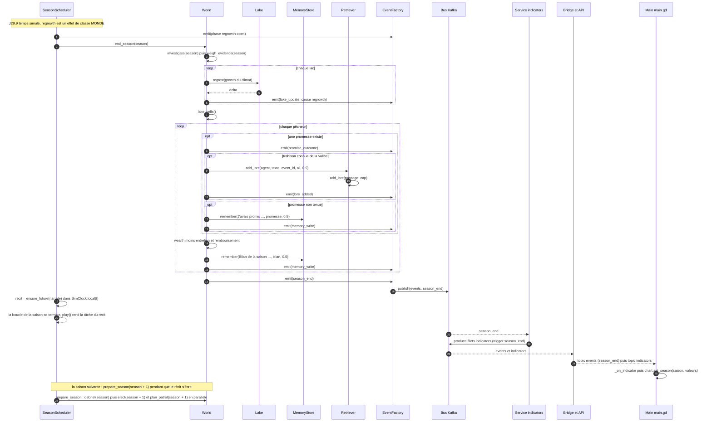

Le récit du narrateur, ensuite :

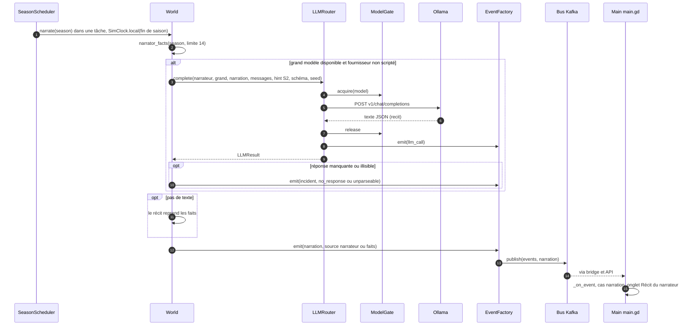

Dans le code :
- Ordonnancement : `filets/scheduler.py:222-231` (`regrowth`, tâche `narrate` `:227-230`), `filets/world.py:2968-2974` (`prepare_season`), `:1809` (`debrief`), `:1771` (`elect`), `:1819` (`plan_patrol`).
- Fin de saison : `filets/world.py:2563` (`end_season`), `:772` (`investigate`), `:836` (`weigh_evidence`), `filets/lake.py:87` (`regrow`), `filets/world.py:544` (`lake_update`), `:2573` (`promise_outcome`), `:2577-2580` (`add_lore`), `:409-418` (`add_lore`, événement `lore_added`), `:2582-2585` (`remember`), `:2587` (bilan), `:2591` (`season_end`).
- RAG : `filets/rag.py:167` (`Retriever.add_lore`), `:225` (`VectorRetriever.add_lore`, écrit en base par `_flush_lore` `:231`).
- Narrateur : `filets/world.py:2747` (`narrator_facts`), `:2847-2872` (`narrate`, appel `:2859`, repli sur les faits `:2865`, événement `narration` `:2870`).
- Indicateurs : `filets/services/indicators.py:30-38`, `filets/pipeline.py:28`.
- Godot : `godot/scripts/main.gd:1122` (`_on_indicator`), `:1158` (`chart.set_season`), `:757` (`_on_event`).
- Partie suivante si l'ancien rapporte et élit : `filets/world.py:2968-2974`.

## (g) Le tirage d'une vallée depuis le menu

Dans le menu, le joueur règle le nombre de villages, de pêcheurs, de lacs, la flotte et la graine (ou choisit « Aléatoire »), ou clique sur « Générer la vallée » / « Autre vallée ». Un délai court (`_gen_timer`) regroupe les réglages rapides. Le menu envoie `generate_world` avec un identifiant ; le moteur, en salon (`idle` ou `ended`), génère la vallée (la même pour la même graine), remplace sa composition de base dans le catalogue et publie son état avec le catalogue. Le pont relaie le catalogue à part ; Godot le reçoit et le menu remplace sa liste de pêcheurs et ses lacs, sans toucher aux autres réglages.

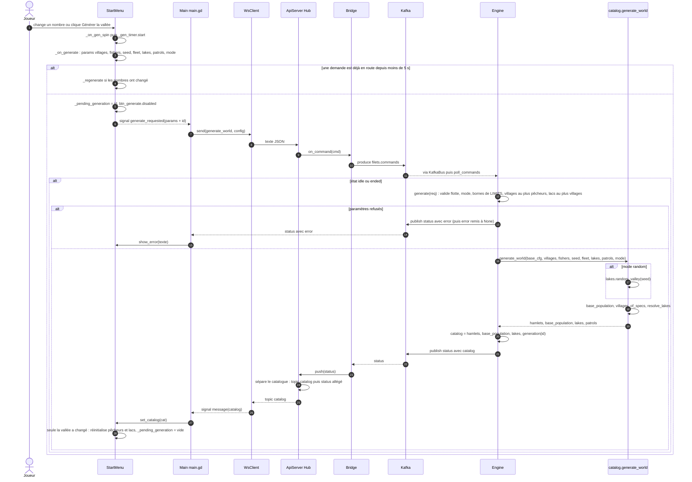

Dans le code :
- Menu : `godot/scripts/start_menu.gd:1313-1323` (`_on_gen_spin`), `:1336-1354` (`_on_generate`, `_pending_generation`, `generate_requested.emit`), `:569` (`_gen_timer`), `:650` (`set_catalog`), `:641` (`_same_but_valley`), `:1171` (`_load_lakes`).
- Godot : `godot/scripts/main.gd:603-605` (`_on_menu_generate`), `:729-737` (`catalog` dans `_on_message`).
- Moteur : `filets/engine.py:360-374` (dispatch de `generate_world` `:370`), `:376-414` (`generate`), `filets/catalog.py:119-142` (`generate_world`), `filets/lakes.py:254` (`random_valley`), `filets/catalog.py:145` (`build_catalog`).
- API : `filets/api.py:213-224` (`push` sépare `catalog`), `:236-247` (`_pump`, `catalog` relayé si changé).

## (h) L'arrêt d'une partie

« Arrêter la partie » est irréversible : une boîte de confirmation « Oui, arrêter / Non » s'ouvre. Si le joueur confirme, la commande `stop` arrive au monde, qui lève un drapeau d'arrêt dans le contrôle de partie. Tout point de passage (`checkpoint`) lève alors `StopRun`, et `guard` annule le travail en cours, y compris les appels de modèle déjà partis (qui laissent une trace `llm_call` de statut « cancelled »). La partie se termine proprement : `run_end`, archivage, état `ended`.

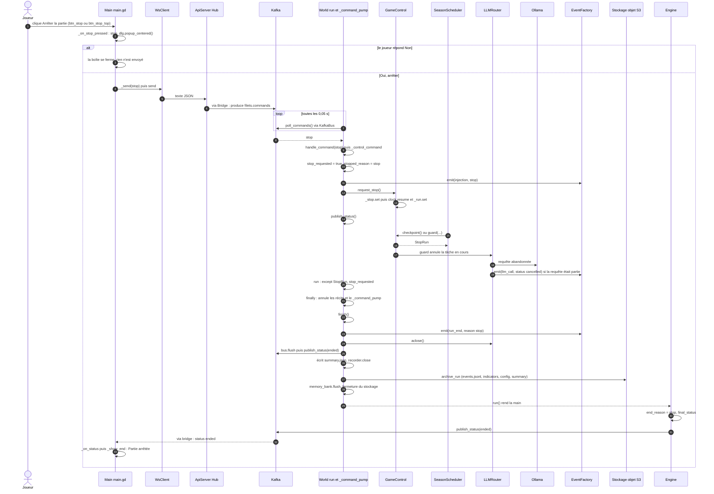

Dans le code :
- Godot : `godot/scripts/main.gd:358` (`btn_stop`), `:560` (`btn_stop_top`), `:594-596` (`_on_stop_pressed`), `:562-568` (`stop_dlg` : titre, texte, « Oui, arrêter », « Non », `confirmed` envoie `stop`), `:645-662` (`_show_end`, `_refresh_end_text`, « Partie arrêtée »).
- Monde : `filets/world.py:1663` (`handle_command`), `:1698-1704` (`stop`), `filets/control.py:24` (`StopRun`), `:75` (`request_stop`), `:83` (`checkpoint`), `:107` (`guard`).
- Fin de partie : `filets/world.py:2976-3010` (`run`, `StopRun` `:2997`, `finally` `:3002-3010`), `:2900` (`finish`, `run_end` `:2901`, `summary.json`), `:2926` (`close_storage`, archivage `:2931`), `filets/llm.py:384-396` (appel annulé, trace `cancelled`).
- Moteur : `filets/engine.py:458-479` (`end_reason`, `final_status`, `publish_status("ended")`).
