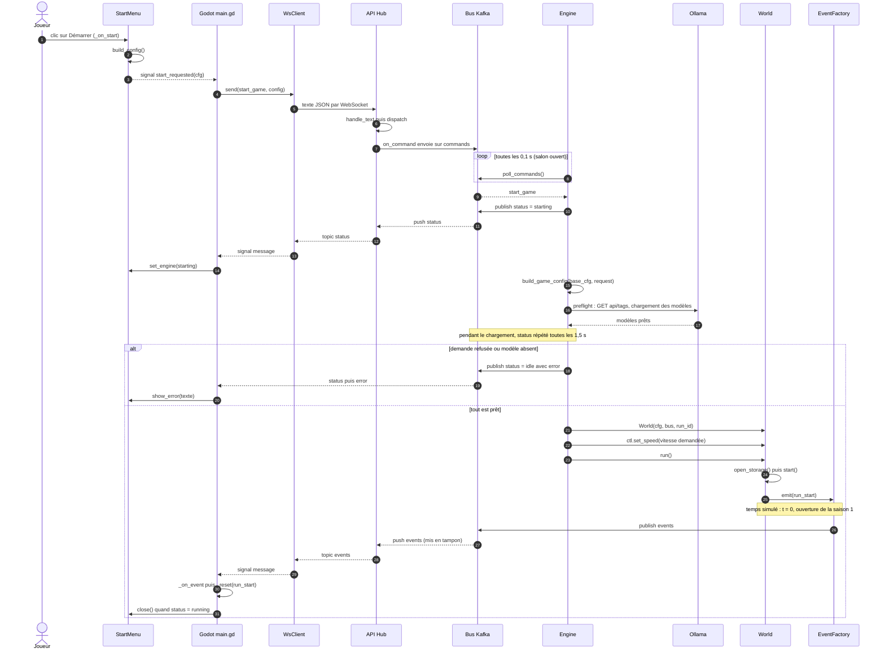
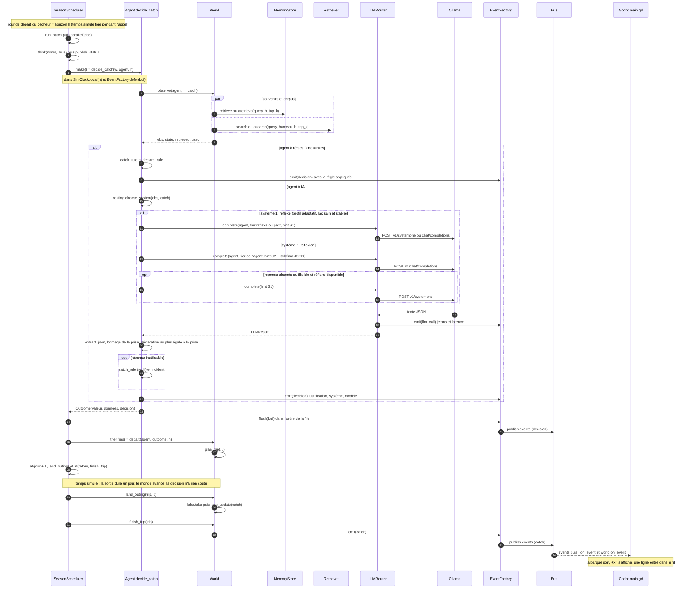
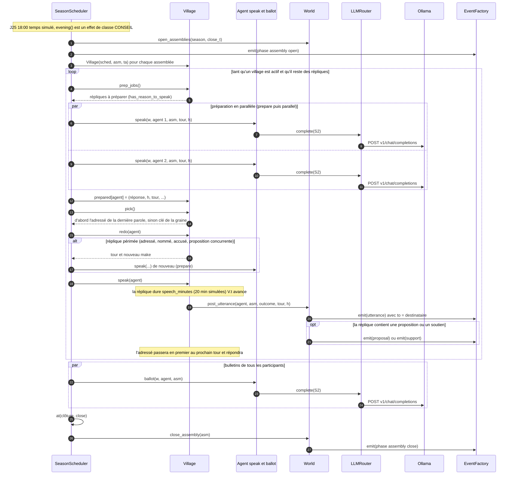
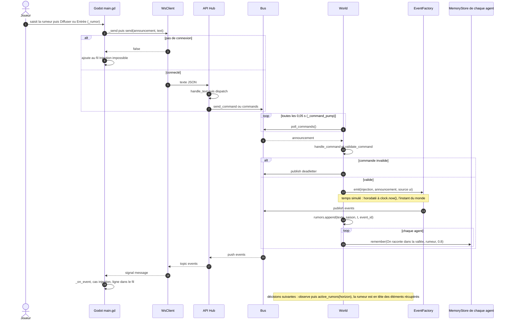
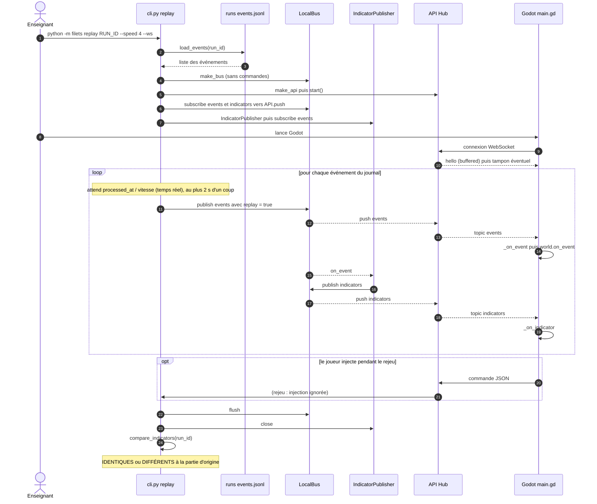

# Diagrammes de séquence

Un diagramme de séquence se lit de haut en bas : le temps réel (l'ordre des appels) descend, chaque colonne est un objet du code. Une flèche pleine `->>` est un appel, une flèche pointillée `-->>` une réponse ou un signal. Les blocs `par` montrent des appels qui se font en même temps, `loop` une répétition, `alt` un choix. Les notes `Note` rappellent l'autre temps, le **temps simulé** du monde (la saison dure 30 jours simulés) : réfléchir ne prend pas de temps simulé, agir en prend (voir `docs/temps.md`).

Cinq scénarios : (a) démarrer une partie, (b) la décision de prise d'un pêcheur, (c) la veillée, (d) une rumeur injectée par le joueur, (e) le rejeu d'une partie.

Vocabulaire des participants : *Godot* (`main.gd` = scène principale, `WsClient` = client WebSocket), *API* (`Hub` et `ApiServer` de `filets/api.py`, le « bridge »), *Bus* (`LocalBus` en local, `KafkaBus` ou topics Kafka avec le service bridge), *Engine* (le salon), *World* (la partie), *SeasonScheduler* (l'ordonnanceur d'une saison), *Agent* (les fonctions de `filets/agents.py`), *LLMRouter*, *Ollama*, *EventFactory* (fabrique et publie les événements).

## (a) Démarrer une partie depuis le menu

Le joueur règle sa partie dans le menu de Godot et clique sur « Démarrer ». Le menu fabrique une configuration, `main.gd` l'envoie en commande JSON `start_game` par WebSocket. L'API la dépose dans le bus (en Kafka, le topic `commands`), le moteur, qui attendait dans son salon, la reprend, vérifie et charge les modèles dans Ollama, crée le `World` et le lance. Le premier événement, `run_start`, redescend jusqu'à Godot par le chemin inverse et déclenche la remise à zéro de l'affichage.

Dans le code :
- Menu et envoi : `godot/scripts/start_menu.gd:1402-1413` (`_on_start`, `build_config` `:1377`, `start_requested.emit`) ; `godot/scripts/main.gd:552` (connexion du signal), `:598-600` (`_on_menu_start`, `ws.send({"type": "start_game", ...})`) ; `godot/scripts/ws_client.gd:58-62` (`send`).
- API : `filets/api.py:321-335` (`socket`, boucle de réception), `:293` (`handle_text`), `:282` (`dispatch`), `:212-227` (`push`), `:236-266` (`_pump`, tampon et diffusion).
- Bus : en local, `filets/bus.py:65` (`LocalBus.send_command`), `:68` (`poll_commands`), `filets/cli.py:140` (l'API reçoit `bus.send_command`) ; avec Kafka, `filets/services/bridge.py:28-30` (`on_command` publie sur `commands`) puis `filets/bus.py:134` (`KafkaBus._consume`, `poll_commands` `:158`).
- Engine : `filets/engine.py:348-374` (`serve`, boucle à 0,1 s, `start_game` `:360`), `:437-479` (`_play`), `:152` (`build_game_config`), `:416` (`_prepare` et son battement `beat` `:425-428`), `:207` (`preflight`, `GET /api/tags` `:229` et chargement `:247-259`), `:343` (`publish_status`).
- Échec : `filets/engine.py:450-461` (`GameRequestError` puis `status idle` avec `error`), `godot/scripts/main.gd:625-637` (`show_error`).
- World : `filets/world.py:2976` (`run`), `:2918` (`open_storage`), `:2873` (`start`, événement `run_start`), `filets/events.py:71` (`emit`), `:108` (publication sur le bus).
- Retour dans Godot : `godot/scripts/main.gd:132` (`ws.message.connect`), `:729` (`_on_message`), `:757-762` (`_on_event`, `run_start` donne `_reset`), `:1161` (`_reset`), `:631` (`menu.close()` quand `running`).

Simplifié : l'ordre exact entre le dernier `status` et `run_start` n'est pas fixé (ils partent du même moteur, par deux topics). Avec Kafka, le service `bridge` est un processus distinct qui consomme les topics `events`, `indicators` et `status` et appelle `Hub.push` (`filets/services/bridge.py:36-43`) ; le diagramme regroupe cela sous « API Hub / Bus ». Les services `indicators` et `store`, qui lisent aussi `events`, sont omis.

## (b) La décision de prise d'un pêcheur

C'est la décision centrale du jeu : combien pêcher. L'ordonnanceur inscrit pour chaque pêcheur une `Decision` au jour de départ de ce pêcheur, puis les lance par lots en parallèle. L'agent construit d'abord ce qu'il sait (observation : état du lac, souvenirs, passages du corpus, règles en vigueur, rumeurs), choisit entre deux voies (système 1, un réflexe rapide, ou système 2, une vraie réflexion), appelle un modèle d'Ollama, valide la réponse et la transforme en événement `decision`. Les événements ne sont émis qu'à la fin du lot, dans l'ordre de la file et non dans l'ordre où les modèles ont répondu, pour qu'à graine égale le journal soit le même. La prise ne sort du lac que plus tard, à la fin de la sortie (un jour simulé après).

Dans le code :
- Ordonnancement : `filets/scheduler.py:147-158` (`open_season` : `Decision(a.id, 1.0, decide_catch..., depart...)` à `opening + a.offset_days`), `:100-115` (`run_batch`), `:117-135` (`parallel`, `think`, `EventFactory.defer`, `flush`), `:137-145` (`think`), `:32-43` (`Decision`).
- Décision : `filets/agents.py:144` (`decide_catch`), `:170` (`routing.choose_system`), `:171-183` (réflexe et reprise), `:154-167` (branche agent à règles), `:222-229` (événement `decision` d'un agent à IA), `:79-136` (`_ask_llm`, appel `world.router.complete` `:108`, repli `petit` `:119`, incidents `:121-136`).
- Routage : `filets/routing.py:53` (`choose_system`, système 1 réservé aux prises), `filets/prompts.py:42` (`is_adaptive` : sans profil adaptatif, tout est système 2).
- Observation : `filets/world.py:1250` (`observe`), `:1314-1321` (`retrieve`/`search` en mémoire, ou `aretrieve`/`asearch` en parallèle avec `asyncio.gather` quand le RAG est dans PostgreSQL), `:1279` (`pinned`), `:684` (`active_rumors`).
- Mémoire et RAG : `filets/memory.py:60` (`MemoryStore.retrieve`), `:75` (`aretrieve`), `:119` (`VectorMemory.aretrieve`) ; `filets/rag.py:179` (`Retriever.search`), `:194` (`asearch`), `:257` (`VectorRetriever.asearch`, plongements par `POST /api/embed`, `filets/vectors.py:65`).
- Modèle : `filets/llm.py:365` (`LLMRouter.complete`), `:176` (`OpenAICompatClient.complete`, `POST /chat/completions` `:209`), `:269` (`SystemOneClient.complete`, `/v1/systemone`), `:406` (événement `llm_call`).
- Effets : `filets/scheduler.py:160-171` (`depart`), `filets/world.py:1506` (`plan_trip`), `:1559` (`land_outing`), `:1570` (`finish_trip`, événement `catch` `:1595`), `filets/events.py:59-69` (`flush`).
- Affichage : `godot/scripts/main.gd:757` (`_on_event`, cas `catch` `:776`, cas `decision` `:1033`), `godot/scripts/world_view.gd:1167` (`on_event`, cas `catch` `:1223`).

Simplifié : la file de portes `ModelGate` (`filets/llm.py:61`), qui limite les appels simultanés à la carte graphique, n'est pas dessinée. Le client Ollama n'est pas distingué de `OpenAICompatClient` (les deux passent par `LLMRouter.complete`). La reprise `rescue` (grand modèle trop lent) existe dans `decide_catch` mais n'est pas dessinée.

## (c) La veillée au fil de l'eau

À J25 18 h simulé, les pêcheurs se retrouvent chez l'ancien. Il n'y a pas de tours synchrones : l'ordonnanceur prépare en parallèle les répliques de tous ceux qui ont quelque chose à dire, puis une seule personne parle à la fois (20 minutes simulées par défaut). Le prochain à parler est d'abord celui à qui l'on vient de s'adresser ; sa réplique est préparée de nouveau si, depuis, on l'a interpellé ou si une autre proposition a concurrencé la sienne. Quand plus personne n'a rien à dire, on passe aux bulletins (soutiens, votes), eux aussi préparés en parallèle, puis la veillée se clôt. Plusieurs villages peuvent tenir leur veillée de front (une instance `Village` chacun).

Dans le code :
- Boucle : `filets/scheduler.py:173-211` (`evening`), `:213-220` (`prepare`), `:117` (`parallel`), `:204-206` (bulletins en `parallel`), `:207-211` (clôture à `assembly_close_day`).
- Village : `filets/scheduler.py:233-241` (`Village`, `duration = speech_minutes / 1440`), `:245-256` (`prep_jobs`), `:258-266` (`pick`), `:268-278` (`stale`), `:280-287` (`redo`), `:289-302` (`speak`, `SimClock.local(end)` `:298`).
- Agent : `filets/agents.py:232` (`speak`, toujours système 2 `:250`), `:289` (`ballot`), `:302` (`_sanction_ballot`), `:404` (`_quota_ballot`).
- Monde : `filets/world.py:2039` (`open_assemblies`), `:2162` (`has_reason_to_speak`), `:2066` (`post_utterance`, événement `utterance` `:2073`, `proposal` `:2094`), `:2285` (`_support`, événement `support`), `:2517` (`close_assembly`).
- Temps : `docs/temps.md` (sections sur la veillée au fil de l'eau) ; `filets/world.py:1122` (`phase_text`).

Simplifié : la boucle `while True` de `evening` comporte aussi deux passes de préparation par tour (la seconde ne concerne que les répliques périmées) ; le diagramme les fond. Le vote final des sanctions et l'élection (`elect`) se font hors de la veillée et ne sont pas dessinés ici.

## (d) Une injection du joueur : la rumeur

Le joueur tape une phrase dans le champ « rumeur » de Godot et clique sur « Diffuser ». C'est une commande `announcement` : elle suit le même chemin que `start_game` jusqu'au bus, mais c'est maintenant le `World` en cours de partie qui l'écoute (une tâche qui interroge le bus toutes les 0,05 s, même quand le moteur attend un modèle). Le monde enregistre un événement `injection`, garde la rumeur dans sa liste et la glisse dans la mémoire de chaque agent. Lors des décisions suivantes, `observe` la remonte en tête des éléments récupérés : l'agent la « sait ».

Dans le code :
- Godot : `godot/scripts/main.gd:537-545` (champ et bouton « Diffuser »), `:702-705` (`_rumor`), `:723-726` (`_send`, message d'échec), `godot/scripts/ws_client.gd:58` (`send`).
- API et bus : `filets/api.py:293` (`handle_text`), `:282` (`dispatch`), `filets/bus.py:65-74` (`LocalBus`), `filets/services/bridge.py:28` (Kafka).
- Monde : `filets/world.py:1732-1747` (`_command_pump`, `asyncio.sleep(0.05)`), `:1728` (`poll_commands`), `:1663` (`handle_command`), `:1664-1667` (`validate_command` puis `deadletter`), `filets/schemas.py:246` (`validate_command`), `filets/world.py:1675` (événement `injection`), `:1688-1696` (branche `announcement`, texte tronqué à 300 caractères), `:399` (`remember`).
- Récupération : `filets/world.py:684` (`active_rumors`), `:1328-1330` (rumeurs insérées en tête de `retrieved`).
- Affichage : `godot/scripts/main.gd:1052` (cas `injection` de `_on_event`).

Simplifié : l'ordre entre la publication de l'événement `injection` et l'ajout de la rumeur aux souvenirs n'a pas d'importance côté joueur ; le diagramme suit l'ordre du code. La sécheresse (`drought`) suit le même chemin, avec `lake.shock` au lieu de `remember` de rumeur (`filets/world.py:1676-1683`).

## (e) Le rejeu d'une partie

Rejouer ne relance aucun modèle : la commande `python -m filets replay RUN_ID --ws` relit le journal `events.jsonl` de la partie enregistrée et le republie sur le bus, événement après événement, à la cadence d'origine divisée par la vitesse. Godot s'y connecte comme à une partie en direct et affiche exactement la même chose (son état est reconstruit à partir des événements). Les indicateurs sont recalculés à partir des événements rejoués, puis comparés à ceux de la partie d'origine. Les injections faites pendant un rejeu sont ignorées.

Dans le code :
- Commande : `filets/cli.py:5` (usage), `:402-403` (sous-commande), `:468-471` (appel de `replay`).
- Rejeu : `filets/cli.py:155-159` (`load_events`, `events.jsonl`), `:162` (`replay`), `:165` (`make_bus(..., consume_commands=False)`), `:169-173` (API, ignore les injections `:169`), `:176-178` (`IndicatorPublisher`), `:180-186` (attente selon `processed_at / speed` puis `publish` avec `replay: True` et `replayed_at`), `:189-191` (calcul et comparaison), `:205` (`compare_indicators`).
- Indicateurs : `filets/pipeline.py:30` (journal `indicators_replay.jsonl` quand `ev.replay`), `:35`.
- Godot : `godot/scripts/main.gd:729-755` (`_on_message`), `:757` (`_on_event`), `:1122` (`_on_indicator`), même code qu'en direct.
- API : `filets/api.py:268-277` (`attach`, message `hello` avec `buffered`).

Simplifié : le menu de démarrage de Godot n'est pas dessiné (en rejeu le moteur n'annonce ni catalogue ni état, donc le menu reste fermé ou affiché selon la version de l'interface : à vérifier par un essai réel). Avec `--bus kafka`, le rejeu publie sur Kafka et l'API relaie depuis le bus ; seul le cas local est dessiné.
